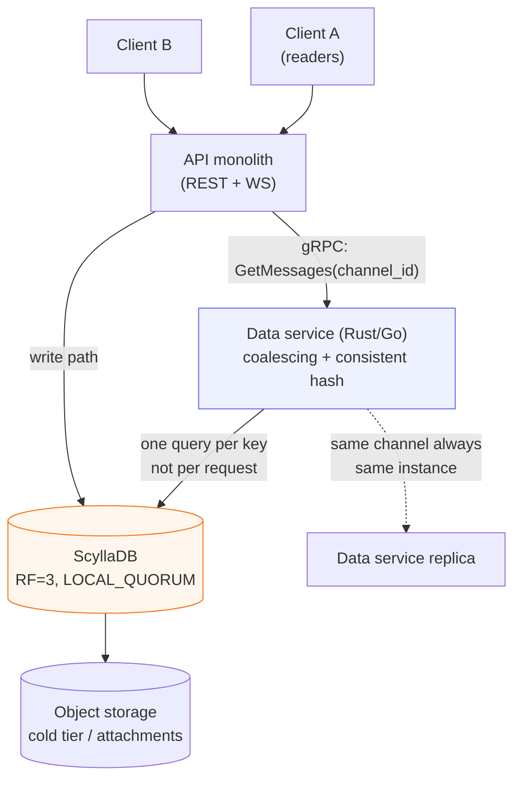
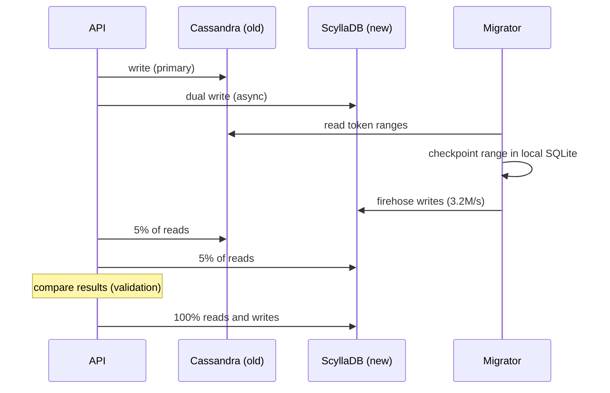

# 01 · Chat message storage

!!! abstract "The question"
    **"Design a chat app."** Store and serve messages for millions of
    channels, with scrollback, at trillions of messages, without a per-node
    hotspot taking the cluster down.

!!! info "Source"
    Discord Engineering, *How Discord Stores Trillions of Messages* (Bo Ingram,
    March 2023). Every production figure on this page comes from that post; the
    code, configs and drills are this repo's additions.

---

## 1. The problem, and the naive design

Day one, a chat app is a table:

```sql
CREATE TABLE messages (
  id         bigserial PRIMARY KEY,
  channel_id bigint NOT NULL,
  author_id  bigint NOT NULL,
  content    text   NOT NULL,
  created_at timestamptz NOT NULL DEFAULT now()
);
CREATE INDEX ON messages (channel_id, created_at DESC);
```

This is correct, and it is fine for years. Discord's version of this served
billions of messages from 12 Cassandra nodes in 2017. By the start of 2022 the
same logical schema was on **177 nodes holding trillions of messages**, and the
system was "high-toil": on-call paged constantly, latency was unpredictable, and
maintenance operations were being cancelled because they cost too much.

Three specific things broke, and they are the three things that break every
message store:

1. **Hot partitions.** Messages were partitioned by `(channel_id, bucket)` — the
   channel plus a static time window. A server with 500,000 members writes orders
   of magnitude more than a five-person group chat, so one partition pair absorbed
   a wildly disproportionate share of reads. In Cassandra, reads are more
   expensive than writes (memtable + potentially many SSTables), and at quorum
   consistency a slow node slows *every* query that touches it.
2. **Compaction debt.** When a node falls behind on compacting SSTables, its reads
   get more expensive, which slows it further. Discord's team ran the "gossip
   dance": take a node out of rotation, let it compact, bring it back to pick up
   hinted handoff, repeat until the backlog cleared.
3. **JVM pauses.** Garbage collection pauses caused latency spikes, and some
   pauses were so long an operator had to manually reboot and babysit the node.

!!! note "The lesson to internalise"
    None of this was a *size* problem. It was a *skew* problem plus a *runtime*
    problem. Buying bigger nodes would not have fixed either.

---

## 2. The numbers that decide the design

| Figure | Value | Consequence |
|---|---|---|
| Nodes at start of 2022 | 177 Cassandra nodes | ~200-node cluster is a maintenance project in itself |
| Data | trillions of messages | cannot be re-keyed casually; migration must be online |
| Cassandra disk per node | ~4 TB average | 177 × 4 TB ≈ 700 TB |
| ScyllaDB disk per node | 9 TB | 72 nodes × 9 TB ≈ 648 TB — same data, 60% fewer nodes |
| p99 read (history fetch) | 40–125 ms → **15 ms** | tail latency was the user-visible problem |
| p99 insert | 5–70 ms → **5 ms** | the 70 ms tail is what caused cascading timeouts |
| Migration throughput | up to **3.2 M messages/s** | trillions migrated in ~9 days, not 3 months |
| Post-migration replication | RF 3, `LOCAL_QUORUM` | survives one node loss without a write stall |

Do the sizing arithmetic yourself before you design (see
[Numbers](../foundations/numbers.md#worked-example-1-sizing-a-message-store)):

```
2e9 msgs/day × 200 B × 1.4 overhead × 3 replicas ≈ 1.7 TB/day
× 365 ≈ 615 TB/year → at 9 TB/node ≈ 69 nodes
```

The real cluster is 72 nodes. That is the level of precision you need in an
interview: an order of magnitude and the *shape* of the calculation.

---

## 3. The mental model

> **A chat store is an append-only log per channel, read by recency. Partition by
> channel, bound the partition by time, and put a coalescing layer in front so a
> million people reading the same message is one disk read.**

Everything else follows: the primary key is `((channel_id, bucket), message_id)`
so a scrollback is a single-partition ordered scan; the bucket bounds partition
size so compaction stays cheap; and the data service exists purely to stop
duplicate reads from reaching the disk.

---

## 4. The flow chart



Failure points on every arrow, and the answer to each:

| Arrow | Failure | Answer |
|---|---|---|
| Client → API | retries a send | client-generated message ID (Snowflake), `INSERT` is naturally idempotent |
| API → data service | data service pod dies | stateless; consistent hash ring heals, 1/N of keys briefly re-route |
| Data service → ScyllaDB | one node slow | `LOCAL_QUORUM` + per-request concurrency cap per shard |
| Data service → ScyllaDB | hot channel | coalescing collapses duplicate reads into one in-flight query |
| ScyllaDB → object storage | cold tier missing | serve from the log; cold tier is an optimisation, not a source of truth |

---

## 5. Build it

### Step 1 — the schema that survives skew

The primary key *is* the design. Note the composite partition key.

```sql
-- code/chat-storage/schema.cql
CREATE KEYSPACE IF NOT EXISTS chat
  WITH replication = {
    'class': 'NetworkTopologyStrategy',
    'ap-south-1': 3
  };

CREATE TABLE IF NOT EXISTS chat.messages (
    channel_id  bigint,
    bucket      int,          -- static time window, e.g. epoch_day / 10
    message_id  bigint,       -- Snowflake: time-ordered, so ordering == id order
    author_id   bigint,
    content     text,
    edited_at   timestamp,
    PRIMARY KEY ((channel_id, bucket), message_id)
) WITH CLUSTERING ORDER BY (message_id DESC)
  AND compaction = {
    'class': 'TimeWindowCompactionStrategy',
    'compaction_window_size': 1,
    'compaction_window_unit': 'DAYS'
  }
  AND default_time_to_live = 0;
```

Why each choice:

- `channel_id` first: every product query is "messages in this channel". One
  partition, one sequential read.
- `bucket` in the partition key: bounds partition size. A 500k-member server's
  channel would otherwise grow without limit. Ten-day buckets are a typical
  choice; pick the window so that even your busiest channel stays under ~100 MB
  per partition.
- `message_id` as clustering key: Snowflake IDs are chronologically sortable, so
  ordering by ID *is* ordering by time, with no secondary index and no sort.
- `TimeWindowCompactionStrategy`: old windows stop being rewritten, so compaction
  cost is bounded and predictable — the direct fix for Discord's compaction debt.

!!! warning "The bucket choice has a cost"
    A bucket in the partition key means "last 50 messages in this channel" may
    need to touch two partitions when you straddle a boundary. Handle it by
    reading `bucket(n)` and `bucket(n-1)` and merging, not by giving up the bound.

### Step 2 — the data service (the actual innovation)

Discord's insight was that a new database would not fix a hot partition. They put
a service in front of the database that:

1. exposes roughly **one gRPC endpoint per database query** and contains **no
   business logic**, and
2. **coalesces**: if 5,000 users request the same row at once, exactly one query
   hits the database and all 5,000 subscribe to its result.

The coalescing primitive is `singleflight` (Go) / a shared future map (Rust):

```go
// code/chat-storage/coalesce.go  (excerpt)
type Coalescer struct {
    mu    sync.Mutex
    calls map[string]*call
}

type call struct {
    wg  sync.WaitGroup
    val []Message
    err error
}

func (c *Coalescer) Do(key string, fn func() ([]Message, error)) ([]Message, error) {
    c.mu.Lock()
    if existing, ok := c.calls[key]; ok {
        c.mu.Unlock()
        existing.wg.Wait()
        return existing.val, existing.err
    }
    n := &call{}
    n.wg.Add(1)
    c.calls[key] = n
    c.mu.Unlock()

    n.val, n.err = fn()
    n.wg.Done()

    c.mu.Lock()
    delete(c.calls, key)
    c.mu.Unlock()
    return n.val, n.err
}
```

Then add **consistent hash routing** so coalescing actually works: hash the
`channel_id` and pick the data-service instance, so all requests for a channel
land on the same pod and can share one in-flight query.

```go
// code/chat-storage/main.go (excerpt)
key := fmt.Sprintf("chan:%d:bucket:%d", req.ChannelId, bucket(req.After))
return coalescer.Do(key, func() ([]Message, error) {
    return scylla.QueryMessages(ctx, req.ChannelId, bucket(req.After), req.After, req.Limit)
})
```

Measured effect: a single `@everyone` announcement in a large server used to send
a traffic spike straight into the database and could page on-call. With
coalescing, N readers of the same window become one query.

### Step 3 — dual-write, then migrate, then flip

The migration is the part interviewers rarely hear and production engineers
always ask about.



Four rules that made this safe:

1. **Checkpoint per token range** in local durable storage (Discord used SQLite),
   so a crashed migrator resumes instead of restarting trillions of rows.
2. **Validate with shadow reads** — send a small percentage of reads to both
   databases and compare, *before* cutting over.
3. **Migrate by token range, not by time.** A time-based cutover ("new data in the
   new cluster") doubles the number of code paths you must reason about.
4. **Expect the last 0.0001%.** Discord's migration sat at 99.9999% because a few
   token ranges held gigantic uncompacted tombstone ranges and timed out. Compacting
   those ranges finished the job in seconds.

```sql
-- code/chat-storage/migration/verify.sql
-- Shadow-read comparison query: run against both clusters, diff the digests.
SELECT channel_id, bucket, count(*) AS n,
       sum(message_id) AS id_sum,
       max(edited_at)  AS newest_edit
FROM chat.messages
WHERE channel_id = ? AND bucket = ?
GROUP BY channel_id, bucket;
```

---

## 6. The production layer

### Storage topology

The single biggest performance decision was **not** the database engine — it was
the disk topology. Discord used a "super-disk" layout: **local NVMe SSDs for
speed, RAID-mirrored to a persistent disk for durability**, so you get local-disk
latency with EBS-class durability.

```yaml
# deploy/scylla/scyllacluster.yaml
apiVersion: scylla.scylladb.com/v1
kind: ScyllaCluster
metadata:
  name: messages
  namespace: chat
spec:
  version: 6.2.0
  agentVersion: 3.2.6
  sysctls:
    - fs.aio-max-nr=2097152
  datacenter:
    name: ap-south-1
    racks:
      - name: ap-south-1a
        members: 3
        storage:
          capacity: 9Gi          # per node, local NVMe in production
          storageClassName: local-nvme
        resources:
          requests: { cpu: "7", memory: 28Gi }
          limits:   { cpu: "7", memory: 28Gi }
        placement:
          nodeAffinity:
            requiredDuringSchedulingIgnoredDuringExecution:
              nodeSelectorTerms:
                - matchExpressions:
                    - key: node.kubernetes.io/instance-type
                      operator: In
                      values: ["i4i.2xlarge"]   # 1×1.9TB NVMe, 8 vCPU, 64 GB
```

| Node class | Local NVMe | vCPU / RAM | Why |
|---|---|---|---|
| `i4i.2xlarge` | 1 × 1.9 TB | 8 / 64 GB | good starting point, ~2 TB usable per node |
| `i4i.4xlarge` | 1 × 3.75 TB | 16 / 128 GB | fewer, denser nodes — Discord's post-migration shape |
| `i3en.3xlarge` | 1 × 7.5 TB | 12 / 96 GB | storage-dense, cheaper per TB |

!!! danger "Never run a wide-column store on gp3 and expect Discord's latency"
    The 15 ms p99 in the post is a *local NVMe* number. On network-attached EBS
    with a cold page cache you should expect a different distribution entirely.
    If you must use EBS, use `io2` with provisioned IOPS and pin the compaction
    window smaller.

### The data service in Kubernetes

```yaml
# deploy/chat-storage/dataservice.yaml (abridged)
apiVersion: apps/v1
kind: Deployment
metadata: { name: message-dataservice, namespace: chat }
spec:
  replicas: 6
  selector: { matchLabels: { app: message-dataservice } }
  template:
    metadata:
      labels: { app: message-dataservice }
      annotations:
        prometheus.io/scrape: "true"
        prometheus.io/port: "9090"
    spec:
      topologySpreadConstraints:
        - maxSkew: 1
          topologyKey: topology.kubernetes.io/zone
          whenUnsatisfiable: ScheduleAnyway
          labelSelector: { matchLabels: { app: message-dataservice } }
      terminationGracePeriodSeconds: 60
      containers:
        - name: app
          image: ghcr.io/example/message-dataservice:1.4.2
          args: ["--shards=6", "--max-concurrent-per-shard=8", "--query-timeout=250ms"]
          ports: [{ containerPort: 8080 }, { containerPort: 9090 }]
          resources:
            requests: { cpu: 500m, memory: 512Mi }
            limits:   { memory: 512Mi }        # no CPU limit: latency-sensitive
          readinessProbe:
            httpGet: { path: /ready, port: 8080 }
            periodSeconds: 5
          livenessProbe:
            httpGet: { path: /live, port: 8080 }
            periodSeconds: 10
            failureThreshold: 6
          env:
            - name: SCYLLA_HOSTS
              value: "messages-client.chat.svc.cluster.local"
---
apiVersion: policy/v1
kind: PodDisruptionBudget
metadata: { name: message-dataservice, namespace: chat }
spec:
  minAvailable: 5
  selector: { matchLabels: { app: message-dataservice } }
---
apiVersion: autoscaling/v2
kind: HorizontalPodAutoscaler
metadata: { name: message-dataservice, namespace: chat }
spec:
  scaleTargetRef: { apiVersion: apps/v1, kind: Deployment, name: message-dataservice }
  minReplicas: 6
  maxReplicas: 24
  metrics:
    - type: Pods
      pods:
        metric: { name: coalescer_inflight_queries }
        target: { type: AverageValue, averageValue: "6" }
```

The HPA scales on **in-flight queries per pod**, not CPU: a coalescing service is
latency-bound, and CPU will look idle while queues grow.

!!! tip "Consistent hashing needs a stable ring"
    Hash on the pod's *ordinal or a ring token*, not on the pod name, or every
    rollout reshuffles all keys. In practice: use a headless Service and a
    client-side ring built from pod IPs sorted by a stable key, with a
    `ringVersion` published in a ConfigMap.

### The four alerts that matter

| Alert | Expression (PromQL sketch) | Threshold |
|---|---|---|
| Read tail | `histogram_quantile(0.99, sum(rate(scylla_query_latency_bucket{op="read"}[5m])) by (le))` | > 25 ms for 5 min |
| Dropped mutations | `rate(scylla_database_dropped_mutations[5m])` | > 0 |
| Compaction backlog | `scylla_compaction_manager_compactions` and pending bytes | growing 30 min |
| Hot shard | `max by (instance) (rate(scylla_storage_proxy_coordinator_read_latency_count[5m])) / avg(...)` | ratio > 3 |

### Failure drills

Run these before you trust the cluster. Each takes minutes.

1. **Hot channel.** Point 20,000 writes/s at one channel and watch the coalescer
   and per-shard concurrency cap. Expect: read p99 stays flat, that one shard's
   CPU saturates, everything else unaffected. If cluster-wide p99 moves, your
   concurrency cap is missing.
2. **Kill a node mid-write.** `kubectl delete pod messages-ap-south-1a-2`. With
   RF=3 `LOCAL_QUORUM`, writes continue with no error. Confirm hinted handoff
   drains and the node returns to the ring.
3. **Tombstone storm.** Delete 10 million rows in one partition, then read it.
   This is the exact bug that stalled Discord's migration at 99.9999%. Watch read
   latency on that partition and learn what a `tombstone_failure_threshold` warning
   looks like.
4. **Coalescer off.** Set `--coalesce=false` under a hot-channel load test and
   compare database QPS. That delta is the value of the whole data-service tier,
   and it is the number to quote in a design review.

---

## 7. The two-minute answer

> "A chat store is an append-only log per channel read by recency, so I'd
> partition by channel and bucket the partition by time — `((channel_id, bucket),
> message_id)` with a Snowflake ID, which gives me an ordered scrollback as a
> single-partition scan and keeps partition size bounded so compaction stays
> predictable.
>
> The failure mode is not size, it's skew: one 500k-member server writes orders of
> magnitude more than a small group, and at quorum reads one slow node slows every
> query touching it. That's exactly what Discord hit at 177 Cassandra nodes with
> trillions of messages — 40 to 125 ms p99 reads and 5 to 70 ms inserts.
>
> Their fix had two halves. Storage: ScyllaDB, shard-per-core, no GC pauses, local
> NVMe mirrored by RAID — 72 nodes at 9 TB each instead of 177 at 4 TB, 15 ms p99
> reads and a flat 5 ms p99 write. And architecture: a data service in front with
> one gRPC endpoint per query, no business logic, that coalesces duplicate reads
> and uses consistent hash routing on channel ID so the coalescing can work. A
> million people reading one announcement becomes one disk read.
>
> Migration was dual-write, then a token-range migrator with SQLite checkpoints
> doing 3.2 million messages a second, shadow reads to validate, then a flip.
> Trillions of messages in about nine days, no downtime."

### Follow-ups you should expect

| Question | The answer they want |
|---|---|
| "Why not just use Postgres?" | It works to ~500 GB per table; chat is append-only at trillions of rows with a per-channel access pattern. Postgres is the right answer until it isn't — and Notion (chapter 02) shows what sharding it costs. |
| "Why is the bucket in the partition key?" | Bounds partition size so compaction and reads stay predictable; costs a two-partition read at boundaries. |
| "How do you handle a user scrolling back years?" | Recent buckets from the log, cold data from an object-store tier keyed by the same `(channel_id, bucket)`; the tier is an optimisation, the log is truth. |
| "What about search?" | Separate inverted index (Elasticsearch/OpenSearch) fed asynchronously; never make the message log serve ad-hoc queries. |
| "How do you delete a message?" | Tombstone plus TTL; and note that deletes create the tombstone storm from drill 3 — that is why deletion in a wide-column store is a design decision. |
| "Consistency for read-your-writes?" | Route by channel to the same coordinator; `LOCAL_QUORUM` reads give you monotonic reads within a channel. |

---

## 8. Checklist

- [ ] Partition key starts with the entity every query filters on
- [ ] Time bucket in the partition key, with a documented max partition size
- [ ] Clustering key is time-ordered so no secondary index is needed
- [ ] Time-window compaction configured, not the default
- [ ] A coalescing layer with a per-shard concurrency cap
- [ ] Consistent hash routing so coalescing is effective
- [ ] `LOCAL_QUORUM` reads and writes, RF=3, across 3 AZs
- [ ] Online migration plan: dual write, checkpointed backfill, shadow validation, flip
- [ ] Alerts on p99, dropped mutations, compaction backlog, shard skew
- [ ] Drills run: hot channel, node kill, tombstone storm, coalescer off

**Code:** `code/chat-storage/` · **Manifests:** `deploy/scylla/`, `deploy/chat-storage/`
