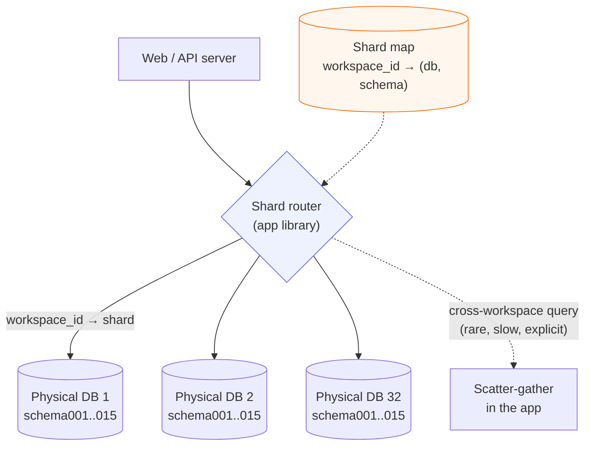
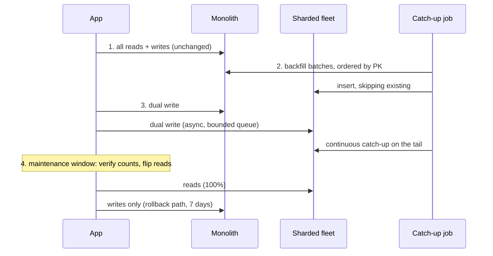

# 02 · Sharding Postgres

!!! abstract "The question"
    **"Your Postgres database is full. Now what?"** Split a working monolith across
    many databases without breaking foreign keys, transactions, or the on-call
    engineer — and without a year of downtime.

!!! info "Source"
    Notion Engineering, *Herding elephants: Lessons learned from sharding Postgres
    at Notion* (Garrett Fidalgo, October 2021), plus the 2023 follow-up
    *The Great Re-Shard*.

---

## 1. The problem, and the naive design

Notion's monolith was a single Postgres database that had served them through five
years and four orders of magnitude of growth. The naive answer — "buy a bigger
instance" — is what they were doing, and it stopped working for reasons that had
nothing to do with running out of disk:

- **`VACUUM` began to stall consistently.** Postgres could not reclaim space from
  dead tuples, so the database grew even when data was deleted.
- **TXID wraparound became an existential threat.** Postgres uses a 32-bit
  transaction ID; at 2³¹ ≈ 2.1 billion transactions it must stop *all writes* to
  avoid clobbering data. "Just resize the instance" cannot fix that.
- **Migrations became unsafe.** Even catalog-only migrations were risky, and
  engineers were woken up by database CPU spikes.

!!! quote "The line worth memorising"
    "Playing Cookie Clicker with the RDS *Resize Instance* button is not a viable
    long-term strategy — even if you have the budget for it."

So the decision was to shard. Not because of disk size, but because of
**maintenance operations degrading before any hardware limit**.

---

## 2. The numbers that decide the design

Notion published their capacity constraints. This is a rare gift — use them.

| Constraint | Value | Why it matters |
|---|---|---|
| Required IOPS | **≥ 60,000 total** | set by both instance type *and* EBS volume type |
| Max table size | **500 GB** | keeps Postgres and RDS replication healthy |
| Max physical database | **10 TB** | same |
| Logical shards chosen | **480** | divisible by 2, 3, 4, 5, 6, 8, 10, 12, 15, 16, 20, 24, 30, 32, 40, 48, 60, 80, 96, 120, 160, 240 |
| Physical databases | **32** (15 shards each) | then 96 databases × 5 shards in 2023 |
| Growth | billions of blocks | ~20 B block rows in 2021, 200 B+ by 2024 |
| Downtime for the cutover | **5 minutes** scheduled | the double-write catch-up was the bottleneck |

### Why 480 and not 512

This is the best shard-count argument in the industry, and it is arithmetic you
can reproduce on a whiteboard:

| Shard count | Number of physical hosts you can grow to evenly |
|---|---|
| 512 (a power of two) | 32 → **64** → 128. Every scale-up doubles the fleet. |
| 480 | 32 → 40 → 48 → 60 → 80 → 96 → 120 … |

With 480 you can add capacity in ~25% steps. With 512 you must double. On a fleet
where each host is a `db.r6g.4xlarge` with `io2` storage, doubling is a very
different budget conversation than adding 8 hosts.

!!! tip "The rule"
    **Choose a logical shard count with many factors, roughly 2–4× your current
    physical host count.** The logical shard count is expensive to change; the
    physical mapping is a config change. That asymmetry is the entire design.

---

## 3. The mental model

> **Sharding is not "split the data". It is "make the routing key the first column
> of every question". Pick one key that co-locates everything a user does, put all
> transitively-related tables on the same shard, and make the application — not a
> magic proxy — own the map.**

Three decisions, in order:

1. **Which tables?** Everything reachable from `block` by a foreign key.
2. **Which key?** `workspace_id`.
3. **How many shards, and how do they map to hosts?** 480 logical, N physical.

---

## 4. The flow chart



Note what is *not* in this diagram: a proxy that rewrites SQL. Notion explicitly
chose **application-level sharding** over Citus or Vitess because those tools make
the clustering logic opaque, and they wanted control over data distribution.

---

## 5. Build it

### Step 1 — decide the shard key by walking the foreign keys

Start at the hot table and follow every FK. Anything reachable must live on the
same shard, or you introduce the exact bug Notion called out:

> A block on shard A with its comments on shard B means deleting the block can
> succeed while updating the comments fails — transactionality only holds within
> one database.

```sql
-- code/sharding/fk_graph.sql
-- Which tables hang off `block`? (run on a copy, this is a planning query)
WITH RECURSIVE reachable(tbl) AS (
  SELECT 'block'::regclass::oid
  UNION
  SELECT con.conrelid
  FROM pg_constraint con
  JOIN reachable r ON con.confrelid = r.tbl
  WHERE con.contype = 'f'
)
SELECT tbl::regclass AS table_name FROM reachable ORDER BY 1;
```

Result at Notion-shaped scale: `block`, `collection`, `space`, `discussion`,
`comment`, and friends. All sharded, all with the same key.

### Step 2 — one schema per logical shard, in the application

Notion chose **separate tables per schema** (`schema001.block`) instead of
natively-partitioned tables, so there is exactly one routing step:

```
Application: workspace_id → (physical database, logical schema)
```

With a partitioned table you would have two routing layers (app → database, then
partition table → child), and two places to debug.

```sql
-- code/sharding/schema.sql  (run once per logical shard, schema name templated)
CREATE SCHEMA IF NOT EXISTS :schema;

CREATE TABLE :schema.space (
    id          uuid PRIMARY KEY,
    workspace_id uuid NOT NULL,
    name        text NOT NULL,
    created_at  timestamptz NOT NULL DEFAULT now()
);

CREATE TABLE :schema.block (
    id           uuid PRIMARY KEY,
    workspace_id uuid NOT NULL,
    space_id     uuid NOT NULL REFERENCES :schema.space(id),
    parent_id    uuid,
    type         text NOT NULL,
    properties   jsonb NOT NULL DEFAULT '{}',
    alive        boolean NOT NULL DEFAULT true,
    created_at   timestamptz NOT NULL DEFAULT now()
);

-- The index that every real query needs: "blocks in this space, live, by position"
CREATE INDEX block_space_alive_idx ON :schema.block (workspace_id, space_id, id) WHERE alive;
```

Two things to notice:

- `workspace_id` is denormalised onto **every** sharded table. It is the routing
  key, and the router needs it on the row to be able to move data later.
- There is **no cross-shard foreign key**. `REFERENCES` only works inside one
  database, so the constraint above is intra-shard by construction. Anything
  across shards becomes an application invariant.

### Step 3 — the router

```python
# code/sharding/router.py (excerpt, complete file in the repo)
import hashlib
from dataclasses import dataclass

LOGICAL_SHARDS = 480
PHYSICAL_DBS = 32
SHARDS_PER_DB = LOGICAL_SHARDS // PHYSICAL_DBS  # 15

@dataclass(frozen=True)
class Location:
    database: str
    schema: str

def shard_for(workspace_id: str) -> Location:
    """Deterministic, stateless routing. Same workspace always lands here."""
    digest = hashlib.sha256(workspace_id.encode()).digest()
    shard = int.from_bytes(digest[:8], "big") % LOGICAL_SHARDS
    db = shard // SHARDS_PER_DB
    return Location(database=f"notion_db_{db:02d}", schema=f"schema{shard % SHARDS_PER_DB + 1:03d}")

def connection_for(workspace_id: str, pool_factory):
    loc = shard_for(workspace_id)
    return pool_factory(loc.database), loc.schema
```

Why hash the UUID rather than use its bytes directly? Because UUIDs are already
uniform, but hashing gives you a stable, well-distributed mapping that survives a
change of shard count for the *logical* layer, and it is trivially reimplementable
in any language. Store the computed location on the workspace row too, so you can
audit the map.

!!! danger "The one thing you must never do"
    Do not put the shard map in a cache that can be stale during a re-shard. A
    stale map writes a workspace's rows to two different shards and you will spend
    a week reconciling. Version the map (`shard_map_version`) and make writes
    reject a mismatched version.

### Step 4 — online migration, in four phases

Notion's cutover took a 5-minute maintenance window because their **double-write
throughput** was the bottleneck. The pattern, generalised:



Their hard-won lessons, which you should copy:

- **Backfill the shard key on the fly.** Notion's partition key (`workspace_id`)
  did not exist in the old schema, and backfilling the column on the monolith
  would have added load to an already-strained database. They populated it as rows
  were written to the shards, and used a custom catch-up script instead of logical
  replication.
- **Shard earlier than feels comfortable.** Waiting until the database is strained
  removes the option of using logical replication, because you cannot afford the
  extra write load.
- **Verify with counts and digests, not vibes.** A per-shard checksum of
  `count(*)`, `sum(hashtext(id))` and `max(updated_at)` is enough to catch
  dropped rows.

```sql
-- code/sharding/verify.sql : run against old and new, diff the output
SELECT count(*)                        AS rows,
       sum(('x' || substr(md5(id::text), 1, 8))::bit(32)::bigint) AS id_digest,
       max(updated_at)                 AS newest
FROM block
WHERE updated_at < :watermark;
```

### Step 5 — the re-shard (yes, it happens again)

By the end of 2022 Notion's shards were above 90% CPU at peak, and they re-sharded
from 32 physical databases to **96, keeping the same 480 logical shards** (5 per
database), with PgBouncer in front split into four clusters of 24 databases. This
is the payoff for choosing 480: the logical→physical mapping changed and the
application's `shard_for()` did not.

---

## 6. The production layer

### Instances and IOPS

```hcl
# deploy/terraform/sharded-postgres/main.tf (abridged)
resource "aws_db_instance" "shard" {
  count                   = 96
  identifier              = "notion-db-${format("%02d", count.index)}"
  engine                  = "postgres"
  engine_version          = "16.4"
  instance_class          = "db.r6g.4xlarge"     # 16 vCPU, 128 GB
  allocated_storage       = 2000
  max_allocated_storage   = 10000
  storage_type            = "io2"
  iops                    = 16000                # provisioned, not burst
  storage_throughput      = 1000
  multi_az                = true
  backup_retention_period = 14
  performance_insights_enabled = true
  auto_minor_version_upgrade   = false
  parameter_group_name    = aws_db_parameter_group.shard.name
  tags = { "shard-map-version" = "2" }
}

resource "aws_db_parameter_group" "shard" {
  family = "postgres16"
  parameter { name = "max_connections"              value = "800" }
  parameter { name = "autovacuum_vacuum_scale_factor" value = "0.02" }  # vacuum earlier, not later
  parameter { name = "autovacuum_naptime"            value = "15" }
  parameter { name = "idle_in_transaction_session_timeout" value = "30000" }
  parameter { name = "statement_timeout"             value = "15000" }
  parameter { name = "track_io_timing"               value = "1" }
}
```

| Knob | Value | Why |
|---|---|---|
| `io2` + provisioned IOPS | 16,000 | gp3 burst credits run out exactly during your peak |
| `max_connections` | 800 | but the app never uses them directly — PgBouncer does |
| `autovacuum_vacuum_scale_factor` | 0.02 | vacuum at 2% dead tuples, not 20%; this is the knob that would have saved Notion pain |
| `idle_in_transaction_session_timeout` | 30 s | kills the leaked transactions that exhaust pools |
| `statement_timeout` | 15 s | one bad query cannot hold a shard hostage |
| `track_io_timing` | on | needed for real IOPS attribution in `pg_stat_statements` |

### PgBouncer, and the connection arithmetic

```
96 databases × (1 primary + 1 standby) = 192 Postgres endpoints
if each app pod opened 20 connections: 200 pods × 20 = 4,000 connections
→ more than a db.r6g.4xlarge can serve sanely
```

So: PgBouncer in **transaction pooling** mode, with a small server-side pool per
database.

```ini
; deploy/pgbouncer/pgbouncer.ini (abridged)
[databases]
notion_db_00 = host=notion-db-00.xxxx.ap-south-1.rds.amazonaws.com dbname=notion
notion_db_01 = host=notion-db-01.xxxx.ap-south-1.rds.amazonaws.com dbname=notion

[pgbouncer]
pool_mode = transaction
max_client_conn = 5000
default_pool_size = 25          ; server connections per (user, database)
min_pool_size = 5
reserve_pool_size = 10
reserve_pool_timeout = 3
server_idle_timeout = 60
query_wait_timeout = 10
ignore_startup_parameters = extra_float_digits,options
```

```yaml
# deploy/pgbouncer/deployment.yaml (abridged)
apiVersion: apps/v1
kind: Deployment
metadata: { name: pgbouncer, namespace: data }
spec:
  replicas: 8
  template:
    spec:
      containers:
        - name: pgbouncer
          image: edoburu/pgbouncer:1.23.1
          ports: [{ containerPort: 6432 }]
          resources:
            requests: { cpu: 200m, memory: 128Mi }
            limits:   { memory: 256Mi }
          readinessProbe:
            tcpSocket: { port: 6432 }
            initialDelaySeconds: 3
          volumeMounts:
            - { name: cfg, mountPath: /etc/pgbouncer }
      volumes:
        - name: cfg
          configMap: { name: pgbouncer-config }
```

!!! warning "Transaction pooling breaks some things"
    Session-level features stop working: `SET` outside a transaction, advisory
    locks held across statements, `LISTEN/NOTIFY`, and prepared statements unless
    you set `max_prepared_statements`. Test your ORM's behaviour before you switch.

### The shard-map ConfigMap and its rollout

```yaml
apiVersion: v1
kind: ConfigMap
metadata:
  name: shard-map
  namespace: app
data:
  version: "2"
  logical_shards: "480"
  physical_databases: "96"
  shards_per_database: "5"
  map.json: |
    {
      "version": 2,
      "databases": [
        {"name": "notion_db_00", "host": "notion-db-00...", "port": 6432},
        {"name": "notion_db_01", "host": "notion-db-01...", "port": 6432}
      ]
    }
```

### The five alerts

| Alert | What it catches |
|---|---|
| `pg_stat_activity` count per shard > 80% of pool | pool exhaustion before it becomes an outage |
| Replica lag > 5 s for 2 min | the failure mode that makes idempotency reads wrong (ch 04) |
| `age(datfrozenxid)` > 1.5 B | **TXID wraparound runway** — the existential one |
| Dead tuples > 10% on any sharded table | vacuum not keeping up; the Notion failure |
| IOPS at provisioned limit for 10 min | you are at the ceiling of that instance class |

---

## 7. The two-minute answer

> "Before sharding I'd check whether the binding constraint is really size. At
> Notion it wasn't: `VACUUM` started stalling and TXID wraparound — 2³¹
> transactions, then Postgres stops all writes — became existential. That's the
> signal to shard, and it's earlier than most people think, because waiting until
> the database is strained removes your ability to use logical replication for the
> migration.
>
> I'd shard at the application level, not with Citus or Vitess, so the routing is
> explicit and testable. Key choice comes from the foreign-key graph: everything
> reachable from `block` goes on the same shard, and the key is `workspace_id`,
> because users query within one workspace so cross-shard joins almost disappear.
> `workspace_id` gets denormalised onto every sharded table so the router always
> has it.
>
> For counts: 500 GB per table and 10 TB per database as ceilings, and at least
> 60k IOPS. I'd pick 480 logical shards over 32 physical databases — not 512,
> because 480 divides by 40, 48, 60, 80, 96, so I can grow the fleet in 25% steps
> instead of doubling. The logical count is hard to change; the physical mapping is
> a config change.
>
> Migration: backfill in primary-key order with a checkpointed job, then dual
> write, then a continuous catch-up on the tail, then a short window to verify
> counts and digests and flip reads. Notion's window was five minutes and the
> double-write throughput was the bottleneck. And I'd expect to re-shard — they
> went 32 to 96 databases in 2023 without touching the 480."

### Follow-ups you should expect

| Question | The answer they want |
|---|---|
| "What breaks when you shard?" | Joins across workspaces, cross-shard transactions, globally unique indexes, and `ALTER TABLE` needing to run on 480 schemas (use a migration orchestrator). |
| "How do you handle a cross-workspace query?" | Scatter-gather in the app with a hard concurrency cap and a timeout, or a separate analytics replica fed by CDC. Never on the request path. |
| "How do you move one workspace to a new shard?" | Logical re-shard keeps the mapping in config; for a single hot tenant, use a dedicated shard and route by an override entry. |
| "Why not just use a bigger instance?" | You can, and you should for as long as it works — it's one rung below sharding on the cost ladder (see chapter 03). The ceiling is maintenance ops, not disk. |
| "How do you test 480 schemas?" | A schema-migration orchestrator with per-shard status, run on a canary shard first, plus a `schema_version` table per shard. |

**Code:** `code/sharding/` · **Manifests:** `deploy/pgbouncer/`, `deploy/terraform/sharded-postgres/`
