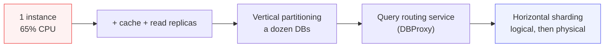
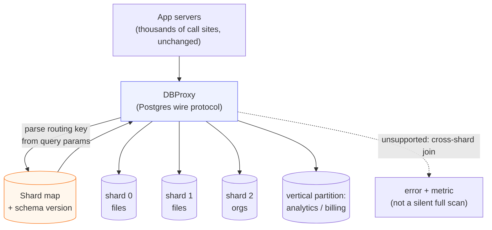
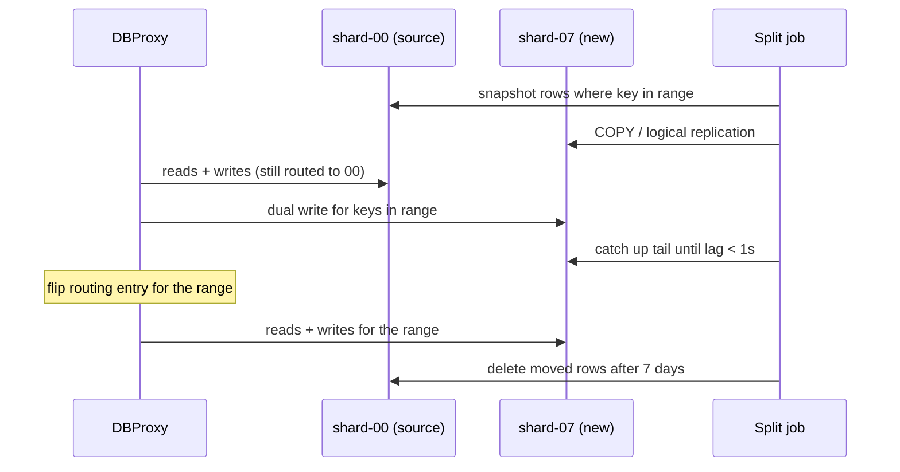

# 03 · Scaling Postgres without rewriting the app

!!! abstract "The question"
    **"Scale a database without rewriting the app."** Keep shipping features
    while the database underneath goes from one instance to a sharded fleet —
    and make every step reversible.

!!! info "Source"
    Figma Engineering, *How Figma's databases team lived to tell the scale*
    (March 2024) and *The growing pains of database architecture* (April 2023).

---

## 1. The problem, and the naive design

In 2020 Figma ran a **single Postgres database on AWS's largest physical
instance**. It was at **~65% CPU utilisation at peak**, and database traffic was
growing roughly **3× per year**. Latency becomes unpredictable as you approach
saturation; if the database saturates completely, Figma stops working.

The naive options, and why each is a trap:

| Naive move | Why it fails |
|---|---|
| Resize the instance again | There is a biggest instance, and you reach it in one growth cycle at 3×/year |
| Add read replicas | Only helps reads; writes and `VACUUM` still hit one primary |
| Horizontally shard immediately | Costs joins, foreign keys, cross-shard transactions, and a year of engineering |
| Rewrite the app to use a distributed SQL database | Multi-year rewrite; the app has thousands of call sites |

Figma did the thing that is boring and correct: **climb the ladder one rung at a
time**, and build tooling that makes each rung cheap.



---

## 2. The numbers that decide the design

| Figure | Value | Consequence |
|---|---|---|
| 2020 baseline | 1 RDS instance, ~65% CPU at peak | one growth cycle of runway |
| Growth rate | ~3× DB traffic per year | ~100× over four years |
| Vertical partitioning result | ~a dozen databases, largest at **~10% CPU** | massive headroom, no app rewrite |
| Cost of one vertical move | **~30 s partial availability, ~2% of requests dropped** | acceptable, and worth engineering for |
| Time to shard the first table | **~9 months** | this is why you need the runway first |
| First horizontal shard | September 2023, failover with **10 s** partial availability on primaries | replicas unaffected |
| Sharding keys | `UserID`, `FileID`, `OrgID` | no single good key existed for every table |
| Largest tables | several TB, billions of rows | vacuum-driven reliability risk |

The key insight from those numbers: **vertical partitioning bought the nine
months that horizontal sharding needed.** If you attempt horizontal sharding
without that runway, you shard under fire.

---

## 3. The mental model

> **Move the routing decision out of the application and into one service, then
> change the data layout behind that service. The app keeps asking the same
> question; only the answer changes.**

Two sub-models make it work:

- **Vertical partitioning = split by table group.** Cheap, reversible, no
  application semantics change. The unit of movement is a table.
- **Logical sharding before physical sharding.** Logically sharded means the app
  *behaves* as if the table is split — all reads and writes route as if there were
  N shards — while the data is still on one host. Rollback is a config change.
  Then you physically split the data, with the routing already proven.

---

## 4. The flow chart



The critical design decision: a proxy that **cannot** route a query must fail
loudly with a metric, not fan out to every shard. A silent scatter-gather is how
you turn a 2 ms query into a 400 ms one and never notice until it is a p99
incident.

---

## 5. Build it

### Step 1 — instrument before you move anything

You cannot partition what you cannot attribute. Figma measured **average active
sessions (AAS)** per query by sampling `pg_stat_activity` every 10 ms and
aggregating by table.

```sql
-- code/dbproxy/aas.sql : average active sessions by table (run on a replica)
SELECT
  (regexp_match(query, 'FROM\s+"?([a-z_]+)"?', 'i'))[1] AS table_name,
  count(*)                                              AS samples,
  count(*) * 0.01                                       AS approx_seconds_of_work
FROM pg_stat_activity
WHERE state = 'active'
  AND query NOT ILIKE '%pg_stat_activity%'
GROUP BY 1
ORDER BY 2 DESC
LIMIT 20;
```

Then rank tables by two criteria: **impact** (how much AAS it carries) and
**isolation** (how few FKs and joins connect it to everything else). Move the
high-impact, high-isolation tables first.

### Step 2 — the routing service (DBProxy)

The app talks Postgres wire protocol to DBProxy. DBProxy parses enough to find the
routing key, looks up the shard, and forwards the connection.

```go
// code/dbproxy/shardmap.go (excerpt)
type ShardMap struct {
    mu      sync.RWMutex
    version int
    // logical table -> shard key column
    Keys map[string]string
    // shard key value -> physical pool
    Pools map[string]*pgxpool.Pool
}

func (m *ShardMap) Route(table string, params map[string]any) (string, error) {
    m.mu.RLock()
    defer m.mu.RUnlock()
    keyCol, ok := m.Keys[table]
    if !ok {
        return "", fmt.Errorf("table %q is not sharded; route it explicitly", table)
    }
    v, ok := params[keyCol]
    if !ok {
        return "", fmt.Errorf("query on sharded table %q missing routing key %q", table, keyCol)
    }
    return shardOf(v), nil
}

func shardOf(v any) string {
    h := fnv.New64a()
    fmt.Fprintf(h, "%v", v)
    return fmt.Sprintf("shard-%02d", h.Sum64()%uint64(numShards))
}
```

```go
// code/dbproxy/main.go (excerpt) : one decision point, one metric
func (p *Proxy) handle(ctx context.Context, q Query) (*Result, error) {
    shard, err := p.map.Route(q.Table, q.Params)
    if err != nil {
        proxyUnroutable.WithLabelValues(q.Table).Inc()   // alert on this
        return nil, ErrUnroutable
    }
    pool := p.map.Pools[shard]
    ctx, cancel := context.WithTimeout(ctx, p.queryTimeout)  // 250 ms
    defer cancel()
    return pool.Query(ctx, q.SQL, q.Args...)
}
```

!!! tip "Logical sharding is a feature flag"
    Run the proxy in logical-shard mode against a single host first. Every query is
    routed, every missing routing key is an error, but the data has not moved.
    Roll back = flip a flag. Only when that is clean for a week do you copy data.

### Step 3 — the physical shard split



```sql
-- code/dbproxy/split.sql : the copy, chunked so it never holds a long transaction
COPY (
  SELECT * FROM files
  WHERE org_id >= :lo AND org_id < :hi
    AND updated_at >= :chunk_start AND updated_at < :chunk_end
) TO STDOUT WITH (FORMAT csv);
```

Rules that keep a split safe:

1. **Chunk by a monotonic column**, not by `OFFSET`; `OFFSET` degrades as you go.
2. **Copy, then stream the tail** with logical replication or a change table.
3. **Flip the routing entry atomically** in the shard map (a single row update in
   the map database, versioned).
4. **Keep the source rows for a week** so rollback is possible.
5. **Measure the flip**, not the copy: Figma's first shard flip caused ~10 s of
   partial availability on primaries, zero on replicas. Rehearse it.

### Step 4 — schema changes across N shards

This is the operational tax nobody mentions. With N shards you need:

```sql
-- code/dbproxy/schema_migrations.sql
CREATE TABLE IF NOT EXISTS schema_migrations (
  shard        text NOT NULL,
  version      integer NOT NULL,
  applied_at   timestamptz NOT NULL DEFAULT now(),
  duration_ms  integer,
  PRIMARY KEY (shard, version)
);
```

and an orchestrator that: applies to a canary shard → waits a soak period →
applies in batches of 10 with a concurrency cap → records every shard → halts and
reports on the first failure. Every DDL must be backward compatible for one
release (add nullable column → deploy code → backfill → add constraint `NOT
VALID` → `VALIDATE CONSTRAINT`).

---

## 6. The production layer

### DBProxy on Kubernetes

```yaml
# deploy/dbproxy/deployment.yaml
apiVersion: apps/v1
kind: Deployment
metadata: { name: dbproxy, namespace: data }
spec:
  replicas: 4
  strategy:
    rollingUpdate: { maxUnavailable: 0, maxSurge: 1 }   # never drop below 4
  selector: { matchLabels: { app: dbproxy } }
  template:
    metadata:
      labels: { app: dbproxy }
      annotations:
        prometheus.io/scrape: "true"
        prometheus.io/port: "9090"
    spec:
      topologySpreadConstraints:
        - maxSkew: 1
          topologyKey: topology.kubernetes.io/zone
          whenUnsatisfiable: DoNotSchedule
          labelSelector: { matchLabels: { app: dbproxy } }
      containers:
        - name: dbproxy
          image: ghcr.io/example/dbproxy:2.3.0
          args:
            - --shard-map-config=/etc/shardmap/map.json
            - --query-timeout=250ms
            - --max-conns-per-shard=40
            - --require-routing-key=true
          ports: [{ containerPort: 6432 }, { containerPort: 9090 }]
          resources:
            requests: { cpu: "1", memory: 512Mi }
            limits:   { memory: 1Gi }
          startupProbe:
            httpGet: { path: /healthz, port: 9090 }
            failureThreshold: 30
            periodSeconds: 2
          readinessProbe:
            httpGet: { path: /ready, port: 9090 }   # ready only if all pools warm
            periodSeconds: 5
          livenessProbe:
            httpGet: { path: /healthz, port: 9090 }
            periodSeconds: 10
          volumeMounts:
            - { name: shardmap, mountPath: /etc/shardmap }
      volumes:
        - name: shardmap
          configMap: { name: shard-map }
---
apiVersion: policy/v1
kind: PodDisruptionBudget
metadata: { name: dbproxy, namespace: data }
spec:
  minAvailable: 3
  selector: { matchLabels: { app: dbproxy } }
---
apiVersion: autoscaling/v2
kind: HorizontalPodAutoscaler
metadata: { name: dbproxy, namespace: data }
spec:
  scaleTargetRef: { apiVersion: apps/v1, kind: Deployment, name: dbproxy }
  minReplicas: 4
  maxReplicas: 20
  metrics:
    - type: Pods
      pods:
        metric: { name: dbproxy_active_connections }
        target: { type: AverageValue, averageValue: "120" }
  behavior:
    scaleDown:
      stabilizationWindowSeconds: 600   # connection churn is expensive
```

### Terraform for the partitioned fleet

```hcl
# deploy/terraform/figma-style/main.tf (abridged)
locals {
  partitions = {
    files    = { instance = "db.r6g.8xlarge", storage = 4000, iops = 32000 }
    orgs     = { instance = "db.r6g.4xlarge", storage = 2000, iops = 16000 }
    comments = { instance = "db.r6g.4xlarge", storage = 2000, iops = 16000 }
    billing  = { instance = "db.r6g.xlarge",  storage = 500,  iops = 8000  }
  }
}

resource "aws_db_instance" "partition" {
  for_each                = local.partitions
  identifier              = "figma-${each.key}"
  engine                  = "postgres"
  engine_version          = "16.4"
  instance_class          = each.value.instance
  allocated_storage       = each.value.storage
  storage_type            = "io2"
  iops                    = each.value.iops
  multi_az                = true
  parameter_group_name    = aws_db_parameter_group.partition[each.key].name
  performance_insights_enabled          = true
  performance_insights_retention_period = 465
}
```

| Partition | Instance | Why that size |
|---|---|---|
| files | `db.r6g.8xlarge` | highest write rate, several TB |
| orgs | `db.r6g.4xlarge` | heavy joins inside the org |
| comments | `db.r6g.4xlarge` | high insert rate, low read amplification |
| billing | `db.r6g.xlarge` | small, but must never share a host with anything noisy |

Figma's own summary of the result: the largest partition sat at **~10% CPU**, and
they *reduced* resources on the low-traffic partitions. Vertical partitioning also
gives you per-partition cost control, which is invisible in a single-monolith
design and very visible on the bill.

### Alerts

| Alert | Threshold | Why |
|---|---|---|
| `dbproxy_unroutable_total` rate | > 0.1/s | a code path forgot the routing key; it is silently failing |
| `dbproxy_cross_shard_queries` | > 0 for 5 min | scatter-gather appeared on the request path |
| Per-shard AAS imbalance | max/avg > 2 | the shard key is skewed |
| Logical replication lag during a split | > 5 s for 5 min | pause the split |
| `dbproxy` pool saturation | > 90% for 3 min | scale or raise pool, before latency moves |

### Failure drills

1. **Unroutable query.** Ship a query that omits the routing key. It must error and
   increment a metric — never fan out.
2. **Kill a shard's primary.** `aws rds reboot-db-instance --force-failover`. With
   `multi_az` the proxy should reconnect in under 60 s; verify the connection
   retry path and that no query silently returns stale data from a replica.
3. **Abort a shard split halfway.** Kill the copy job, restart it, and confirm the
   checkpoint makes it idempotent and the routing entry is untouched.
4. **Stale shard map.** Deploy an old ConfigMap and confirm writes are rejected by
   version mismatch rather than landing in the wrong shard.

---

## 7. The two-minute answer

> "The mistake I want to avoid is going from one Postgres instance straight to
> horizontal sharding. Figma's ladder is the right shape: they started at ~65% CPU
> on AWS's largest instance with traffic growing 3× a year, and instead of sharding
> immediately they added caching and read replicas, then vertically partitioned —
> moved groups of related tables, like files or organizations, onto their own
> databases. That's cheap, reversible, and it doesn't change application
> semantics. It got their largest partition down to about 10% CPU and bought them
> the runway for the hard part.
>
> The enabler was moving routing out of the app into a query routing service —
> DBProxy — so thousands of call sites keep asking the same question while the
> answer behind it changes. Their vertical partitioning moves cost about 30 seconds
> of partial availability with ~2% of requests dropped, which is a number you can
> engineer around.
>
> Then horizontal sharding, and the key trick: logical sharding before physical.
> Logically sharded means the app behaves as if the table is split and all routing
> is exercised, but the data is still on one host — so rollback is a config change.
> Only then do you copy data and flip routing. It took them about nine months for
> the first table, and the first production flip cost 10 seconds of partial
> availability on primaries and nothing on replicas.
>
> The costs I'd be explicit about: no cross-shard joins or transactions, foreign
> keys and globally unique indexes can't be enforced by Postgres, partial commit
> failures become a product concern, and schema changes now run across N shards so
> you need an orchestrator and backward-compatible DDL."

### Follow-ups you should expect

| Question | The answer they want |
|---|---|
| "What is a colo?" | Figma's abstraction over sharded tables sharing a shard key, so product devs get joins and transactions within one key without knowing about shards. |
| "Why not one shard key for everything?" | No single candidate existed; they used `UserID`, `FileID`, `OrgID` per table group. Different tables, different natural keys. |
| "How do you handle partial commit failures?" | Application-level sagas with compensation, plus idempotent retries — chapters 04 and 05. |
| "When do you stop climbing the ladder?" | When the cost of the next rung exceeds the runway it buys. Write the runway in months next to each option. |
| "How do you know a table needs sharding?" | Table size in the TB range, write rate near the instance's IOPS ceiling, or vacuum duration crossing your maintenance window. |

**Code:** `code/dbproxy/` · **Manifests:** `deploy/dbproxy/`, `deploy/terraform/figma-style/`
