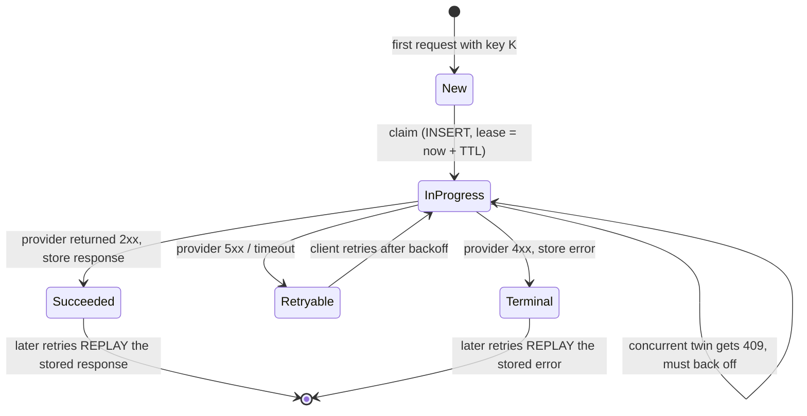
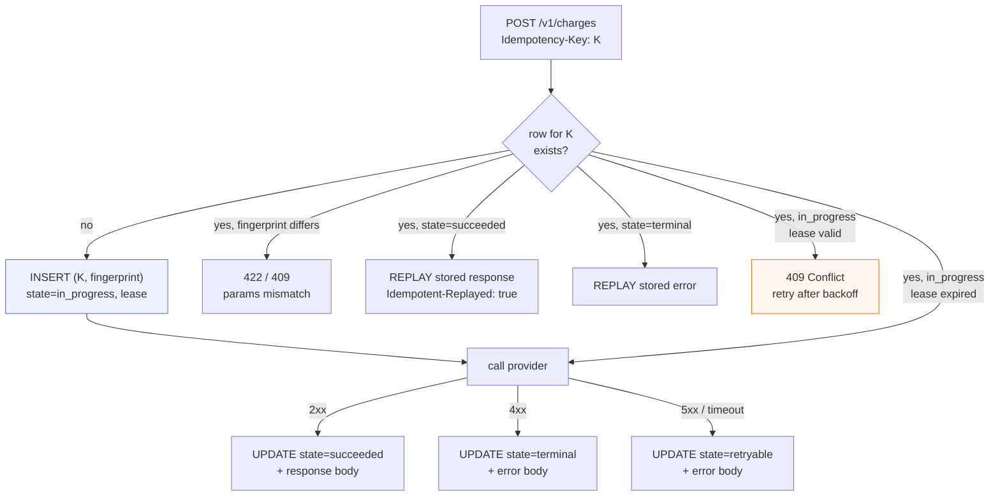

# 04 · Idempotent payment APIs

!!! abstract "The question"
    **"Design a payment API."** A client sends `POST /v1/charges`, the network
    drops the response, and the client retries. Charge the card once — and give
    the client a *correct* answer on the retry.

!!! info "Source"
    Stripe Engineering, *Designing robust and predictable APIs with idempotency*
    (Brandur Leach, February 2017), and the Stripe API reference for
    `Idempotency-Key` semantics.

---

## 1. The problem, and the naive design

The naive payment endpoint:

```python
@app.post("/v1/charges")
def create_charge(amount: int, customer: str):
    charge = gateway.charge(amount=amount, customer=customer)
    db.save(charge)
    return charge
```

Three ways this loses money or data:

| Failure | What happens | Consequence |
|---|---|---|
| Response lost after the gateway charged | Client retries; second charge succeeds | **Customer charged twice** |
| Crash after `gateway.charge`, before `db.save` | Retry charges again; no record of the first | **Double charge + no audit trail** |
| Client's own retry loop (mobile app, 3 tries) | Three concurrent charges | **Triple charge** |

The correct instinct is *not* "make the client smarter" and it is *not* "add a
dedupe flag". It is to make the endpoint idempotent: **the same request, sent any
number of times, has the same effect as sending it once.**

!!! quote "Stripe's framing"
    "The easiest way to address inconsistencies in distributed state caused by
    failures is to implement server endpoints so that they're idempotent — they
    can be called any number of times while guaranteeing that side effects only
    occur once."

---

## 2. The numbers that decide the design

| Figure | Value | Consequence |
|---|---|---|
| Retention of an idempotency key (Stripe API v1) | **24 hours**, then reaped | the retry window is part of your public contract |
| Stripe API v2 retention | 30 days | for workflows that span days |
| Typical gateway timeout | 2–30 s | your lease must exceed it |
| Duplicate rate you should expect | 0.1–2% of writes in the wild | not rare; assume it happens hourly at scale |
| Cost of one duplicate charge | refund + support + chargeback fee (~₹500–2,500 per case, plus goodwill) | this is why the key store exists |
| Latency added by a key lookup | ~0.5–2 ms on the primary | acceptable; it is one indexed write |
| Key store growth | proportional to **write throughput**, not to users | needs a reaper, or the table becomes the biggest in your DB |

The last row is the one people forget: an idempotency table grows with every
`POST`, forever, unless something deletes rows.

---

## 3. The mental model

> **An idempotency key is a state machine with a stored answer. Claim it
> atomically, fingerprint the request, and never let two workers own the same key
> at the same time.**

The states:



Five rules fall out of that diagram:

1. **Claim atomically.** `INSERT ... ON CONFLICT DO NOTHING` — not a `SELECT`
   followed by an `INSERT`.
2. **Fingerprint the request.** Same key + different body is a client bug, and it
   must not replay a response for a different request.
3. **Lease, don't lock forever.** A crashed worker must not strand a key; the
   lease expires and a retry takes over.
4. **Store the answer.** Replay is what makes retries *correct*, not just safe.
5. **Read from the primary.** A replica with 2 s of lag is a double charge
   (this is chapter 05's story, and it is worth saying in an interview).

---

## 4. The flow chart



---

## 5. Build it

### Step 1 — the table

```sql
-- code/idempotency/migrations/001_keys.sql
CREATE TABLE idempotency_keys (
    id              bigserial PRIMARY KEY,
    account_id      text        NOT NULL,
    key             text        NOT NULL,
    request_method  text        NOT NULL,
    request_path    text        NOT NULL,
    request_hash    bytea       NOT NULL,          -- sha256 of canonical body
    state           text        NOT NULL DEFAULT 'in_progress'
                    CHECK (state IN ('in_progress','succeeded','terminal','retryable')),
    locked_at       timestamptz,
    lease_expires_at timestamptz,
    response_code   integer,
    response_body   jsonb,
    created_at      timestamptz NOT NULL DEFAULT now(),
    updated_at      timestamptz NOT NULL DEFAULT now(),
    UNIQUE (account_id, key)
);

CREATE INDEX idempotency_keys_created_idx ON idempotency_keys (created_at);
CREATE INDEX idempotency_keys_lease_idx   ON idempotency_keys (lease_expires_at)
    WHERE state = 'in_progress';
```

Why `(account_id, key)` and not `key`: keys are scoped per account, exactly as
Stripe scopes them per account/sandbox. Otherwise one tenant can DoS another by
guessing keys.

### Step 2 — the atomic claim

One statement, no race:

```sql
-- code/idempotency/claim.sql
INSERT INTO idempotency_keys
    (account_id, key, request_method, request_path, request_hash,
     state, locked_at, lease_expires_at)
VALUES ($1, $2, $3, $4, $5, 'in_progress', now(), now() + interval '30 seconds')
ON CONFLICT (account_id, key) DO NOTHING
RETURNING id, state;
```

If it returns a row, you own the work. If it returns nothing, someone else has the
key — go and read the row and arbitrate:

```python
# code/idempotency/store.py (excerpt, complete file in repo)
def claim(pool, account, key, method, path, fingerprint) -> Claim:
    with pool.connection() as conn, conn.transaction():
        row = conn.execute(CLAIM_SQL, (account, key, method, path, fingerprint)).fetchone()
        if row:
            return Claim.execute(row["id"])

        existing = conn.execute(
            "SELECT * FROM idempotency_keys WHERE account_id=%s AND key=%s FOR UPDATE",
            (account, key),
        ).fetchone()

        if existing["request_hash"] != fingerprint:
            return Claim.params_mismatch()          # same key, different body

        if existing["state"] == "succeeded":
            return Claim.replay(existing["response_code"], existing["response_body"])
        if existing["state"] == "terminal":
            return Claim.replay(existing["response_code"], existing["response_body"])
        if existing["state"] == "in_progress" and existing["lease_expires_at"] > utcnow():
            return Claim.in_progress()              # concurrent twin -> 409
        # lease expired: the previous attempt died. Take over.
        conn.execute(
            "UPDATE idempotency_keys SET locked_at=now(), lease_expires_at=now()+interval '30 seconds' "
            "WHERE id=%s", (existing["id"],),
        )
        return Claim.execute(existing["id"])
```

That `if/elif` ladder is the whole public contract of the API, and its **order
matters**: fingerprint mismatch must be checked before replay, or you will happily
return someone else's charge to a request that asked for something different.

### Step 3 — the handler, with the boundary respected

```python
# code/idempotency/api.py (excerpt)
@app.post("/v1/charges")
def create_charge(req: ChargeRequest, request: Request):
    key = request.headers.get("Idempotency-Key")
    if not key:
        raise HTTPException(400, "Idempotency-Key header is required on POST")

    fingerprint = sha256(canonical_json(req)).digest()
    claim = store.claim(pool, req.account_id, key, "POST", "/v1/charges", fingerprint)

    if claim.kind == "params_mismatch":
        # Stripe's documented wording, worth matching so clients behave predictably
        raise HTTPException(409, "Keys for idempotent requests can only be used with "
                                 "the same parameters they were first used with")
    if claim.kind == "in_progress":
        raise HTTPException(409, "A request with this Idempotency-Key is already in progress")
    if claim.kind == "replay":
        return JSONResponse(claim.body, status_code=claim.code,
                            headers={"Idempotent-Replayed": "true"})

    try:
        result = gateway.charge(amount=req.amount, customer=req.customer)   # RPC
    except GatewayTimeout:
        store.mark(claim.id, "retryable", 503, {"error": "provider timeout"})
        raise HTTPException(503, "Provider timed out; retry with the same key")
    except GatewayDeclined as e:                                            # 4xx: terminal
        store.mark(claim.id, "terminal", 402, {"error": str(e)})
        raise HTTPException(402, str(e))

    store.mark(claim.id, "succeeded", 201, result)                          # store the answer
    return JSONResponse(result, status_code=201)
```

Note the two invariants from chapter 05, already visible here: **no database
transaction is open across `gateway.charge`**, and the response is persisted
before it is returned.

### Step 4 — the reaper

```sql
-- code/idempotency/reap.sql : batched, so it never locks the hot table
DELETE FROM idempotency_keys
WHERE id IN (
    SELECT id FROM idempotency_keys
    WHERE created_at < now() - interval '72 hours'
    ORDER BY created_at
    LIMIT 10000
);
```

```yaml
# deploy/idempotency/reaper-cronjob.yaml
apiVersion: batch/v1
kind: CronJob
metadata: { name: idempotency-reaper, namespace: payments }
spec:
  schedule: "*/15 * * * *"
  concurrencyPolicy: Forbid
  successfulJobsHistoryLimit: 1
  jobTemplate:
    spec:
      backoffLimit: 2
      template:
        spec:
          restartPolicy: OnFailure
          containers:
            - name: reap
              image: ghcr.io/example/payments-tools:1.8.0
              command: ["/bin/sh", "-c"]
              args:
                - psql "$DATABASE_URL" -v ON_ERROR_STOP=1 -f /sql/reap.sql
              resources:
                requests: { cpu: 100m, memory: 128Mi }
                limits:   { memory: 256Mi }
```

Pick the window deliberately: **longer than your slowest legitimate retry path**
(queue-driven clients redeliver hours later) and **shorter than your privacy
obligations** allow. Stripe chose 24 hours for v1 and 72 hours is a common
in-house choice so a Friday bug still has its keys on Monday.

### Step 5 — the Redis fast path (optional, and honest about it)

Redis `SET key token NX EX 86400` closes the check-then-claim race cheaply, but it
cannot make the claim atomic *with the work*, because the claim lives in a
different system. Claim-then-crash loses the operation silently until the TTL
expires; work-then-claim duplicates it. Use Redis to reject obvious duplicates
early and to protect the database, and keep the transactional claim as the source
of truth.

---

## 6. The production layer

```yaml
# deploy/idempotency/deployment.yaml (abridged)
apiVersion: apps/v1
kind: Deployment
metadata: { name: payments-api, namespace: payments }
spec:
  replicas: 4
  template:
    spec:
      containers:
        - name: api
          image: ghcr.io/example/payments-api:3.1.0
          env:
            - name: IDEMPOTENCY_LEASE_SECONDS
              value: "30"          # > provider timeout (2s) by an order of magnitude
            - name: IDEMPOTENCY_RETENTION_HOURS
              value: "72"
            - name: DB_POOL_MAX
              value: "20"          # times 4 replicas = 80 connections
          resources:
            requests: { cpu: 250m, memory: 256Mi }
            limits:   { memory: 512Mi }
          readinessProbe:
            httpGet: { path: /ready, port: 8080 }   # fails if the primary is unreachable
          lifecycle:
            preStop:
              exec: { command: ["sleep", "10"] }    # drain in-flight charges
---
apiVersion: policy/v1
kind: PodDisruptionBudget
metadata: { name: payments-api, namespace: payments }
spec:
  minAvailable: 3
  selector: { matchLabels: { app: payments-api } }
```

| Knob | Value | Reasoning |
|---|---|---|
| Lease | 30 s | must exceed provider timeout (2 s) with margin; shorter than client retry interval |
| Retention | 72 h | covers weekend incidents |
| DB pool | 20 per pod | 4 pods × 20 = 80; the primary has room |
| `preStop` sleep | 10 s | a rolling deploy must not cut a charge in half |
| Read target | **primary only** | replica lag is a double charge |

```hcl
# deploy/terraform/idempotency/main.tf (abridged)
resource "aws_db_instance" "payments" {
  identifier           = "payments-primary"
  engine               = "postgres"
  instance_class       = "db.r6g.2xlarge"
  multi_az             = true          # non-negotiable for a money path
  storage_type         = "io2"
  iops                 = 12000
  performance_insights_enabled = true
  deletion_protection  = true
  backup_retention_period = 35
}
```

### The four alerts

| Alert | Expression | Why |
|---|---|---|
| Replay rate spike | `rate(idempotency_replays_total[5m]) / rate(http_requests_total[5m])` > 5% | client retry storm or a provider incident |
| Stuck leases | `count(state='in_progress' and lease_expires_at < now() - 5min)` > 0 | crashed workers are stranding payments |
| Key table bloat | table size > 20 GB or reaper lag > 1 h | reaper broken; the table will eat the primary |
| Primary read latency p99 | > 20 ms for 5 min | the whole path is about to slow down |

### Failure drills

1. **Kill the pod between the provider call and the state update.**
   `kubectl delete pod` mid-request (use a 3 s sleep in the gateway stub). Then
   retry with the same key: you should get `409` while the lease is live, and a
   take-over after 30 s. This is the single most valuable drill in the chapter.
2. **Replay correctness.** Retry a successful charge 100 times; exactly one
   provider call must appear in the stub's log, and all 100 responses identical.
3. **Param mismatch.** Same key, different amount → 409 with the documented
   message.
4. **Primary failover.** `aws rds reboot-db-instance --force-failover` while
   retries are in flight; no duplicates, and a brief spike in 503s.

---

## 7. The two-minute answer

> "A payment POST is not idempotent by nature, so I make it idempotent with a
> client-generated `Idempotency-Key` header — a UUID per logical operation, reused
> on every retry, never mutated.
>
> Server side it's a state machine in one row: the key, a fingerprint of the
> request body, a state of in-progress/succeeded/terminal/retryable, a lease
> expiry, and the stored response. The claim is a single `INSERT ... ON CONFLICT DO
> NOTHING`, so there's no read-then-write race. If the insert wins, I own the work.
> If it doesn't, I arbitrate in a fixed order: different fingerprint is a 409
> because replaying a different request's response is a lie; finished replays the
> stored response with an `Idempotent-Replayed` marker; in-progress with a live
> lease is a 409 and the client backs off; in-progress with an expired lease means
> the worker died and I take over.
>
> The lease matters because it distinguishes 'someone is working on this' from
> 'someone died working on this'. It's set longer than the provider timeout and
> shorter than the client's retry interval — 30 seconds for a 2-second provider
> call.
>
> Two non-obvious details: reads go to the primary, because a replica with two
> seconds of lag will hand you a stale 'no such key' and you double-charge; and the
> key table grows with write throughput, so there's a batched reaper. Stripe keeps
> v1 keys 24 hours, v2 for 30 days; in-house I'd use 72 hours so a Friday bug still
> has its keys on Monday."

### Follow-ups you should expect

| Question | The answer they want |
|---|---|
| "What if the client forgets the header?" | Reject `POST` with 400 — never auto-generate, because then retries cannot be correlated. |
| "What if the client reuses a key for a genuinely new payment?" | That's what the fingerprint is for: 409 params-mismatch rather than a wrong replay. |
| "Redis or Postgres for the key store?" | Postgres for correctness (claim atomic with local state), Redis as a cheap pre-filter. Never Redis alone for money. |
| "Doesn't this add a round trip?" | One indexed write, ~0.5–2 ms, on a path that already does an external RPC. Negligible. |
| "How do you handle a provider that isn't idempotent?" | Send your own key to the provider where supported; otherwise the lease + reconciliation job is your only defence (chapter 05). |

**Code:** `code/idempotency/` · **Manifests:** `deploy/idempotency/`, `deploy/terraform/idempotency/`
