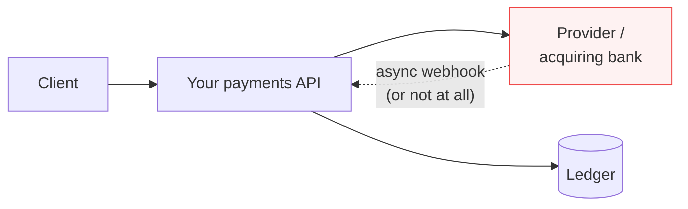
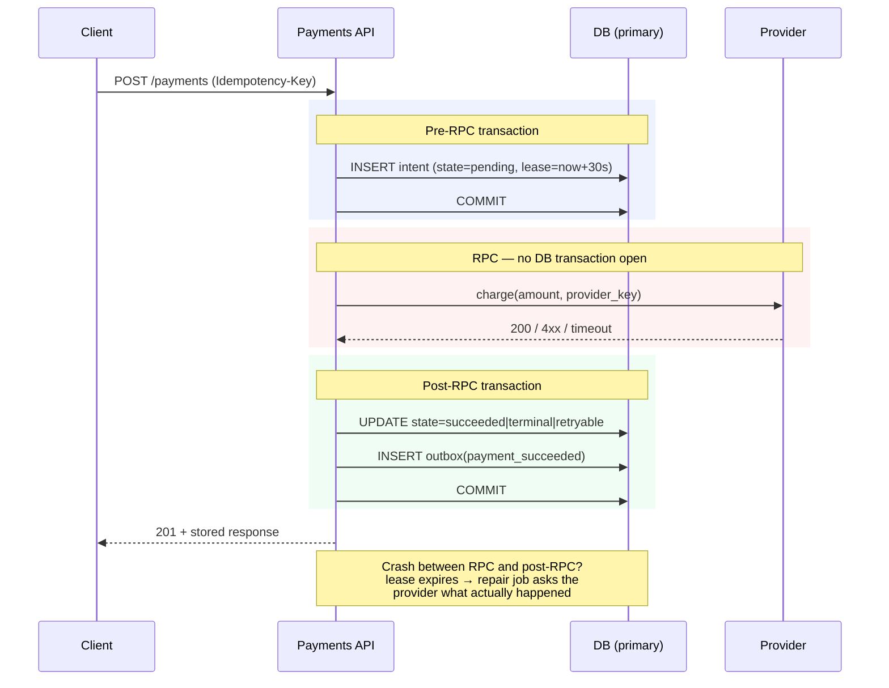

# 05 · Stopping double payments

!!! abstract "The question"
    **"How do you stop a user getting charged twice?"** Not "is the API
    idempotent" — but how do you guarantee *exactly-once* money movement when the
    network, the process, and the downstream provider can all fail at the worst
    possible moment.

!!! info "Source"
    Airbnb Engineering, *Avoiding Double Payments in a Distributed Payments
    System* (April 2019), describing their in-house library **Orpheus**.

---

## 1. The problem, and the naive design

Chapter 04 made *your* endpoint idempotent. That is necessary and not sufficient,
because a real payment has a second party:



The failure that chapter 04's key store alone cannot fix:

> Your API records intent, calls the provider, the provider charges the card and
> then **times out** on the response. You do not know whether money moved. You
> retry. Now you have charged twice, and no amount of request deduplication helps,
> because the two attempts are legitimately different attempts from the provider's
> point of view.

Airbnb's framing is the one to internalise: you cannot buy exactly-once *delivery*.
You can only build **at-most-once money movement plus a repair system** that is
provably convergent.

---

## 2. The numbers that decide the design

| Figure | Value | Consequence |
|---|---|---|
| Phases per request | **3**: pre-RPC, RPC, post-RPC | each phase is its own transaction |
| DB transactions per request | **2** (intent, outcome) | a crash between them is *expected*, not exceptional |
| Lease vs RPC timeout | lease **>** RPC timeout | a dead worker must not block retries forever |
| Retryable window | a bounded maximum | stops rogue retries from living forever |
| Idempotency store read target | **primary only** | seconds of replica lag = a duplicate payment |
| Store growth | proportional to throughput | responses table needs pruning |
| Shard key for the key store | the idempotency key | high cardinality, even distribution |

The replica-lag number deserves the emphasis Airbnb gave it: if the "have I seen
this key?" read goes to a replica that is a few seconds behind, the answer is
"no", and you execute the payment a second time. **Seconds of lag, real money.**

---

## 3. The mental model

> **Commit the intent, then do the irreversible thing, then commit the outcome —
> and never hold a database transaction across a network call. A crash in the
> middle is recovered by a lease plus a repair job, not by hoping.**

The three phases:

| Phase | Does | Must not do |
|---|---|---|
| **Pre-RPC** | validate, acquire the idempotency lease, record intent | make network calls |
| **RPC** | call the provider, with a timeout | touch the database |
| **Post-RPC** | record outcome, classify retryable vs terminal, emit outbox event | make network calls |

Two rules, stated as Airbnb states them:

1. **No service interaction over the network in pre-RPC and post-RPC.**
2. **No database interaction during the RPC.**

The reason is mechanical: an open transaction holds a connection, a network call
holds a thread. Couple them and a slow provider exhausts your connection pool and
takes down endpoints that have nothing to do with payments.

---

## 4. The flow chart



That last note is the whole chapter. The repair job is not an admission of
failure; it is the design.

---

## 5. Sizing the components

The three-phase request means you hold a database connection *and* a thread for the duration of an
external call — so the connection pool is sized by concurrency, not by request rate.

| Component | Unit of work | Cost per unit | Peak demand | Provisioned | Headroom |
|---|---|---|---|---|---|
| Payments API | 2 transactions + 1 RPC | ~100 charges/s per pod | 1,000/s | 10 pods | 1.5× |
| Connections during RPC | 1 held per in-flight request | 1,000/s × 2 s timeout = **2,000 in flight** | 2,000 | PgBouncer transaction pool, 200 server conns | 10× |
| Repair worker | 1 provider query per stuck row | 200 rows per 5 s batch | < 10 stuck rows steady state | 2 pods | 40 rows/s |
| Ledger | 2 append-only rows per payment | — | 2,000 rows/s | same primary | ~20% of write capacity |
| Outbox publisher | batches of 500 | 50 in flight | 1,000 events/s | 2 pods | 2× |

That 2,000-connection row is the whole reason PgBouncer appears in this chapter: 2,000 direct
connections would exceed a `db.r6g.2xlarge`'s `max_connections` of 800, and the service would
fail during a provider slowdown — precisely when it must not.

**Bytes on the wire.**

- client → API: 1,000 charges/s × 1.2 KB = **1.2 MB/s**
- API → provider: 1,000/s × 700 B = **0.7 MB/s out**, responses ~600 B = **0.6 MB/s in**
- repair → provider: 40 queries/s, negligible bandwidth but 2 s each

| Benchmark | How to measure | Target | What it tells you |
|---|---|---|---|
| `unknown` age | `max(now() - updated_at)` where state is unknown | < 5 min | money is in limbo |
| Duplicate provider refs | daily reconciliation against settlement file | 0 per day | the one that pages a human |
| Outbox lag | `max(now() - created_at)` unpublished | < 60 s | downstream consumers are stale |
| Repair throughput | rows fixed per second | ≥ 40/s | the loop keeps up with a provider incident |
| Provider error rate | 5xx ÷ total | < 2% | above this, stop retrying into the outage |

## 6. Build it

### Step 1 — intent, outcome, and an outbox in one schema

```sql
-- code/payments-outbox/migrations/001.sql
CREATE TABLE payments (
    id                uuid PRIMARY KEY DEFAULT gen_random_uuid(),
    account_id        text NOT NULL,
    idempotency_key   text NOT NULL,
    amount_minor      bigint NOT NULL,          -- paise; never floats for money
    currency          char(3) NOT NULL,
    provider          text NOT NULL,
    provider_ref      text,
    state             text NOT NULL CHECK (state IN
                        ('pending','succeeded','failed_retryable','failed_terminal','unknown')),
    retryable         boolean,
    lease_expires_at  timestamptz,
    attempts          integer NOT NULL DEFAULT 0,
    last_error        text,
    created_at        timestamptz NOT NULL DEFAULT now(),
    updated_at        timestamptz NOT NULL DEFAULT now(),
    UNIQUE (account_id, idempotency_key)
);

-- The ledger is append-only and double-entry: every movement has two sides.
CREATE TABLE ledger_entries (
    id           bigserial PRIMARY KEY,
    payment_id   uuid NOT NULL REFERENCES payments(id),
    account      text NOT NULL,          -- 'customer_receivable', 'provider_clearing', ...
    direction    char(1) NOT NULL CHECK (direction IN ('debit','credit')),
    amount_minor bigint NOT NULL CHECK (amount_minor > 0),
    created_at   timestamptz NOT NULL DEFAULT now()
);

-- Transactional outbox: written in the same transaction as the state change.
CREATE TABLE outbox (
    id           bigserial PRIMARY KEY,
    aggregate_id uuid NOT NULL,
    topic        text NOT NULL,
    payload      jsonb NOT NULL,
    published_at timestamptz,
    attempts     integer NOT NULL DEFAULT 0,
    created_at   timestamptz NOT NULL DEFAULT now()
);
CREATE INDEX outbox_unpublished_idx ON outbox (id) WHERE published_at IS NULL;
```

`state='unknown'` is not a cop-out — it is the honest state after a timeout, and
having a name for it is what lets the repair job exist.

### Step 2 — the three phases in code

```python
# code/payments-outbox/service.py (excerpt, full file in repo)
def create_payment(req, idem_key) -> Payment:
    # ---- PRE-RPC: one short transaction, no network ----
    with primary.transaction() as tx:
        p = tx.insert_intent(
            account=req.account_id, key=idem_key, amount=req.amount_minor,
            currency=req.currency, lease_seconds=30,
        )
        if p.replay:
            return p                      # already finished: return stored answer
        if p.in_progress:
            raise Conflict("payment already in progress")   # 409

    # ---- RPC: no transaction, no connection held ----
    try:
        ref = provider.charge(
            amount=p.amount_minor, currency=p.currency,
            idempotency_key=f"pay-{p.id}",     # our key, sent to the provider
            timeout=2.0,
        )
        outcome = Outcome.succeeded(ref)
    except ProviderDeclined as e:
        outcome = Outcome.terminal(str(e))       # 4xx: never retry
    except (ProviderTimeout, ProviderUnavailable) as e:
        outcome = Outcome.unknown(str(e))        # money may or may not have moved
    except Exception as e:
        outcome = Outcome.unknown(f"unexpected: {e}")

    # ---- POST-RPC: one short transaction, no network ----
    with primary.transaction() as tx:
        p = tx.finish(p.id, outcome)             # state + ledger + outbox, atomically
        tx.insert_outbox(
            aggregate_id=p.id,
            topic="payments.settled" if outcome.ok else "payments.needs_review",
            payload={"payment_id": str(p.id), "state": p.state, "amount": p.amount_minor},
        )
    return p
```

Notice `idempotency_key=f"pay-{p.id}"` passed to the provider: when the provider
supports it, their dedupe is your second line of defence, and the recovery call
becomes "query by our key" instead of "guess".

### Step 3 — the repair job (the part that makes it exactly-once)

```python
# code/payments-outbox/repair.py (excerpt)
def repair_stuck_payments(limit=200):
    stuck = primary.fetch_all("""
        SELECT * FROM payments
        WHERE state IN ('unknown','pending')
          AND lease_expires_at < now() - interval '10 seconds'
        ORDER BY updated_at
        LIMIT %s
        FOR UPDATE SKIP LOCKED
    """, (limit,))

    for p in stuck:
        try:
            remote = provider.get_by_key(f"pay-{p.id}")     # authoritative answer
        except ProviderUnavailable:
            continue                                        # try again next tick
        with primary.transaction() as tx:
            if remote.status == "captured":
                tx.finish(p.id, Outcome.succeeded(remote.ref))
            elif remote.status == "not_found":
                tx.finish(p.id, Outcome.retryable("provider has no record; safe to retry"))
            else:
                tx.finish(p.id, Outcome.terminal(f"provider says {remote.status}"))
```

```sql
-- code/payments-outbox/stuck.sql : the query you put on a dashboard
SELECT state, count(*), max(now() - updated_at) AS oldest
FROM payments
WHERE state IN ('unknown','pending')
GROUP BY state;
```

`FOR UPDATE SKIP LOCKED` is what lets you run several repair workers without them
fighting over the same rows.

### Step 4 — retryable vs terminal, and why misclassification is the real bug

Airbnb's warning is worth quoting in a design review: label a transient failure as
non-retryable and the payment is failed forever; label a permanent failure as
retryable and you get a double payment.

| Class | Examples | Action |
|---|---|---|
| Retryable | HTTP 5xx, connection reset, provider timeout, rate limited | retry with exponential backoff **+ jitter** |
| Terminal | HTTP 4xx, invalid card, insufficient funds, "you can't refund a refund" | never retry; replay the stored error |
| Unknown | timeout with no response | **query the provider**; never blind-retry |

Airbnb's default is non-retryable with explicit opt-in for retryable, so that a
new error type fails safe (stranded, visible, refundable) rather than unsafe
(charged twice, invisible).

### Step 5 — request-level vs entity-level keys

| Level | Key format | Guarantees | Use for |
|---|---|---|---|
| Request-level | random UUID per request | the *same request* runs once | most write endpoints |
| Entity-level | `payment-1234-refund` | that *operation on that entity* happens once, ever | refunds, captures, "one payout per host per week" |

Entity-level is stricter and it is what you need for anything a user can trigger
twice from two different screens.

---

## 7. The production layer

```yaml
# deploy/payments/worker.yaml (abridged) : the repair loop
apiVersion: apps/v1
kind: Deployment
metadata: { name: payments-repair, namespace: payments }
spec:
  replicas: 2
  template:
    spec:
      containers:
        - name: repair
          image: ghcr.io/example/payments-worker:3.1.0
          args: ["repair", "--interval=5s", "--batch=200"]
          env:
            - { name: DB_PRIMARY_URL, valueFrom: { secretKeyRef: { name: pg, key: primary-url } } }
            - { name: PROVIDER_TIMEOUT_MS, value: "2000" }
            - { name: LEASE_SECONDS, value: "30" }
          resources:
            requests: { cpu: 200m, memory: 256Mi }
            limits:   { memory: 512Mi }
---
apiVersion: batch/v1
kind: CronJob
metadata: { name: payments-reconcile-daily, namespace: payments }
spec:
  schedule: "30 2 * * *"          # 02:30 IST, after provider settlement files land
  jobTemplate:
    spec:
      template:
        spec:
          restartPolicy: OnFailure
          containers:
            - name: reconcile
              image: ghcr.io/example/payments-worker:3.1.0
              args: ["reconcile", "--since=48h"]
```

The outbox publisher is a separate small worker, and it is what makes downstream
consumers (email, analytics, ledger export) exactly-once-ish without distributed
transactions:

```yaml
# deploy/payments/outbox-publisher.yaml (abridged)
apiVersion: apps/v1
kind: Deployment
metadata: { name: outbox-publisher, namespace: payments }
spec:
  replicas: 2
  template:
    spec:
      containers:
        - name: pub
          image: ghcr.io/example/payments-worker:3.1.0
          args: ["outbox", "--batch=500", "--max-in-flight=50"]
```

| Knob | Value | Why |
|---|---|---|
| `LEASE_SECONDS` | 30 | > provider timeout (2 s) |
| `PROVIDER_TIMEOUT_MS` | 2000 | bounded; a payment that takes 30 s is a support ticket either way |
| Repair interval | 5 s | the visible window for `unknown` is minutes, not hours |
| Outbox batch | 500, in-flight 50 | bounded memory, bounded provider load |
| Reconciliation | daily, 48 h window | catches anything the online path missed |

### The five alerts

| Alert | Threshold | Why |
|---|---|---|
| `payments{state="unknown"}` count | > 10 for 5 min | the repair loop is not keeping up |
| Oldest `unknown` age | > 5 min | money in limbo |
| Provider error rate | > 2% for 5 min | stop retrying into an outage; open the circuit |
| Outbox unpublished age | > 60 s | downstream consumers are going stale |
| Duplicate provider refs | > 0 in the daily reconciliation | **the one that pages a human at 3 a.m.** |

### Failure drills

1. **Timeout after a successful charge.** Make the provider stub charge and then
   sleep past your timeout. Expect `state=unknown`, then repair flips it to
   `succeeded` using the provider key. Assert exactly **one** charge.
2. **Crash between pre-RPC commit and the provider call.** `kubectl delete pod`
   with a 5 s sleep before the call. Expect the lease to expire and repair to
   either retry (provider has no record) or mark it failed — never a duplicate.
3. **Provider outage.** Fail 100% of calls for two minutes. Watch retries back
   off with jitter, the circuit open, and `unknown` drain after recovery.
4. **Replica-lag regression test.** Point idempotency reads at a lagged replica on
   purpose and demonstrate the duplicate. Then write the test that prevents
   anyone from doing it again.

---

## 8. The two-minute answer

> "Request-level idempotency isn't enough, because the money moves at a third
> party. So I split every payment into three phases: a pre-RPC transaction that
> records intent and takes a lease on the idempotency key; the RPC itself, with no
> database transaction open; and a post-RPC transaction that records the outcome,
> writes the ledger entries, and inserts an outbox event. Two short transactions,
> one network call, and a crash between them is an expected state, not an
> exception.
>
> The two rules Airbnb enforce are: no network calls in the pre and post phases,
> because that's how you exhaust your connection pool during a provider incident,
> and no database work during the RPC, because that's how you hold connections
> across a two-second external call.
>
> The state after a timeout is honestly `unknown`. A repair worker picks up rows
> whose lease has expired with `FOR UPDATE SKIP LOCKED` and asks the provider
> 'what happened to key pay-123?' — that query, not the retry, is what makes it
> exactly-once. I send my own idempotency key to the provider so that question has
> an answer.
>
> Two details that cause real incidents: the idempotency read must go to the
> primary, because a couple of seconds of replica lag means you don't see the key
> and you charge again; and error classification must fail safe — default to
> non-retryable and opt in to retries, because a 4xx labelled retryable is a double
> charge, while a 5xx labelled terminal is just a stranded payment you can refund.
>
> And a daily reconciliation against the provider's settlement file, because the
> online path is allowed to miss things and a human needs to be told."

### Follow-ups you should expect

| Question | The answer they want |
|---|---|
| "Why not use a distributed transaction / 2PC?" | The provider is outside your transaction boundary; 2PC with an external party is not available. Outbox + repair is the practical equivalent. |
| "What about a saga?" | This *is* a saga: intent, action, compensation (refund/void), with idempotent steps. |
| "How do you avoid a thundering herd on retry?" | Exponential backoff with jitter, plus a circuit breaker per provider. |
| "Where does the ledger fit?" | Append-only double-entry, written in the same transaction as the state change, so balances are derivable and auditable. |
| "How do you test this?" | Deterministic fault injection at each phase boundary (the four drills above), asserted against the provider stub's call log. |

**Code:** `code/payments-outbox/` · **Manifests:** `deploy/payments/`
