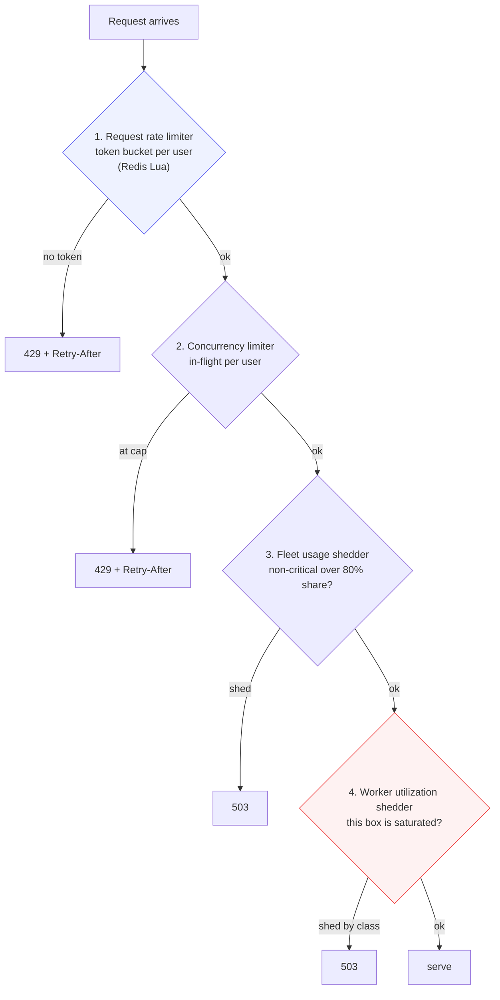
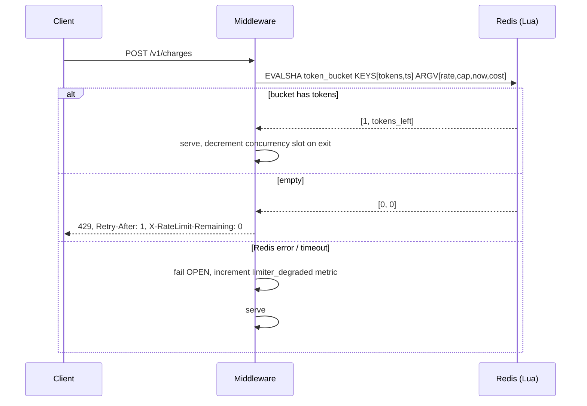

# 06 · Rate limiting and load shedding

!!! abstract "The question"
    **"Design a rate limiter."** Not one limiter — four, each protecting a
    different thing, wired into middleware that can never become the outage it is
    supposed to prevent.

!!! info "Source"
    Stripe Engineering, *Scaling your API with rate limiters* (Paul Tarjan, March
    2017), including the published token-bucket Lua script.

---

## 1. The problem, and the naive design

The naive limiter is a counter in Redis with an expiry:

```python
def allow(user):
    n = redis.incr(f"rl:{user}")
    if n == 1:
        redis.expire(f"rl:{user}", 60)
    return n <= 100        # 100 requests per minute
```

It "works", and it has four problems that show up in production:

| Problem | What it looks like | Consequence |
|---|---|---|
| Fixed window burst | 100 requests at 12:00:59, 100 more at 12:01:00 | **200 requests in one second**, 2× your intended peak |
| No burst allowance | A legitimate batch job that sends 5 requests at once is rejected | angry customers |
| No notion of cost | One endpoint is 50× more expensive than another, both counted the same | the expensive endpoint is what takes you down |
| Only counts requests | The thing that actually saturates is **in-flight work**, not request rate | CPU-bound endpoints melt while the limiter says "all clear" |

Stripe runs **four** limiters because rate is only one of the four ways a fleet
gets overwhelmed.

---

## 2. The numbers that decide the design

| Figure | Value | Consequence |
|---|---|---|
| Request rate limiter | N requests/second per user, with a burst allowance | the workhorse; rejected **millions** of requests per month at Stripe, mostly test-mode scripts |
| Burst capacity | typically **5×** the replenish rate | absorbs flash sales without rejecting |
| Concurrent requests limiter | e.g. **20 in flight** per user | triggered ~**12,000 requests/month** — rare but decisive on CPU-heavy endpoints |
| Fleet usage load shedder | reserve e.g. **20%** of fleet for critical methods | non-critical over their 80% share get **503** |
| Worker utilization shedder | 4 traffic classes, shed in order | only **~100 requests/month** — the last line of defence |
| Redis failure rate | **0.01%** observed | limiter **fails open** and alerts |
| Redis GET round trip | ~0.2–0.5 ms same-AZ | the entire budget for a per-request check |
| Shedding rate | "substantial amount within a few minutes" | slower than this and the system flaps |

The last two rows are the ones interviewers probe: *how fast do you shed, and what
happens when Redis dies?*

---

## 3. The mental model

> **A rate limiter protects one resource from one client; a load shedder protects
> the fleet from the aggregate. Rate limit early and cheaply, shed late and
> brutally, and always fail open when the limiter itself breaks.**

The four limiters, in the order they fire:



Why that order: cheap and precise first (one Redis call), expensive and coarse
last (local state, no network). A shedder that needs a network call is a shedder
that fails when the network is the problem.

---

## 4. The flow chart of one request through the token bucket



---

## 5. Sizing the components

A rate limiter adds a network round trip to every request, so it has two budgets: Redis capacity,
and the milliseconds it is allowed to consume.

| Component | Unit of work | Cost per unit | Peak demand | Provisioned | Headroom |
|---|---|---|---|---|---|
| API pods | 1 `EVAL` + handler | ~2,500 req/s per pod | 100k req/s | 40 pods | 1.5× |
| Redis (cluster) | one Lua `EVAL`, 2 keys | ~150k ops/s per shard | 100k ops/s | 3 shards (33k each) | 4.5× |
| Concurrency limiter | `ZADD` + `ZREM` | 2 ops per request | 20k requests in flight | same cluster | — |
| Fleet shedder | 1 counter read | cached 1 s per pod | 40 reads/s | same cluster | negligible |
| Limiter budget | 1 round trip | ~0.3 ms same-AZ | — | 20 ms timeout, fail open | 60× |

If every request also read the fleet counters from Redis you would triple the op count; caching
them for one second per pod turns 100k ops/s into 40. That is the kind of change that decides
whether one Redis shard is enough.

**Bytes on the wire.**

- API → Redis: 100k ops/s × 220 B command = **22 MB/s in**, ~100 B response = **10 MB/s out**
- The limiter itself never touches the request body — it only needs the account id and a cost

| Benchmark | How to measure | Target | What it tells you |
|---|---|---|---|
| Limiter overhead | p99 with limiter minus p99 without | < 1 ms | it must be invisible |
| Degraded rate | `ratelimit_degraded_total` ÷ requests | < 0.1% | you are running unprotected |
| Redis p99 | client-side command latency | < 5 ms | the limiter is about to be the bottleneck |
| 429 rate per user | p99 across accounts | < 5% | limits set too low, or abuse |
| Shed rate | worker shedder rejections | 0 at steady state | above zero, you are in an incident |

## 6. The algorithm, end to end

Four decisions in a fixed order, each cheaper than the next, with a documented
answer for "the limiter itself is broken". The order matters as much as the
algorithms.

| # | Limiter | Cost | Decision | Failure mode |
|---|---|---|---|---|
| 1 | Request rate | 1 Redis `EVAL` (~0.3 ms) | take `cost` tokens from the bucket; empty → 429 | Redis error → **allow**, increment `degraded` |
| 2 | Concurrency | 1 `ZADD` + `ZREM` | more than N in flight → 429 | error → allow |
| 3 | Fleet usage | 1 cached counter read | non-critical over its share → 503 | stale counter → allow |
| 4 | Worker utilisation | local atomic, 0 network | shed class by class → 503 | cannot fail |

```pseudo
function admit(request):
    if not limiterEnabled: return ALLOW                 # kill switch

    # 1. token bucket, atomic in Lua
    (allowed, left) = eval(tokenBucket, keys = ["{u}:tokens", "{u}:ts"],
                           args = [rate, burst, now, cost(request)])
    if redisError: metric("degraded"); return ALLOW     # fail open
    if not allowed: return REJECT_429(left)

    # 2. in-flight cap for CPU-heavy endpoints
    if inFlight(user) >= 20: return REJECT_429()

    # 3. fleet reservation for critical methods
    if not critical(request) and fleetInflight() > capacity * 0.80:
        return SHED_503()

    # 4. this box, right now
    util = localInflight / localCapacity
    if util > 0.98 and class(request) != CRITICAL: return SHED_503()
    if util > 0.95 and class(request) == GET:      return SHED_503()
    if util > 0.90 and class(request) == TEST:     return SHED_503()

    return ALLOW

function tokenBucket(rate, burst, now, cost):
    tokens = min(burst, stored + (now - lastRefill) * rate)
    allowed = tokens >= cost
    if allowed: tokens -= cost
    store(tokens, now, ttl = 2 * burst / rate)
    return (allowed, tokens)
```

**Invariants.**

- **The limiter is a filter, not a dependency.** Every error path allows the request;
  `ratelimit_degraded_total` is the alarm, not a 500.
- **One round trip per request, bounded at 20 ms.** Anything more expensive belongs in
  a different layer.
- **Shedding and restoring are slow.** Thresholds move a few percent per minute, or the
  system flaps.
- **Critical methods are exempt from steps 3 and 4.** Payments do not queue behind a
  test-mode script.

| Edge case | What the algorithm does |
|---|---|
| Redis down | allow everything, alert, keep serving |
| One user at 10k req/s | their bucket empties; other users' keys hash to other shards |
| Legitimate 5× burst | burst capacity absorbs it; the bucket refills at `rate` |
| Clock skew across pods | `now` comes from the server, and the bucket tolerates a small delta because it stores `lastRefill` |
| Bad limit shipped | kill switch flips the limiter off in seconds, no deploy |

## 7. Build it

### Step 1 — the token bucket, atomically, in Lua

Two keys per user: the token count and the last refill timestamp. The script is
the whole algorithm, and it must be atomic or two concurrent requests both see the
same token.

```lua
-- code/ratelimit/token_bucket.lua
-- KEYS[1] = tokens key, KEYS[2] = timestamp key
-- ARGV[1] = replenish rate (tokens/sec), ARGV[2] = capacity,
-- ARGV[3] = now (unix seconds), ARGV[4] = requested tokens (cost)
local tokens_key = KEYS[1]
local timestamp_key = KEYS[2]

local rate = tonumber(ARGV[1])
local capacity = tonumber(ARGV[2])
local now = tonumber(ARGV[3])
local requested = tonumber(ARGV[4])

local fill_time = capacity / rate
local ttl = math.floor(fill_time * 2)      -- keep the keys alive for 2 fill cycles

local last_tokens = tonumber(redis.call("get", tokens_key))
if last_tokens == nil then last_tokens = capacity end

local last_refreshed = tonumber(redis.call("get", timestamp_key))
if last_refreshed == nil then last_refreshed = 0 end

local delta = math.max(0, now - last_refreshed)
local filled_tokens = math.min(capacity, last_tokens + (delta * rate))
local allowed = filled_tokens >= requested
local new_tokens = filled_tokens
if allowed then new_tokens = filled_tokens - requested end

redis.call("setex", tokens_key, ttl, new_tokens)
redis.call("setex", timestamp_key, ttl, now)

return { allowed and 1 or 0, math.floor(new_tokens) }
```

Note `requested` — that is your **cost**, so a batch endpoint can charge 20 tokens
and a cheap read 1. This one parameter turns a request limiter into a work limiter.

### Step 2 — the middleware, and the fail-open rule

```go
// code/ratelimit/middleware.go (excerpt, full file in repo)
type Limiter struct {
    rdb      redis.UniversalClient
    script   *redis.Script
    rate     float64
    capacity int
    timeout  time.Duration
    enabled  *atomic.Bool        // kill switch, flipped by a feature flag
    degraded prometheus.Counter
}

func (l *Limiter) Allow(ctx context.Context, user string, cost int) Decision {
    if !l.enabled.Load() {
        return Decision{Allowed: true, Reason: "disabled"}
    }
    ctx, cancel := context.WithTimeout(ctx, l.timeout)   // 20ms: never the bottleneck
    defer cancel()

    keys := []string{"rl:" + user + ":tokens", "rl:" + user + ":ts"}
    res, err := l.script.Run(ctx, l.rdb, keys, l.rate, l.capacity, time.Now().Unix(), cost).Slice()
    if err != nil {
        // FAIL OPEN. A rate limiter must never be the reason the API is down.
        l.degraded.Inc()
        return Decision{Allowed: true, Reason: "degraded"}
    }
    allowed := res[0].(int64) == 1
    remaining := res[1].(int64)
    return Decision{Allowed: allowed, Remaining: remaining, Reason: "bucket"}
}

func (l *Limiter) Middleware(next http.Handler) http.Handler {
    return http.HandlerFunc(func(w http.ResponseWriter, r *http.Request) {
        user := auth.UserFrom(r.Context())
        d := l.Allow(r.Context(), user, costOf(r))
        w.Header().Set("X-RateLimit-Remaining", strconv.FormatInt(d.Remaining, 10))
        if !d.Allowed {
            w.Header().Set("Retry-After", "1")
            w.Header().Set("Content-Type", "application/problem+json")
            w.WriteHeader(http.StatusTooManyRequests)
            json.NewEncoder(w).Encode(map[string]any{
                "type":   "rate_limit_error",
                "title":  "Too many requests",
                "detail": "Limit is 100 requests/second with bursts to 500. " +
                    "Batch your requests or back off on 429.",
                "docs": "https://example.com/rate-limits",
            })
            return
        }
        next.ServeHTTP(w, r)
    })
}
```

Three things this middleware gets right that most do not:

- **Fail open** with a metric. Stripe's observed Redis failure rate is 0.01%, and
  they alert on it rather than rejecting traffic.
- **A kill switch** (`enabled`) driven by a feature flag, so a bad limit can be
  turned off in seconds without a deploy.
- **An actionable error body** with the actual limit, the burst allowance and what
  to do about it. A 429 that says nothing generates support tickets.

### Step 3 — the concurrency limiter (protects CPU, not bandwidth)

```python
# code/ratelimit/concurrency.py (excerpt)
# Redis sorted set of in-flight request tokens; score = start timestamp.
ACQUIRE = """
local key = KEYS[1]
local now = tonumber(ARGV[1])
local limit = tonumber(ARGV[2])
local token = ARGV[3]
local stale = now - 60
redis.call('ZREMRANGEBYSCORE', key, '-inf', stale)      -- reap dead workers
if redis.call('ZCARD', key) >= limit then return 0 end
redis.call('ZADD', key, now, token)
redis.call('PEXPIRE', key, 120000)
return 1
"""

def acquire(user: str, token: str, limit: int = 20) -> bool:
    ok = redis.eval(ACQUIRE, 1, f"cc:{user}", time.time(), limit, token)
    return bool(ok)

def release(user: str, token: str) -> None:
    redis.zrem(f"cc:{user}", token)      # always in a finally block
```

The `ZREMRANGEBYSCORE` of stale entries is the safety valve: a crashed process
that never releases its slot must not permanently reduce a user's concurrency.

### Step 4 — the fleet usage shedder (reserve capacity for critical work)

```python
# code/ratelimit/fleet_shed.py (excerpt)
CRITICAL = {"POST /v1/charges", "POST /v1/refunds", "POST /v1/payouts"}
RESERVED_FRACTION = 0.20          # 20% of the fleet is always available for critical

def admit(method_path: str, inflight_total: int, capacity: int) -> bool:
    if method_path in CRITICAL:
        return True                                  # critical never sheds here
    non_critical_share = capacity * (1 - RESERVED_FRACTION)
    return inflight_total <= non_critical_share
```

In production this needs an *aggregate* view, which is why Stripe counts in-flight
requests per class in a Redis cluster. The decision is coarse and deliberately so:
it is an emergency valve, not a fairness mechanism.

### Step 5 — the worker utilization shedder (the last line of defence)

Per-box, no network, four classes shed in order:

```go
// code/ratelimit/worker_shed.go (excerpt)
type Class int
const (
    TestMode Class = iota   // shed first
    Get
    Post
    Critical                // shed last, ideally never
)

func (s *Shedder) Admit(c Class) bool {
    util := s.inflight.Load() / float64(s.capacity)   // 0..1, local atomic counter
    switch {
    case util < 0.90:
        return true
    case util < 0.95:
        return c != TestMode
    case util < 0.98:
        return c == Post || c == Critical
    default:
        return c == Critical
    }
}
```

The critical operational detail, straight from Stripe: **shed and un-shed
slowly**. If you drop test-mode traffic, see utilisation improve, and immediately
bring it back, you flap. Move the thresholds a few percent per minute.

---

## 8. The production layer

### Where to put the limiter

| Placement | Good for | Trade-off |
|---|---|---|
| **In-app middleware** (this chapter) | per-user, per-cost, business-aware limits | one Redis call per request |
| **Envoy / gateway global rate limit** | per-IP, per-route, before your app is even reached | coarse; needs its own Redis and a gRPC service |
| **API Gateway / ALB WAF rate rules** | blunt DoS protection, per-IP | no business context, low ceilings |
| **Cloudflare / CDN** | volumetric attacks | cannot see your user identity |

The answer in an interview: **layered**. CDN for volume, gateway for per-route
ceilings, app middleware for per-user cost-aware limits. Each layer assumes the
one above it may be absent.

### ElastiCache and the cluster-mode gotcha

```hcl
# deploy/terraform/ratelimit/main.tf (abridged)
resource "aws_elasticache_replication_group" "rl" {
  replication_group_id       = "ratelimit"
  description                = "rate limit counters"
  engine                     = "redis"
  engine_version             = "7.1"
  node_type                  = "cache.r7g.large"
  num_node_groups            = 3          # cluster mode: shard by key
  replicas_per_node_group    = 1
  automatic_failover_enabled = true
  multi_az_enabled           = true
  port                       = 6379
  transit_encryption_enabled = true
  at_rest_encryption_enabled = true
  parameter_group_name       = aws_elasticache_parameter_group.rl.name
  apply_immediately          = false
}

resource "aws_elasticache_parameter_group" "rl" {
  family = "redis7"
  parameter { name = "maxmemory-policy" value = "volatile-lru" }  # counters have TTLs
}
```

| Knob | Value | Why |
|---|---|---|
| `num_node_groups` | 3 | cluster mode spreads keys; a single shard is a hot-key single point |
| `maxmemory-policy` | `volatile-lru` | all limiter keys have TTLs; never evict a non-expiring key instead |
| `replicas_per_node_group` | 1 | a shard loss should not open the floodgates |
| Client | cluster-aware (`CLUSTER SLOTS`) | the Lua keys must hash to the same slot |

!!! warning "Cluster mode and Lua"
    A Lua script touching two keys (`tokens` and `ts`) requires both keys in the
    **same hash slot**. Use a hash tag: `rl:{user123}:tokens` and `rl:{user123}:ts`.
    Without the braces, `CROSSSLOT` errors appear only under load, only in
    production, only for some users. Use `{...}` around the user id.

### The app deployment

```yaml
# deploy/ratelimit/deployment.yaml (abridged)
apiVersion: apps/v1
kind: Deployment
metadata: { name: api, namespace: api }
spec:
  replicas: 6
  template:
    spec:
      containers:
        - name: api
          image: ghcr.io/example/api:5.2.0
          args:
            - --ratelimit-rate=100
            - --ratelimit-burst=500
            - --ratelimit-timeout=20ms
            - --ratelimit-fail-open=true
            - --concurrency-limit=20
          env:
            - name: REDIS_ADDR
              valueFrom: { secretKeyRef: { name: ratelimit-redis, key: endpoint } }
          resources:
            requests: { cpu: 500m, memory: 512Mi }
            limits:   { memory: 1Gi }
          readinessProbe:
            httpGet: { path: /ready, port: 8080 }   # must NOT depend on Redis
---
apiVersion: autoscaling/v2
kind: HorizontalPodAutoscaler
metadata: { name: api, namespace: api }
spec:
  scaleTargetRef: { apiVersion: apps/v1, kind: Deployment, name: api }
  minReplicas: 6
  maxReplicas: 40
  metrics:
    - type: Pods
      pods:
        metric: { name: http_inflight_requests }
        target: { type: AverageValue, averageValue: "30" }
```

**The readiness probe must not depend on Redis.** If it does, a Redis blip removes
every pod from the load balancer — the exact outage you were protecting against.

### The five alerts

| Alert | Threshold | Why |
|---|---|---|
| `ratelimit_degraded_total` rate | > 0.1% of requests | the limiter is failing open; you are unprotected |
| 429 rate per user p99 | > 5% | either abuse or a limit set too low |
| Redis command latency p99 | > 5 ms | the limiter is about to become the bottleneck |
| Concurrency limiter rejections | any sustained rise | CPU-bound endpoints are saturating |
| Shed rate from the worker shedder | > 0 | you are in an incident already |

### Failure drills

1. **Kill Redis.** `kubectl scale deploy/ratelimit-redis --replicas=0`. Every
   request must succeed (fail open), `ratelimit_degraded_total` must spike, and the
   readiness probe must stay green.
2. **Burst test.** 1,000 requests in one second from one user: expect exactly
   `burst` successes, the rest 429 with `Retry-After`, and — critically — the fixed
   window bug must not appear (no double burst at the window boundary).
3. **Hot key.** Point 10k requests/s at one user id and confirm only that user is
   limited; cluster-mode sharding must keep other shards unaffected.
4. **Shed and un-shed.** Force worker utilisation to 97% and watch the shed
   escalate class by class, then recover without flapping.
5. **Kill switch.** Flip the feature flag mid-load test; the limiter must stop
   limiting within one config refresh (seconds), with no deploy.

---

## 9. The two-minute answer

> "Rate is only one of four ways a fleet gets overwhelmed, so I'd build four
> limiters that fire in order of cost.
>
> First, a request rate limiter: a token bucket per user in Redis, implemented in
> Lua so the read-modify-write is atomic. Rate N per second with capacity 5× that,
> so a flash sale can burst without a rejection, and each request carries a cost so
> an expensive batch endpoint debits more than a cheap read. That one rejects most
> abuse — at Stripe it rejects millions of requests a month, mostly runaway
> test-mode scripts.
>
> Second, a concurrency limiter, because the thing that actually saturates a
> CPU-bound endpoint is in-flight work, not request rate: 'you may have 20 requests
> in progress', tracked in a Redis sorted set scored by start time, with stale
> entries reaped so a crashed worker doesn't permanently consume a slot.
>
> Third, a fleet usage load shedder that reserves a fraction — say 20% — of the
> fleet for critical methods, and returns 503 for non-critical traffic above its
> share. Fourth, a per-box worker utilization shedder, the last line of defence: no
> network call, four traffic classes, shed test mode first, then GETs, then POSTs,
> and shed gradually so you don't flap.
>
> The two rules that matter most in production: the whole stack fails open — if
> Redis is down, requests pass and you alert, because a limiter must never be the
> reason the API is down; and every limiter has a kill switch behind a feature
> flag, dark-launched first so you can see what it would have blocked before it
> blocks anything."

### Follow-ups you should expect

| Question | The answer they want |
|---|---|
| "Token bucket vs leaky bucket vs sliding window?" | Token bucket for bursts (this is the one to build); sliding window log for strict accuracy at high cardinality cost; fixed window never. |
| "429 or 503?" | 429 for "you, specifically, are too fast" (with `Retry-After`); 503 for "the system is shedding you right now". |
| "Where does the limit live?" | Layered: CDN → gateway → app middleware. The app layer is the only one that knows cost and identity. |
| "How do you set the limit?" | Dark launch, measure the distribution of per-user rates, set it above p99.5 of legitimate traffic, then watch the rejection rate. |
| "Distributed clock skew?" | Never use client clocks; use Redis `TIME` inside the script or pass the server's time, and note that `now` monotonicity matters more than accuracy. |
| "Doesn't the Lua script become a hotspot?" | Yes — one key per user spreads it; a single abusive user is a deliberate single-shard hotspot, which is why cluster mode and per-user key design matter. |

**Code:** `code/ratelimit/` · **Manifests:** `deploy/ratelimit/`, `deploy/terraform/ratelimit/`
