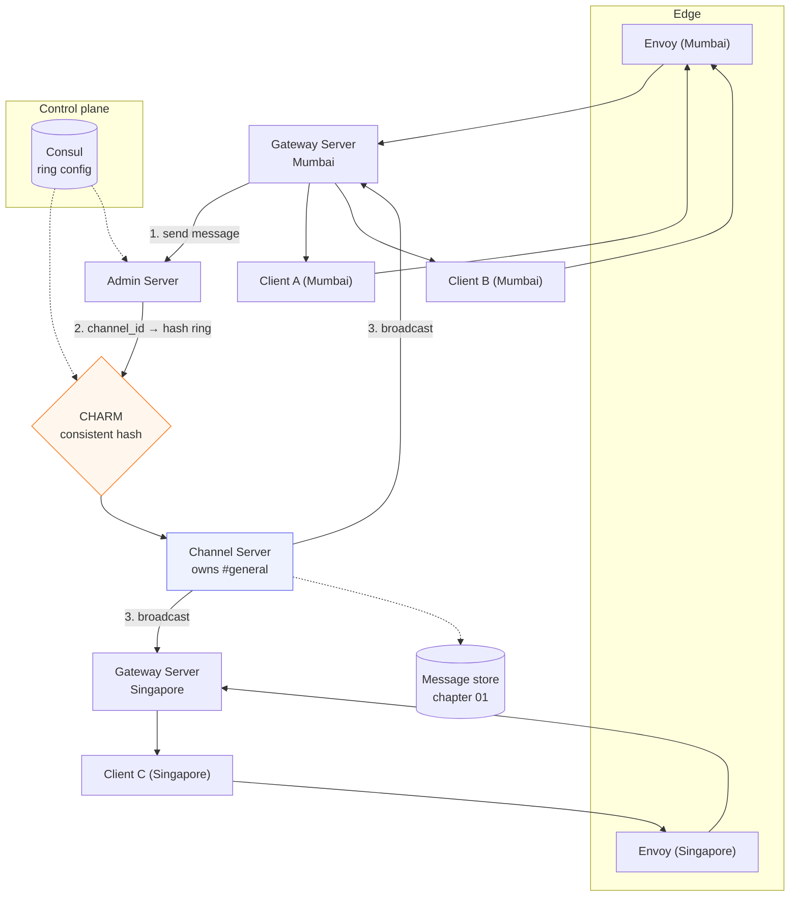

# 07 · Realtime messaging

!!! abstract "The question"
    **"Design Slack."** Millions of channels, millions of concurrent WebSocket
    clients, a message delivered to everyone in the channel in under a second —
    and a server that can die without anyone noticing for more than 20 seconds.

!!! info "Source"
    Slack Engineering, *Real-time Messaging* (Sameera Thangudu, April 2023).

---

## 1. The problem, and the naive design

The naive design is one stateless service with a WebSocket per client and a Redis
pub/sub topic per channel:

```
client --ws--> any gateway pod --subscribe--> redis channel topic
```

It breaks in three specific ways at Slack's scale:

1. **Fan-out is duplicated.** Every gateway pod that has *any* subscriber on a
   channel receives *every* message on that channel. With 16 million channels and
   thousands of pods, that is an enormous amount of redundant delivery.
2. **No memory of channel state.** Whoever holds the socket has no idea which
   messages a client missed; every reconnect needs a full re-sync from the
   database.
3. **No routing primitive.** Redis pub/sub fans out to everyone; you cannot ask
   "which single server owns channel X?" and you cannot move ownership cheaply when
   a pod dies.

Slack's answer is a split into four roles with a consistent hash ring in the
middle, and the split is the design.

---

## 2. The numbers that decide the design

| Figure | Value | Consequence |
|---|---|---|
| Channels per Channel Server host at peak | **~16 million** | one host holds a *lot* of state; it is stateful by design |
| Channels per host (fleet-wide, later stated) | tens of millions | the ring must be sharded and rebalanced continuously |
| CS replacement time | new CS serving in **< 20 seconds** | the blast radius of a node loss is bounded and measurable |
| User-visible impact of a CS loss | elevated delivery latency **< 20 s** | acceptable, and it is the SLO to write down |
| Global message delivery | **~500 ms** end to end | the fan-out path must be 1–2 hops, not a database round trip |
| Core services | 4: Channel, Gateway, Admin, Presence | each has exactly one job |
| CS implementation | Java, in-memory, holds channel history window | fast, and deliberately not durable |
| Chaos test | partition **25%** of Channel Servers | the ring must re-route correctly |

---

## 3. The mental model

> **Split "who owns this conversation" from "who holds this socket". A Channel
> Server owns a channel by consistent hash and is the only writer of its messages;
> Gateway Servers hold sockets by region and subscribe to the channels their users
> care about. One message becomes one write and N subscriptions, not N writes.**

Four roles, one sentence each:

| Role | Stateful? | Job |
|---|---|---|
| **Channel Server (CS)** | yes, in-memory | owns a subset of channels by hash; holds recent history; broadcasts to subscribed gateways |
| **Gateway Server (GS)** | yes, in-memory | holds client WebSocket connections and subscriptions; deployed per region |
| **Admin Server (AS)** | stateless | routes a message from the web app to the right CS |
| **Presence Server (PS)** | in-memory | who is online; users hashed across PSs |

---

## 4. The flow chart



Read the arrows as costs: step 2 is O(1) (a hash lookup), step 3 is O(number of
gateways with a subscriber), and there is no database read on the hot path.

**Transient events** (typing indicators, cursor positions) take a shortcut: the
client sends over its existing WebSocket to the GS, the GS routes straight to the
CS, the CS fans out — never persisted, never through the web app. They are the
highest-volume traffic class and they must not touch storage.

---

## 5. Build it

### Step 1 — the consistent hash ring

```go
// code/realtime/ring.go (excerpt, full file in repo)
type Ring struct {
    mu       sync.RWMutex
    vnodes   []uint64            // sorted virtual node hashes
    owner    map[uint64]string   // vnode hash -> CS address
    vnodesPer int
}

func (r *Ring) Add(addr string) {
    r.mu.Lock()
    defer r.mu.Unlock()
    for i := 0; i < r.vnodesPer; i++ {
        h := xxhash.Sum64String(fmt.Sprintf("%s#%d", addr, i))
        r.owner[h] = addr
        r.vnodes = append(r.vnodes, h)
    }
    sort.Slice(r.vnodes, func(i, j int) bool { return r.vnodes[i] < r.vnodes[j] })
}

func (r *Ring) Owner(channelID string) string {
    r.mu.RLock()
    defer r.mu.RUnlock()
    if len(r.vnodes) == 0 {
        return ""
    }
    h := xxhash.Sum64String(channelID)
    i := sort.Search(len(r.vnodes), func(i int) bool { return r.vnodes[i] >= h })
    if i == len(r.vnodes) {
        i = 0
    }
    return r.owner[r.vnodes[i]]
}
```

Design notes that matter in production:

- **Virtual nodes** (100–200 per physical node) smooth the distribution. Without
  them, 16 million channels land very unevenly.
- **The ring is control-plane data.** It lives in Consul (Slack's choice) or a
  ConfigMap/etcd, and every CS and AS watches it. Never compute it per request.
- **Version the ring.** A message routed with ring v41 to a CS that already
  believes it is v42 can be dropped. Include the version in the routing call and
  reject on mismatch.

### Step 2 — the gateway: sockets, subscriptions, and a bounded outbound queue

```go
// code/realtime/gateway.go (excerpt)
type Client struct {
    userID   string
    conn     *websocket.Conn
    out      chan []byte     // bounded! 256 is a good start
    channels map[string]struct{}
}

func (c *Client) writePump() {
    ticker := time.NewTicker(30 * time.Second)
    defer ticker.Stop()
    for {
        select {
        case msg, ok := <-c.out:
            if !ok {
                c.conn.WriteMessage(websocket.CloseMessage, nil)
                return
            }
            c.conn.SetWriteDeadline(time.Now().Add(10 * time.Second))
            if err := c.conn.WriteMessage(websocket.TextMessage, msg); err != nil {
                return
            }
        case <-ticker.C:
            c.conn.SetWriteDeadline(time.Now().Add(10 * time.Second))
            if err := c.conn.WriteMessage(websocket.PingMessage, nil); err != nil {
                return
            }
        }
    }
}

// Slow consumer policy: never block the fan-out loop for one client.
func (h *Hub) deliver(c *Client, msg []byte) {
    select {
    case c.out <- msg:
    default:
        slowConsumerDrops.Inc()
        // Tell the client to re-sync from history rather than dropping silently.
        c.closeWith(websocket.ClosePolicyViolation, "slow consumer; resync required")
    }
}
```

That `default:` branch is the most important line in the file. A single client on
a bad mobile connection must not be able to stall delivery to 50,000 others.

### Step 3 — subscription, region affinity, and reconnect storms

```go
// code/realtime/subscribe.go (excerpt)
func (h *Hub) OnConnect(c *Client) error {
    chans, err := h.webapp.UserChannels(c.userID)   // all channels this user can see
    if err != nil {
        return err
    }
    // Subscribe to each owning CS asynchronously, with a cap on concurrency.
    sem := make(chan struct{}, 32)
    var wg sync.WaitGroup
    for _, ch := range chans {
        wg.Add(1)
        sem <- struct{}{}
        go func(ch string) {
            defer wg.Done()
            defer func() { <-sem }()
            owner := h.ring.Owner(ch)
            if err := h.csClient.Subscribe(owner, ch, c.id); err != nil {
                h.retrySubscribe(owner, ch, c.id)   // bounded retries with jitter
            }
        }(ch)
    }
    wg.Wait()
    return nil
}
```

Reconnect behaviour, learned the hard way across the industry:

- **Jitter the reconnect delay** (`base * (1 + rand())`). After a regional blip,
  every client reconnects at once; without jitter you DDoS yourself.
- **Resume, don't re-sync.** Send `last_seen_message_id` on reconnect; the CS
  replays the delta from its in-memory history window, and only falls back to the
  database if the gap is too large.
- **Drain before death.** On `SIGTERM`, stop accepting connections, send a
  `reconnect: true` control frame, and let clients move to another region.

### Step 4 — the channel server

```go
// code/realtime/channelserver.go (excerpt)
type ChannelServer struct {
    ring        *Ring
    version     int
    mu          sync.RWMutex
    history     map[string]*ringBuffer   // channel -> last N messages, in memory
    subscribers map[string]map[string]struct{}  // channel -> gateway ids
}

func (s *ChannelServer) Publish(channelID string, msg Message, ringVersion int) error {
    if ringVersion != s.version {
        return ErrRingVersionMismatch          // caller re-reads the ring and retries
    }
    if s.ring.Owner(channelID) != s.addr {
        return ErrNotOwner                     // never write a channel you don't own
    }
    s.mu.Lock()
    s.history[channelID].Append(msg)
    subs := s.subscribers[channelID]
    s.mu.Unlock()

    payload, _ := json.Marshal(msg)
    var wg sync.WaitGroup
    for gw := range subs {                     // fan out to gateways, in parallel
        wg.Add(1)
        go func(gw string) {
            defer wg.Done()
            s.gwClient.Send(gw, channelID, payload)   // bounded, with timeout
        }(gw)
    }
    wg.Wait()
    return nil
}
```

Two invariants worth writing in the code as comments: **a CS writes only the
channels it owns**, and **a CS never blocks on a slow gateway** (bounded queue per
gateway connection, same policy as clients).

---

## 6. The production layer

### Channel servers: StatefulSet, not Deployment

```yaml
# deploy/realtime/channelserver-statefulset.yaml (abridged)
apiVersion: apps/v1
kind: StatefulSet
metadata: { name: cs, namespace: realtime }
spec:
  serviceName: cs-headless
  replicas: 12
  podManagementPolicy: Parallel
  selector: { matchLabels: { app: cs } }
  template:
    metadata:
      labels: { app: cs }
      annotations:
        prometheus.io/scrape: "true"
        prometheus.io/port: "9090"
    spec:
      terminationGracePeriodSeconds: 45
      topologySpreadConstraints:
        - maxSkew: 1
          topologyKey: topology.kubernetes.io/zone
          whenUnsatisfiable: DoNotSchedule
          labelSelector: { matchLabels: { app: cs } }
      containers:
        - name: cs
          image: ghcr.io/example/channelserver:2.7.1
          args:
            - --vnodes=160
            - --history-window=500
            - --ring-config=/etc/ring/ring.json
            - --max-gateway-inflight=200
          ports: [{ containerPort: 9090 }, { containerPort: 7000 }]
          resources:
            requests: { cpu: "2", memory: 6Gi }
            limits:   { memory: 8Gi }
          env:
            - name: POD_NAME
              valueFrom: { fieldRef: { fieldPath: metadata.name } }
          lifecycle:
            preStop:
              exec: { command: ["/bin/sh", "-c", "/app/drain --timeout=30s"] }
---
apiVersion: policy/v1
kind: PodDisruptionBudget
metadata: { name: cs, namespace: realtime }
spec:
  maxUnavailable: 1          # never lose two ring members to one rollout
  selector: { matchLabels: { app: cs } }
---
apiVersion: v1
kind: Service
metadata: { name: cs-headless, namespace: realtime }
spec:
  clusterIP: None
  publishNotReadyAddresses: true
  selector: { app: cs }
  ports: [{ port: 7000, name: grpc }]
```

### Gateway servers: per region, scaled on connections

```yaml
# deploy/realtime/gateway-deployment.yaml (abridged)
apiVersion: apps/v1
kind: Deployment
metadata: { name: gw, namespace: realtime }
spec:
  replicas: 8
  strategy:
    rollingUpdate: { maxUnavailable: 0, maxSurge: 2 }   # never drop live sockets
  template:
    spec:
      containers:
        - name: gw
          image: ghcr.io/example/gateway:2.7.1
          args: ["--region=ap-south-1", "--max-conns=60000", "--outbound-queue=256"]
          ports: [{ containerPort: 8080 }]
          resources:
            requests: { cpu: "1", memory: 2Gi }
            limits:   { memory: 4Gi }
          readinessProbe:
            httpGet: { path: /ready, port: 8080 }        # ready = ring loaded + CS reachable
            periodSeconds: 5
          lifecycle:
            preStop:
              exec: { command: ["/bin/sh", "-c", "sleep 20 && /app/drain"] }
---
apiVersion: autoscaling/v2
kind: HorizontalPodAutoscaler
metadata: { name: gw, namespace: realtime }
spec:
  scaleTargetRef: { apiVersion: apps/v1, kind: Deployment, name: gw }
  minReplicas: 8
  maxReplicas: 60
  metrics:
    - type: Pods
      pods:
        metric: { name: gateway_active_connections }
        target: { type: AverageValue, averageValue: "45000" }
  behavior:
    scaleUp:   { stabilizationWindowSeconds: 60 }
    scaleDown: { stabilizationWindowSeconds: 900 }   # sockets are expensive to move
```

| Knob | Value | Why |
|---|---|---|
| `maxUnavailable: 0` on GW rollout | always | a rollout must not disconnect users |
| `terminationGracePeriodSeconds: 45` | 45 s | time to send "reconnect" frames and let clients move |
| HPA on connections, not CPU | 45,000/pod | WebSocket servers are memory- and FD-bound, not CPU-bound |
| `scaleDown` window | 900 s | avoid churning 60k sockets on a 2-minute dip |
| `publishNotReadyAddresses: true` | on CS headless | the ring must be complete before the first request |
| PDB `maxUnavailable: 1` | on CS | the ring can survive one member at a time |

### Alerts

| Alert | Threshold | Why |
|---|---|---|
| `cs_ring_version_mismatch_total` | > 0 sustained | routing is racing a ring change; messages can be lost |
| `cs_owner_rejects_total` | > 0 sustained | a CS is receiving channels it does not own |
| Delivery p99 | > 500 ms | the fan-out SLO |
| `gateway_slow_consumer_drops` | > 0.1% of clients | clients are being closed for slowness |
| `cs_subscriber_count` skew | max/avg > 2 | the hash ring is unbalanced |
| Reconnect rate | > 5%/min | a region or CS is failing |

### Failure drills

1. **Kill one CS.** `kubectl delete pod cs-3`. Watch the ring re-assign its
   channels, gateways re-subscribe, and delivery latency recover. Time it — it must
   be well under the 20-second target.
2. **Partition 25% of CSs** (Slack's own chaos test): cordon and drain three of
   twelve, then send traffic. Verify no message loss, and measure the latency
   window.
3. **Slow consumer.** Connect a client that never reads, then broadcast 10k
   messages. It must be disconnected and told to resync; other clients unaffected.
4. **Reconnect storm.** Kill a gateway pod with 60k connections and confirm the
   jittered reconnect does not spike CS CPU beyond a few percent.
5. **Ring version race.** Deploy a ring change under load; assert zero
   `ring_version_mismatch` errors after the drain completes.

---

## 7. The two-minute answer

> "Slack's design separates ownership of a conversation from ownership of a
> socket. Channel Servers are stateful and in-memory, and each one owns a subset of
> channels by consistent hash — at peak, about 16 million channels per host. They
> hold a recent history window and are the only writer for their channels. Gateway
> Servers hold client WebSockets and are deployed per region so a client connects
> to its nearest one. An Admin Server is stateless and routes a message from the
> web app to the CS that owns the channel, and Presence Servers track who's online,
> hashed per user.
>
> A message takes one write and N subscription deliveries: client to web app to
> Admin Server, which hashes the channel ID to find the CS, and the CS broadcasts
> to every gateway that has a subscriber. Global delivery is about 500 ms. Typing
> indicators skip all of that — the gateway routes straight to the CS and nothing is
> persisted, because it's the highest-volume traffic class.
>
> The hash ring is managed by CHARM ring managers and published through Consul, so
> a replacement CS is serving in under 20 seconds and the teams whose channels lived
> there see elevated latency for less than 20 seconds. That's the blast radius, and
> it's why they run a chaos programme that deliberately partitions 25% of channel
> servers.
>
> In my implementation the details I'd get right: virtual nodes for even
> distribution, a ring version carried in every routing call so a CS rejects
> messages routed with a stale ring, bounded outbound queues per client so one slow
> consumer can't stall fan-out, jittered client reconnects, and a StatefulSet with a
> PodDisruptionBudget of maxUnavailable 1 for the CS tier."

### Follow-ups you should expect

| Question | The answer they want |
|---|---|
| "Why not Redis pub/sub for everything?" | It fans out to every subscriber, so each gateway receives every message on a channel even if it has one subscriber; and it has no notion of ownership to move on failure. |
| "What happens to messages during a CS failover?" | The CS is a cache of history, not the source of truth — messages are persisted (chapter 01); the client resumes with `last_seen_message_id` and the gap is filled from storage. |
| "How do you scale to a new region?" | Deploy GS per region (they're the only region-scoped role); CS stays in one region and cross-region fan-out is a gateway-to-gateway hop. |
| "How many channels per pod?" | Bound it by memory: history window × messages × channels. 16 M channels with a 500-message window is not small — measure, then set a per-pod ceiling and add pods. |
| "What about ordering?" | One owner per channel gives you a single writer, which gives you ordering for free. That is the real reason for the hash ring. |

**Code:** `code/realtime/` · **Manifests:** `deploy/realtime/`
