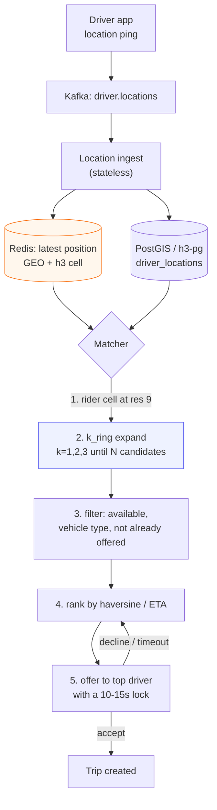

# 08 · Geospatial matching

!!! abstract "The question"
    **"Design driver matching for Uber."** Find the nearest available driver to a
    rider in milliseconds, at city scale, with a spatial index that is cheap to
    update and cheap to query.

!!! info "Source"
    Uber Engineering, *H3: Uber's Hexagonal Hierarchical Spatial Index*
    (Isaac Brodsky, 2018) and the H3 documentation's cell statistics tables.

---

## 1. The problem, and the naive design

The naive spatial query is a bounding box over a lat/lng index:

```sql
SELECT * FROM drivers
WHERE lat BETWEEN :lat - 0.01 AND :lat + 0.01
  AND lng BETWEEN :lng - 0.01 AND :lng + 0.01
  AND available = true;
```

It fails in ways that are not obvious until you run it:

| Problem | Why |
|---|---|
| Two-column index, one dimension | a B-tree on `(lat, lng)` filters well on latitude and then scans every longitude at that latitude |
| Box ≠ circle | the corners of the box are up to √2 further away than the edges, so you get irrelevant candidates |
| No hierarchy | "expand the search radius until you find a driver" becomes a loop of ever-larger boxes with ever-worse performance |
| No uniformity | the same box has 4 drivers in a suburb and 400 at an airport; your candidate set size is unpredictable |
| No sharding story | you cannot hash a bounding box; you *can* hash a cell id |

The insight: **discretise space first, then everything becomes a key-value
problem.** That is what H3 does — it tiles the earth with hexagons on a
hierarchical grid, so a location becomes a 64-bit cell ID you can index, hash,
shard and compare.

---

## 2. The numbers that decide the design

H3 has 16 resolutions (0–15). These are the ones that matter for matching.

| Res | Avg hexagon area | Total cells | Useful for |
|---|---|---|---|
| 5 | 252.9 km² | 2,016,842 | metro-area partitioning |
| 6 | 36.1 km² | 14,117,882 | city district |
| **7** | **5.16 km²** | **98,825,162** | city zone / surge zone |
| 8 | 0.737 km² | — | neighbourhood candidate search |
| **9** | **0.105 km²** | — | **driver position index (≈ a few blocks)** |
| 10 | 0.0150 km² | — | precise pickup point |

Other numbers to have ready:

| Fact | Value | Consequence |
|---|---|---|
| Average hexagon edge length at res 7 | ~1.4 km | the "walk to the corner" distance |
| Pentagons | exactly **12 at every resolution** | all in the ocean; handle them, don't special-case them everywhere |
| Children per cell | 7 for a hexagon, 6 for a pentagon | `h3.cell_to_children()` |
| `k_ring(cell, 1)` | 7 cells (self + 6 neighbours) | one ring at res 9 ≈ 0.7 km² of coverage |
| `k_ring(cell, 3)` | 37 cells | ≈ 4 km², a typical first search at res 9 |
| Cell ID size | 64-bit integer | indexes like a `bigint`, shards like a hash key |
| Position update rate | ~1 update per driver per 4 s | 100k drivers ≈ 25k writes/s per city |

Why hexagons and not squares: a hexagon has exactly 6 equidistant neighbours, so
"expand by one ring" adds a uniform band of distance. A square grid has 4
neighbours at distance 1 and 4 at distance √2, which makes ring expansion lumpy
and biases your candidate set toward diagonals.

---

## 3. The mental model

> **Turn geography into a 64-bit key, then use the database you already know.
> Store drivers by cell at a fine resolution, search by expanding rings at that
> resolution, and shard the whole thing by city.**

The three-part recipe:

1. **Index at res 9** (~0.1 km²): fine enough that a cell holds few drivers, coarse
   enough that a ring query returns a usable candidate set.
2. **Query with `k_ring`**, expanding 1 → 2 → 3 rings until you have enough
   candidates, with a hard cap.
3. **Rank by real distance/ETA**, not by ring, because ring distance is
   quantised.

---

## 4. The flow chart



---

## 5. Sizing the components

Location updates dominate the write path by two orders of magnitude over matching, so the system is
sized for pings and only *budgeted* for matches.

| Component | Unit of work | Cost per unit | Peak demand | Provisioned | Headroom |
|---|---|---|---|---|---|
| Location ingest | 1 driver ping | 60 B, every ~4 s | 100k drivers = **25k pings/s** | 4 pods | 2× |
| Redis geo | `GEOADD` / `SREM`+`SADD` | ~100k ops/s per shard | 25k ops/s | 3 shards, by city | 4× |
| Postgres upsert | 1 row upsert | ~5k rows/s per node | 25k/s, batched every 5 s | 1 × `r6g.4xlarge` | 5× |
| Matcher | 1 ring query, ≤ 40 candidates | 2 ms p99 on Redis | 500 matches/s per city | 9 pods | 6× |
| Offer lock | `SET NX EX` | 0.2 ms | 500/s | same Redis | — |

A ping every four seconds from 100,000 drivers is 25,000 writes a second per city. Sending that
straight to Postgres would be the whole database budget spent on positions nobody reads; batching
to one upsert every five seconds cuts it to 5,000 rows/s and leaves the primary for trips.

**Bytes on the wire.**

- driver → ingest: 25k pings/s × 60 B = **1.5 MB/s**
- ingest → Redis: 25k ops/s × 80 B = **2 MB/s**
- ingest → Postgres: 5k rows/s × 120 B = **0.6 MB/s** after batching
- matcher → client: 500 matches/s × 2 KB candidate list = **1 MB/s**

| Benchmark | How to measure | Target | What it tells you |
|---|---|---|---|
| Match p99 | histogram in the matcher | < 50 ms | riders are waiting |
| Zero-candidate rate | matches returning 0 rows | < 2% | supply is thin, or the index is stale |
| Ingest lag | now − last ping timestamp | < 15 s | you are matching ghosts |
| Offer acceptance | accepted ÷ offered | > 60% | ETAs are wrong, or the wrong drivers are offered |
| Double offers | offers to one driver in one window | 0 | the `SET NX` lock is working |

## 6. The algorithm, end to end

One rider, one request: find candidates by expanding rings, rank by real distance,
offer with an atomic lock, and give up cleanly. The whole thing is bounded work per
request — that is the design goal.

| # | Who | What happens | If this step fails |
|---|---|---|---|
| 1 | Driver app | pings position every ~4 s | next ping fixes it |
| 2 | Ingest | `GEOADD`/`SADD` into the city's Redis, batch-upsert to Postgres every 5 s | ingest lag alarm at 15 s |
| 3 | Rider | requests a match for `(lat, lng, city)` | — |
| 4 | Matcher | `cell = h3(lat, lng, res 9)` | pure function |
| 5 | Matcher | `k_ring(cell, 1)` → 7 cells → candidates; not enough → `k=2, 3, 5`, capped | cap reached → return what exists |
| 6 | Matcher | filters: available, vehicle type, fresh ping (< 2 min), not already offered | — |
| 7 | Matcher | ranks by haversine/ETA, takes the top N (≤ 40) | — |
| 8 | Matcher | `SET NX` on `offer:<driver>` with a 12 s TTL | lock lost → next candidate |
| 9 | Driver | accepts → trip created; declines or times out → lock expires, next candidate | — |

```pseudo
function match(rider):
    cell = h3.cellAt(rider.lat, rider.lng, RES_INDEX)      # res 9, ~0.105 km2

    for k in [1, 2, 3, 5]:                                 # 7, 37, 91, 271 cells
        cells = h3.gridDisk(cell, k)
        drivers = redis.cellMembers(cells)                 # hot path, ~0.5 ms
        drivers = filter(drivers, available, vehicleMatch,
                         pingAge < 2min, notOffered)
        if length(drivers) >= 10:
            break

    ranked = sort(drivers, by = haversine(rider, driver))[:40]
    for d in ranked:
        if redis.set("offer:" + d.id, rider.id, nx = true, ex = 12s):
            notify(d, rider)
            return WAIT_FOR_ANSWER
    return NO_DRIVER                        # explicit, not a hang

function accept(rider, driver):
    if redis.get("offer:" + driver.id) != rider.id: return STALE_OFFER
    redis.del("offer:" + driver.id)                     # idempotent on the offer id
    createTrip(rider, driver)                           # chapters 04/05 apply here
```

**Invariants.**

- **Bounded work per request.** Ring expansion is capped; candidate set is capped;
  offer attempts are capped. No unbounded scan can be triggered by a client.
- **One live offer per driver.** `SET NX` is the only primitive that can promise that.
- **Position and cell never disagree.** They are written in one statement, because a
  stale cell makes a driver unmatchable.
- **Stale pings never win.** A two-minute freshness filter is the difference between a
  ghost driver and a real one.

| Edge case | What the algorithm does |
|---|---|
| Airport hotspot: 2,000 drivers in one cell | candidate cap + ranking; latency stays flat |
| Two riders, one driver | exactly one `SET NX` wins; the other falls through |
| Driver goes offline mid-offer | lock expires in 12 s; rider re-matches |
| Rider on a cell boundary | `k_ring` includes neighbours; no candidate is missed |
| No drivers at all | explicit `NO_DRIVER` after the cap, not a long scan |

## 7. Build it

### Step 1 — index a position

```python
# code/geo/index.py (excerpt)
import h3

RES_INDEX = 9       # driver position index
RES_ZONE  = 7       # surge / demand zones

def cell_for(lat: float, lng: float, res: int = RES_INDEX) -> str:
    return h3.latlng_to_cell(lat, lng, res)

# Mumbai: Bandra Kurla Complex
c = cell_for(19.0670, 72.8680)
print(c)                    # e.g. '8931952d0cbffff'
print(h3.cell_to_latlng(c)) # cell centre
print(h3.get_resolution(c)) # 9
```

The cell ID is the whole point: it is a stable 64-bit key derived from position.
Two drivers in the same cell share a key, so "find drivers near here" is an
equality lookup on an indexed integer column.

### Step 2 — the table

```sql
-- code/geo/schema.sql
CREATE EXTENSION IF NOT EXISTS h3;          -- h3-pg: H3 functions in Postgres
CREATE EXTENSION IF NOT EXISTS postgis;

CREATE TABLE driver_locations (
    driver_id    uuid PRIMARY KEY,
    city_id      text        NOT NULL,
    cell_r9      bigint      NOT NULL,      -- h3 cell at res 9
    cell_r7      bigint      NOT NULL,      -- h3 cell at res 7 (zones, surge)
    position     geography(Point, 4326) NOT NULL,
    available    boolean     NOT NULL DEFAULT true,
    vehicle_type text        NOT NULL,
    updated_at   timestamptz NOT NULL DEFAULT now()
);

-- The index that makes matching fast: equality on cell, then a cheap filter.
CREATE INDEX driver_cell_r9_idx ON driver_locations (cell_r9)
    WHERE available;

-- For "how many drivers in this zone" and surge calculations
CREATE INDEX driver_cell_r7_idx ON driver_locations (cell_r7);

-- Optional: a GiST index for true radius queries when you need them
CREATE INDEX driver_position_idx ON driver_locations USING gist (position);
```

!!! warning "Keep the cell column in sync with the position, in one statement"
    ```sql
    UPDATE driver_locations
       SET position = ST_SetSRID(ST_MakePoint($2, $1), 4326)::geography,
           cell_r9  = h3_lat_lng_to_cell(ST_SetSRID(ST_MakePoint($2, $1), 4326)::point, 9),
           cell_r7  = h3_lat_lng_to_cell(ST_SetSRID(ST_MakePoint($2, $1), 4326)::point, 7),
           updated_at = now()
     WHERE driver_id = $3;
    ```
    A cell that disagrees with the position is a driver who can never be matched,
    and it is invisible until a rider complains.

### Step 3 — the matching query

```sql
-- code/geo/match.sql
-- $1 lat, $2 lng, $3 city_id, $4 limit, $5 k (ring size)
WITH rider AS (
  SELECT h3_lat_lng_to_cell(ST_SetSRID(ST_MakePoint($2, $1), 4326)::point, 9) AS cell
),
ring AS (
  SELECT h3_grid_disk(r.cell, $5) AS cells FROM rider r
)
SELECT d.driver_id,
       d.vehicle_type,
       ST_Distance(d.position,
                   ST_SetSRID(ST_MakePoint($2, $1), 4326)::geography) AS meters,
       d.cell_r9
FROM driver_locations d
JOIN ring ON d.cell_r9 = ANY(ring.cells)
WHERE d.city_id = $3
  AND d.available
  AND d.updated_at > now() - interval '2 minutes'   -- ignore stale pings
ORDER BY meters ASC
LIMIT $4;
```

Notes that matter:

- **`h3_grid_disk(cell, k)`** returns the cell plus every cell within `k` steps.
  `k=1` is 7 cells, `k=3` is 37, `k=5` is 91. Expanding in rings is O(k²) cells,
  not O(area of a box).
- **`city_id` is in the WHERE clause** because the table is sharded by city. It is
  not optional; a cross-city ring is meaningless and slow.
- **`updated_at > now() - 2 minutes`** is the stale-ping filter. A driver who went
  offline without a clean disconnect must not be offered a trip.

### Step 4 — the expansion loop, in the matcher

```python
# code/geo/match.py (excerpt, full file in repo)
def find_candidates(rider_lat, rider_lng, city, want=10, max_k=5):
    cell = h3.latlng_to_cell(rider_lat, rider_lng, RES_INDEX)
    for k in (1, 2, 3, max_k):
        rows = db.query(MATCH_SQL, rider_lat, rider_lng, city, want, k)
        if len(rows) >= want:
            return rows, k
    return rows, max_k        # best effort: fewer than `want`, maybe zero

def offer_trip(rider, driver, ttl_seconds=12):
    """Exactly-once offer, using Redis SET NX as the lock."""
    ok = redis.set(f"offer:{driver.id}", rider.id, nx=True, ex=ttl_seconds)
    if not ok:
        return None            # someone else got there first
    try:
        return notify_driver(driver, rider)
    except Exception:
        redis.delete(f"offer:{driver.id}")
        raise
```

The offer lock is where geo matching meets chapters 04 and 05: **two riders
offering the same driver** is a duplicate-charge-class bug, so the lock must be
atomic (`SET NX EX`), and accepting a trip must be idempotent on the offer id.

### Step 5 — the fast path: Redis for latest positions

Postgres is the source of truth and the analytics store. For the matching hot
path, keep the last position per driver in Redis, because a location ping arrives
every ~4 seconds per driver and you do not want that write amplification on your
relational database.

```bash
# code/geo/redis.sh
# Per city, a geo set of available drivers (for radius queries)
GEOADD drivers:ap-south-1:available 72.8680 19.0670 driver-abc
# Nearest 10 within 3 km
GEOSEARCH drivers:ap-south-1:available FROMLONLAT 72.8680 19.0670 BYRADIUS 3 km ASC COUNT 10

# Or a per-cell set, if you want exact ring semantics and cheap sharding
SADD cell:8931952d0cbffff driver-abc
SMEMBERS cell:8931952d0cbffff
```

| Approach | Query latency | Update cost | Best for |
|---|---|---|---|
| PostGIS + `h3_grid_disk` | ~2–10 ms | one indexed UPDATE | source of truth, complex filters |
| Redis `GEOSEARCH` | ~0.2–1 ms | one `GEOADD` | the hot matching path |
| Redis per-cell sets | ~0.2 ms | `SADD` + `SREM` on cell change | ring expansion with explicit control |
| H3 + in-memory grid in the matcher | ~0.1 ms | stream consumption | extreme scale, per-city shard |

The realistic production answer is **Redis for candidates, PostGIS for truth**,
reconciled by the location-ingest service.

---

## 8. The production layer

### Shard by city, not by cell

```yaml
# deploy/geo/matcher-deployment.yaml (abridged)
apiVersion: apps/v1
kind: Deployment
metadata: { name: matcher, namespace: geo }
spec:
  replicas: 9                      # one per active city shard, plus headroom
  template:
    spec:
      containers:
        - name: matcher
          image: ghcr.io/example/matcher:1.9.3
          args:
            - --city=ap-south-1
            - --ring-expansion=1,2,3,5
            - --max-candidates=40
            - --offer-ttl=12s
          env:
            - { name: REDIS_URL, valueFrom: { secretKeyRef: { name: geo-redis, key: url } } }
            - { name: PG_URL,    valueFrom: { secretKeyRef: { name: geo-pg,    key: url } } }
          resources:
            requests: { cpu: "1", memory: 1Gi }
            limits:   { memory: 2Gi }
          readinessProbe:
            httpGet: { path: /ready, port: 8080 }
---
apiVersion: autoscaling/v2
kind: HorizontalPodAutoscaler
metadata: { name: matcher, namespace: geo }
spec:
  scaleTargetRef: { apiVersion: apps/v1, kind: Deployment, name: matcher }
  minReplicas: 9
  maxReplicas: 36
  metrics:
    - type: Pods
      pods:
        metric: { name: match_duration_seconds_p99 }
        target: { type: AverageValue, averageValue: "50m" }   # 50 ms
```

| Decision | Value | Why |
|---|---|---|
| Shard key | `city_id` | geography is naturally partitioned; cross-city matching does not exist |
| Index resolution | 9 | ~0.1 km², a few blocks |
| Zone resolution | 7 | ~5 km², matches surge-zone granularity |
| Ring expansion | 1 → 2 → 3 → 5, capped | bounded work per request; the cap is the safety valve |
| Offer TTL | 12 s | long enough to answer, short enough not to block a driver |
| Stale ping cutoff | 2 min | protects against ghost drivers |
| Replicas | per city | a Mumbai spike must not slow down Bengaluru |

### Terraform for the data tier

```hcl
# deploy/terraform/geo/main.tf (abridged)
resource "aws_db_instance" "geo" {
  identifier        = "geo-postgis"
  engine            = "postgres"
  engine_version    = "16.4"
  instance_class    = "db.r6g.4xlarge"
  storage_type      = "io2"
  iops              = 16000
  multi_az          = true
  # h3-pg is installed via a custom parameter group option / init container
  parameter_group_name = aws_db_parameter_group.geo.name
}

resource "aws_elasticache_replication_group" "geo" {
  replication_group_id       = "geo-positions"
  engine                     = "redis"
  engine_version             = "7.1"
  node_type                  = "cache.r7g.xlarge"
  num_node_groups            = 3      # shard by city
  replicas_per_node_group    = 1
  automatic_failover_enabled = true
  multi_az_enabled           = true
}
```

### The four alerts

| Alert | Threshold | Why |
|---|---|---|
| Match p99 latency | > 100 ms | riders are waiting; expansion is not converging |
| Candidates returned = 0 | > 2% of requests | supply is thin, or the index is stale |
| Location ingest lag | > 15 s | drivers are being matched on stale positions |
| Offer acceptance rate | drops > 20% | ETA estimates are wrong or offers are going to the wrong drivers |

### Failure drills

1. **Airport hotspot.** Put 2,000 drivers in one res-9 cell and match 1,000 riders.
   Watch candidate-set size explode; confirm the `max-candidates` cap and the
   ranking step keep latency flat. This is the classic H3 production failure.
2. **Stale index.** Stop the ingest stream and keep matching. Expect the stale
   filter to return zero candidates, and confirm riders get a clear "no drivers
   nearby" instead of being matched to ghosts.
3. **Ring boundary.** Match riders exactly on a cell boundary and verify that
   `k_ring` includes the neighbouring cells (a bug here loses half your candidates
   on every boundary).
4. **Double offer.** Send two riders with the same nearest driver concurrently.
   Exactly one `SET NX` must win; the other must fall through to the next
   candidate.
5. **City shard loss.** Kill the Redis shard for one city and confirm other cities
   are unaffected and that one city degrades to the Postgres path rather than
   failing.

---

## 9. The two-minute answer

> "The trick is to stop thinking in coordinates and start thinking in cells. H3
> tiles the earth with hexagons on a hierarchy of 16 resolutions — about 5.2 km² at
> resolution 7, 0.74 km² at 8, and 0.105 km² at 9, which is a few city blocks. Every
> location becomes a 64-bit cell ID, so 'who is near here' becomes an indexed
> equality lookup plus a ring expansion instead of a two-dimensional bounding-box
> scan.
>
> I'd index driver positions at resolution 9 because a cell holds few drivers but a
> ring of a few cells covers a usable area, and use resolution 7 for surge and
> demand zones since that's about 5 km². The query is `h3_grid_disk(cell, k)` for k
> equal to 1, 2, 3, expanding until I have enough candidates with a hard cap —
> 7 cells, then 37, then 91 — and then I rank by actual haversine distance or ETA,
> because ring distance is quantised and a driver in a neighbouring cell can be
> closer than one in the far corner of your own.
>
> Hexagons rather than squares because all six neighbours are equidistant, so
> expanding a ring adds a uniform band of distance instead of biasing toward
> diagonals.
>
> Storage: PostGIS or h3-pg as the source of truth with a `bigint` cell column and
> a partial index on available drivers, and Redis for the hot path — a geo set per
> city, or per-cell sets — because positions update every few seconds per driver
> and that write rate shouldn't hit a relational database. Shard by city, because
> cross-city matching doesn't exist.
>
> The bugs I'd watch: an index cell that disagrees with the position makes a driver
> unmatchable; a stale ping creates ghost drivers, so filter on a two-minute
> freshness window; the airport hotspot where one cell has thousands of drivers, so
> cap the candidate set; and two riders offering the same driver, which needs an
> atomic `SET NX` lock on the offer, idempotent on offer ID."

### Follow-ups you should expect

| Question | The answer they want |
|---|---|
| "Why not geohash / S2?" | Geohash has rectangular distortion and awkward neighbours; S2 is excellent (Google's choice) — the H3 argument is uniform neighbour distance and 12 pentagons handled uniformly. |
| "How do you handle the 12 pentagons?" | They exist at every resolution, are all in the ocean, and have 5 neighbours and 6 children instead of 6/7. Handle them in generic code; never special-case by ID. |
| "How do you pick the resolution?" | Cell area ≈ your desired candidate granularity. Too coarse and a cell has hundreds of drivers; too fine and you expand rings forever. |
| "What about the return trip / pooling?" | Same index; the difference is the cost function in the ranking step (detour, capacity, shared-ride savings). |
| "How do you compute ETA?" | Road-network routing (OSRM/Valhalla or a commercial API), not haversine — haversine is the filter, ETA is the rank. |

**Code:** `code/geo/` · **Manifests:** `deploy/geo/`, `deploy/terraform/geo/`
