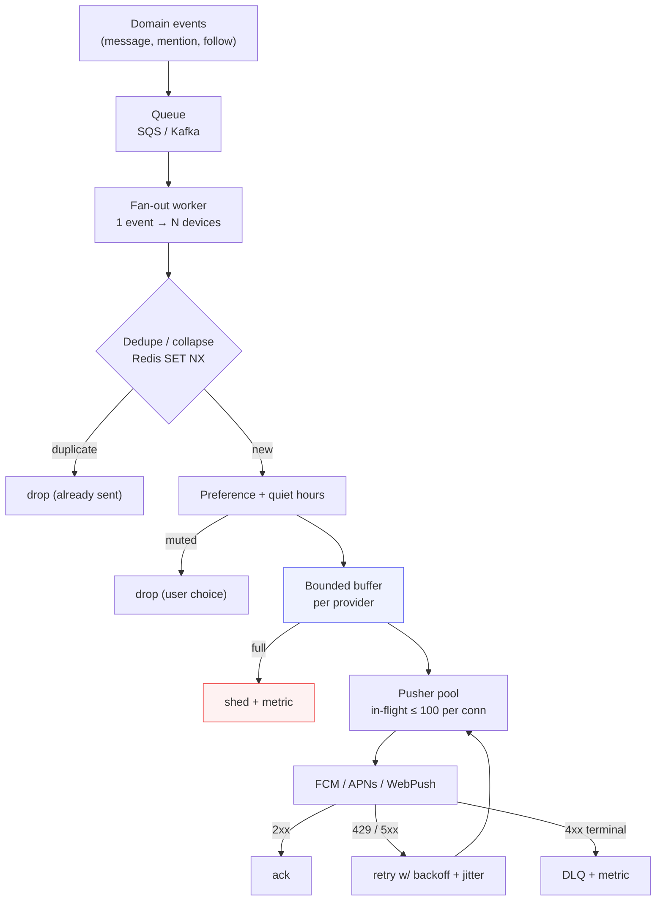

# 09 · Notification fan-out

!!! abstract "The question"
    **"Design a notification system."** A million push notifications in a minute
    during a live event, a provider that accepts only a fixed number of requests in
    flight, and a rule that you must never take the app down trying to deliver them.

!!! info "Source"
    Discord Engineering, *How Discord handles push request bursts of over a million
    per minute with Elixir's GenStage* (Jesse Howarth, December 2016).

---

## 1. The problem, and the naive design

The naive fan-out:

```python
def notify_users(user_ids, payload):
    for uid in user_ids:
        for device in devices_of(uid):
            requests.post(FCM_URL, json=build(device, payload), timeout=5)
```

It works in a demo and collapses in production for four reasons:

| Problem | What happens at 1M/minute |
|---|---|
| Sequential loop | 16,667 sends/second needed; a loop does maybe 50/s per worker |
| No concurrency bound | add threads and you exceed the provider's in-flight limit, and it starts rejecting |
| No backpressure | the burst has to go *somewhere*; without a bounded buffer it becomes unbounded memory or thread explosion |
| No drop policy | when you cannot deliver everything, you must decide what to lose — a loop decides by crashing |

Discord's incident is instructive because the bottleneck was **not** their code. It
was that Firebase's XMPP interface allows **at most 100 pending requests per
connection** — a hard, external, non-negotiable limit. During Overwatch and
Pokémon GO bursts, the push system slowed to a halt and notifications arrived late
or not at all.

---

## 2. The numbers that decide the design

| Figure | Value | Consequence |
|---|---|---|
| Burst size | **> 1 million push requests per minute** | ≈ 16,700/s; a burst, not a steady state |
| Provider in-flight limit | **100 pending per XMPP connection** | this single number sets your entire concurrency architecture |
| Provider latency per request | ~20–100 ms | 100 in flight ÷ 0.05 s ≈ **2,000 sends/s per connection** |
| Connections needed for 16,700/s | 16,700 ÷ 2,000 ≈ **8.4 → 9 minimum** | run 12–16 for headroom |
| Buffer size | finite, e.g. 1,000–10,000 per collector | the load-shedding threshold |
| Burst duration in Discord's incident | ~5 minutes (17:47 → 17:52) | the system must survive minutes, not seconds |
| Acceptable loss | "a few notifications were dropped" | the product decision that makes the design possible |
| Fan-out multiplier | 1 message → N devices → M notification types | multiplies everything above |

Do this arithmetic out loud in an interview. The chain *burst rate → provider
in-flight limit → latency → connections → buffer size → drop policy* is the entire
design, and every number in it is either given to you or estimable.

---

## 3. The mental model

> **A notification pipeline is a bounded queue between an unbounded producer and a
> rate-limited consumer. Backpressure is the mechanism; shedding is the policy; and
> dropping a notification is an acceptable, *documented* outcome.**

Two stages, exactly as Discord built them:

| Stage | Count | Job |
|---|---|---|
| **Producer / collector** | one per machine | receives push requests, buffers a bounded number |
| **Consumer / pusher** | many per machine | asks for work in batches sized to the provider's limit, pushes, acks |

The consumer **demands** work rather than being pushed it. That inversion is what
creates backpressure: the collector can never hand out more than the pusher can
handle, so the provider limit propagates all the way back to the producer.

---

## 4. The flow chart



---

## 5. Build it

### Step 1 — the bounded buffer and the demand-driven pusher

```go
// code/notify/pipeline.go (excerpt, full file in repo)
type Collector struct {
    buf      chan PushRequest   // bounded: this is the load-shedding point
    shed     prometheus.Counter
}

func NewCollector(bufferSize int) *Collector {
    return &Collector{buf: make(chan PushRequest, bufferSize)}
}

// Accept never blocks: if the buffer is full, shed and count it.
func (c *Collector) Accept(req PushRequest) bool {
    select {
    case c.buf <- req:
        return true
    default:
        c.shed.Inc()
        return false
    }
}

type Pusher struct {
    in     *Collector
    client ProviderClient
    conns  int              // number of provider connections
    perConn int             // in-flight limit per connection (100 for Discord's XMPP)
}

// Run asks for work only when it has capacity. This is the backpressure.
func (p *Pusher) Run(ctx context.Context) error {
    sem := make(chan struct{}, p.conns*p.perConn)   // total in-flight budget
    for {
        select {
        case <-ctx.Done():
            return ctx.Err()
        case sem <- struct{}{}:
        }
        select {
        case req := <-p.in.buf:
            go func(r PushRequest) {
                defer func() { <-sem }()
                p.sendWithRetry(ctx, r)
            }(req)
        default:
            <-sem        // nothing to do; release the slot and wait
            time.Sleep(5 * time.Millisecond)
        }
    }
}
```

The `sem` channel is the provider's concurrency limit expressed as code. Set
`conns * perConn` to the number the provider will actually tolerate, and everything
upstream inherits that bound.

### Step 2 — sizing the pusher pool from the provider limit

```python
# code/notify/sizing.py (excerpt)
def pusher_pool(burst_per_second: float, per_conn_limit: int, p50_latency_s: float,
                headroom: float = 1.5) -> dict:
    per_conn_throughput = per_conn_limit / p50_latency_s
    conns_needed = burst_per_second / per_conn_throughput
    conns = int(conns_needed * headroom) + 1
    return {
        "per_conn_limit": per_conn_limit,
        "per_conn_throughput": round(per_conn_throughput, 1),
        "conns_needed": round(conns_needed, 1),
        "conns_to_run": conns,
        "buffer_per_collector": max(1000, int(burst_per_second * 0.5)),
    }

print(pusher_pool(burst_per_second=16_700, per_conn_limit=100, p50_latency_s=0.05))
# {'per_conn_limit': 100, 'per_conn_throughput': 2000.0, 'conns_needed': 8.4,
#  'conns_to_run': 13, 'buffer_per_collector': 8350}
```

This is the whole capacity plan in one function, and it is the answer to "how many
pushers do you need?".

!!! note "About FCM's XMPP interface"
    Discord's 100-in-flight limit came from Firebase's XMPP connection (now a
    legacy interface; FCM HTTP v1 is the current API). The *number* has changed;
    the **shape** has not — every push provider imposes a concurrency or QPS limit,
    APNs has per-connection stream limits, and rate-limited APIs return 429 with
    `Retry-After`. Discover your provider's limit, encode it as a semaphore, and
    size the pool from it.

### Step 3 — dedupe and collapse

A burst is usually a few events fanned out to millions of devices, so most of the
work is duplicate suppression:

```go
// code/notify/dedupe.go (excerpt)
// Collapse key: one notification per (user, thread, window) — "3 new messages"
func collapseKey(n Notification) string {
    return fmt.Sprintf("n:%s:%s:%d", n.UserID, n.ThreadID, n.CreatedAt.Unix()/300)
}

func (d *Deduper) Allow(ctx context.Context, n Notification) (bool, error) {
    key := collapseKey(n)
    // SET NX with a TTL slightly longer than the delivery window
    ok, err := d.rdb.SetNX(ctx, key, n.ID, 10*time.Minute).Result()
    if err != nil {
        return true, err        // fail open: a duplicate push is better than none
    }
    return ok, nil
}
```

Note the **fail-open** decision here, opposite to payments: a duplicate push is
annoying, a missing password-reset push is a support ticket. Decide per feature.

### Step 4 — retries, terminal failures, and the DLQ

```go
// code/notify/retry.go (excerpt)
func (p *Pusher) sendWithRetry(ctx context.Context, r PushRequest) {
    backoff := 200 * time.Millisecond
    for attempt := 0; attempt < 4; attempt++ {
        err := p.client.Send(ctx, r)
        switch classify(err) {
        case Success:
            p.delivered.Inc()
            return
        case Terminal:                       // 400 invalid token: never retry
            p.dlq(r, err)                    // and mark the token for deletion
            return
        case Retryable:                      // 429, 5xx, timeout
            jitter := time.Duration(rand.Int63n(int64(backoff) / 2))
            time.Sleep(backoff + jitter)
            backoff *= 2
        case CircuitOpen:
            p.requeue(r)                     // give it back; don't burn attempts
            return
        }
    }
    p.dlq(r, ErrExhausted)
}
```

| Error class | Examples | Action |
|---|---|---|
| Terminal | 400, `UNREGISTERED`, invalid token | delete the device token, never retry |
| Retryable | 429, 500, 503, timeout | exponential backoff with jitter, cap 4 attempts |
| Circuit open | provider is down | requeue without consuming attempts, alert |

### Step 5 — the product rules that make it cheap

Discord's own note: they **only send pushes when users are not active in the
application**. That single rule removes a large fraction of the fan-out at exactly
the moment it matters — during a live event, when the most users are active.

The rules worth copying:

1. **Presence check before push.** If the user has an active socket (chapter 07),
   deliver in-app and skip the push.
2. **Collapse by thread and window.** "3 new messages" beats three pushes.
3. **Quiet hours** per user timezone, evaluated at fan-out time, not send time.
4. **Priority classes.** Password reset and payment failure are transactional and
   must never be shed; "someone liked your post" is shed first.
5. **Per-user rate ceiling.** Ten pushes in a minute and the app gets uninstalled.

---

## 6. The production layer

### KEDA, because HPA cannot see a backlog

```yaml
# deploy/notify/keda-scaledobject.yaml
apiVersion: keda.sh/v1alpha1
kind: ScaledObject
metadata: { name: notify-fanout, namespace: notify }
spec:
  scaleTargetRef: { name: notify-fanout }
  minReplicaCount: 3
  maxReplicaCount: 120
  pollingInterval: 10
  cooldownPeriod: 120
  advanced:
    horizontalPodAutoscalerConfig:
      behavior:
        scaleUp:
          stabilizationWindowSeconds: 0        # bursts: scale immediately
          policies: [{ type: Percent, value: 100, periodSeconds: 15 }]
        scaleDown:
          stabilizationWindowSeconds: 300      # do not thrash after a burst
          policies: [{ type: Percent, value: 25, periodSeconds: 60 }]
  triggers:
    - type: aws-sqs-queue
      authenticationRef: { name: keda-aws-credentials }
      metadata:
        queueURL: https://sqs.ap-south-1.amazonaws.com/123456789012/notify-fanout
        queueLength: "500"          # target 500 messages per replica
        awsRegion: ap-south-1
        scaleOnInFlight: "true"
```

```yaml
# deploy/notify/deployment.yaml (abridged)
apiVersion: apps/v1
kind: Deployment
metadata: { name: notify-fanout, namespace: notify }
spec:
  replicas: 3
  template:
    spec:
      containers:
        - name: fanout
          image: ghcr.io/example/notify:4.2.0
          args:
            - --buffer=8000
            - --provider-inflight=100
            - --provider-conns=4
            - --max-attempts=4
            - --shed-policy=drop-newest-low-priority
          resources:
            requests: { cpu: 500m, memory: 512Mi }
            limits:   { memory: 1Gi }
          env:
            - { name: REDIS_URL, valueFrom: { secretKeyRef: { name: notify-redis, key: url } } }
            - { name: FCM_CREDENTIALS, valueFrom: { secretKeyRef: { name: fcm, key: json } } }
          readinessProbe:
            httpGet: { path: /ready, port: 8080 }
---
apiVersion: policy/v1
kind: PodDisruptionBudget
metadata: { name: notify-fanout, namespace: notify }
spec:
  minAvailable: 2
  selector: { matchLabels: { app: notify-fanout } }
```

### SQS vs MSK for the queue

| | SQS | MSK (Kafka) |
|---|---|---|
| Ops burden | none | brokers, partitions, rebalance |
| Ordering | FIFO queues only (and lower throughput) | per-partition ordering, high throughput |
| Replay | no (delete on ack) | yes, seek to offset |
| Backlog visibility | `ApproximateNumberOfMessages` | consumer lag per partition |
| KEDA integration | native, trivial | via lag exporter |
| Best for | notification fan-out (drop-tolerant, bursty) | event sourcing, multiple consumers, replay |

For notifications, **SQS is the right default**: the payloads are small, loss is
tolerable, ordering per user is not critical, and the queue-depth metric is a
one-line KEDA trigger. Use MSK if other systems need to replay the same events.

### The five alerts

| Alert | Threshold | Why |
|---|---|---|
| Shed rate | > 1% of enqueued for 2 min | you are dropping notifications; burst exceeds capacity |
| Queue age (oldest message) | > 60 s | delivery latency is now a product problem |
| Provider error rate | > 5% for 2 min | provider incident; open the circuit |
| Provider 429 rate | > 1% | your in-flight limit is set too high |
| DLQ depth | > 0.5% of traffic | token hygiene (dead devices) is degrading |

### Failure drills

1. **Burst.** Inject 1M pushes in 60 s. Expect: the buffer fills, shedding starts,
   **latency for transactional notifications stays flat**, and everything recovers
   within a minute of the burst ending. If transactional latency moves, your
   priority classes are not wired.
2. **Provider limit breach.** Set `--provider-inflight=500` against a stub that
   hard-caps at 100. You must see 429s immediately — this is the drill that proves
   the semaphore is doing its job.
3. **Provider outage.** Fail 100% of sends for three minutes. Watch the circuit
   open, messages requeue rather than burn attempts, and the queue drain afterwards
   without a thundering herd (jitter).
4. **Poison message.** Send a malformed device token. It must go to the DLQ, not
   loop forever.
5. **Scale from zero backlog.** Confirm KEDA scales up within ~15 s of a burst and
   does not scale down mid-burst.

---

## 7. The two-minute answer

> "A notification pipeline is a bounded queue between an unbounded producer and a
> rate-limited consumer, and the whole design follows from the provider's
> concurrency limit. Discord's case: bursts over a million pushes a minute —
> about 16,700 a second — against a provider that allowed only 100 pending requests
> per connection. At roughly 50 ms per send, that's 2,000 sends a second per
> connection, so about nine connections minimum, and they ran more for headroom.
>
> They split it into two stages: a collector per machine that buffers a bounded
> number of requests, and many pushers that *demand* work in batches of 100 so they
> never exceed the provider limit. Because pushers ask for work instead of being
> pushed it, the provider limit becomes backpressure all the way to the producer.
> When the buffer fills, the collector sheds — and that's a deliberate, documented
> product decision: dropping a few notifications is acceptable, taking the system
> down is not. In their incident, a five-minute burst filled the buffer, a few
> notifications were dropped, and nothing else was affected.
>
> In my version I'd add: fan-out from domain events through SQS with KEDA scaling
> on queue depth, because HPA on CPU can't see a backlog; a dedupe and collapse key
> per user-thread-window so a burst of messages becomes one notification; priority
> classes where transactional pushes are never shed; a presence check to skip
> pushes for users who are already active in the app; retries with jitter for 429s
> and 5xx, dead-token deletion for 4xx, and a DLQ for anything else.
>
> And the two rules I'd write on the wall: the buffer is bounded and the shed
> policy is explicit, and retries always have jitter or the recovery becomes a
> second outage."

### Follow-ups you should expect

| Question | The answer they want |
|---|---|
| "Why not just add more workers?" | You can, until you hit the provider's limit — which is exactly the wall Discord hit. Concurrency limits are external and non-negotiable. |
| "How do you choose the buffer size?" | Half a second to a few seconds of peak burst rate, times the number of collectors; big enough to absorb a spike, small enough that shedding starts before memory does. |
| "What do you drop first?" | Low-priority classes (social), then collapsed duplicates, never transactional. Shedding order is a product decision, encoded in config. |
| "How do you guarantee a password reset is delivered?" | A separate queue and worker pool with reserved capacity — the same "reserve a fraction for critical" idea as chapter 06's fleet shedder. |
| "Exactly-once?" | At-least-once delivery with a dedupe key, which in practice means at-most-once *notification* and exactly-once *effect* for anything that matters. |

**Code:** `code/notify/` · **Manifests:** `deploy/notify/`
