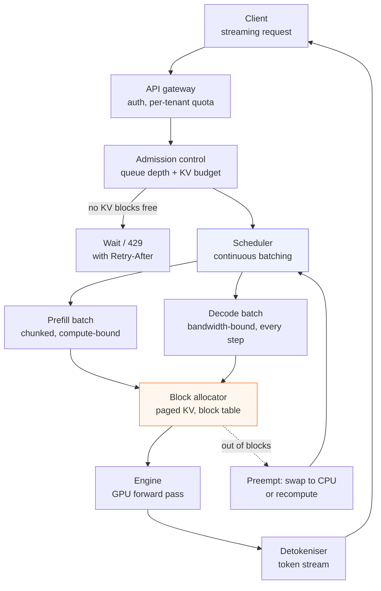

# 10 · LLM inference serving

!!! abstract "The question"
    **"Serve a 70B model at 100 requests per second with a 2-second p95
    time-to-first-token."** Not "how do I call a model" — how do you keep a GPU
    fed, when the scarce resource is memory rather than compute and every
    request has a different, unknown length.

!!! info "Source"
    Kwon et al., *Efficient Memory Management for Large Language Model Serving
    with PagedAttention* (SOSP 2023) and the vLLM project write-up. Every
    production figure below comes from those; the arithmetic and the code are
    this chapter's additions.

---

## 1. The problem, and the naive design

The naive server is a Flask endpoint that loads a model and generates:

```python
@app.post("/generate")
def generate(req: Request):
    tokens = model.generate(req.prompt, max_new_tokens=512)   # 3-30 s, blocking
    return {"text": tokens}
```

It is correct and it wastes most of the GPU, for three reasons that compound:

| Problem | What happens | Consequence |
|---|---|---|
| One request at a time | the GPU idles between tokens waiting on memory | utilisation in the low single digits |
| No batching | two requests cost two full passes | half the throughput you paid for |
| Fixed KV reservation | you reserve `max_seq_len` of cache per request | 60–80% of cache memory wasted |

That last one is the real story. Every token a model has already seen keeps a
key and value vector for every layer and head; that is the **KV cache**, and it
has to stay resident for the whole generation. Existing serving systems
pre-allocated a contiguous block sized to the *maximum* sequence length, so a
request that actually used 300 of 2,048 tokens still held the whole chunk.
vLLM's profiling found only **20.4–38.2%** of KV memory holding real token
state — the rest was internal and external fragmentation.

!!! note "The lesson to internalise"
    Inference is not compute-bound, it is **memory-bound and scheduling-bound**.
    The GPU has plenty of FLOPs; what it lacks is somewhere to put the KV cache
    of the next request you want to admit.

---

## 2. The numbers that decide the design

Two numbers decide everything: how much KV cache one token costs, and how fast
you can stream weights out of memory.

**KV cache per token.** For a model with \(L\) layers, \(H_{kv}\) key/value heads
(grouped-query attention), head dimension \(d\), in FP16:

$$
\text{bytes/token} = 2 \times H_{kv} \times d \times 2 \times L
$$

| Model | L | KV heads | d | Per token | 8k context, one sequence |
|---|---|---|---|---|---|
| 8B, GQA | 32 | 8 | 128 | **128 KB** | **1 GB** |
| 70B, GQA | 80 | 8 | 128 | **320 KB** | **2.6 GB** |
| 70B, no GQA (MHA) | 80 | 64 | 128 | 2.5 MB | 20 GB — unusable |

**Decode speed is bandwidth, not FLOPs.** Each generated token requires reading
every weight once:

$$
\text{ms/token} \approx \frac{\text{weight bytes}}{\text{HBM bandwidth}}
$$

An 8B model in FP16 is 16 GB; an H100 has ~3.35 TB/s of HBM3, so
\(16/3350 \approx 4.8\) ms/token, about **200 tokens/s for a single stream**, no
matter how many tensor cores are idle. A 70B model at 140 GB is ~42 ms/token
across 8 GPUs with tensor parallelism — roughly 24 tokens/s per stream.

| Figure | Value | Consequence |
|---|---|---|
| KV waste in pre-paging systems | 60–80% of cache memory | the batch size you *think* you have is 3× what you get |
| Waste with paged blocks | **under 4%** | near-full memory utilisation |
| Throughput gain | **2–4×** at equal latency vs FasterTransformer/Orca | the same GPUs, three times the traffic |
| Concurrency, 8B on 80 GB | ~64 GB free ÷ 1 GB per 8k sequence = **~64 streams** | this, not FLOPs, sets your capacity |
| Time-to-first-token | dominated by prefill: \(2PT\) FLOPs for \(T\) prompt tokens | a 8k prompt is 64× the prefill of a 128-token one |
| Cost | one H100-hour at ~$3 serving 200 tok/s ≈ **$4 per million output tokens** | the number your pricing has to clear |

---

## 3. The mental model

> **An inference server is an operating system for GPU memory. Requests are
> processes, the KV cache is physical memory, the batch is the run queue, and
> paging is how you avoid reserving a process's maximum size up front.**

Everything follows: you admit work when you have *blocks* free rather than when
you have a slot free; you preempt (swap or recompute) when you do not; and you
schedule prefill and decode separately because they have opposite bottlenecks —
prefill is compute-bound, decode is bandwidth-bound.

---

## 4. The flow chart



Failure points on every arrow: a queue that never drains (admission control
missing), a batch that starves because one request is 30k tokens long
(no chunked prefill), a GPU that OOMs because the block allocator over-committed
(no reservation), and a client that sees a 500 instead of a 429 (no backpressure
signal).

---

## 5. Sizing the components

| Component | Unit of work | Cost per unit | Peak demand | Provisioned | Headroom |
|---|---|---|---|---|---|
| GPU worker | one 8B model, 80 GB H100 | ~200 tok/s/stream, ~64 concurrent 8k streams | 100 req/s × 400 output tokens = 40k tok/s | 2 nodes = 12,800 tok/s at 64 streams × 200 tok/s | scale to 4 |
| KV memory | 128 KB per token | 1 GB per 8k sequence | 64 concurrent | paged allocator, <4% waste | 1.1× |
| Prefill capacity | 2 × 8e9 FLOPs per prompt token | ~0.15 s for an 8k prompt | 20% of requests long | chunked prefill, 512-token chunks | shares the batch |
| Gateway | 1 request | ~1 ms | 100 req/s | 4 pods | 20× |
| Tokeniser | 1 request | ~2 ms per 1k tokens | 100 req/s | sidecar, 2 threads | 5× |
| Queue | 1 pending request | 0 GPU | burst of 10k | bounded at 2,000, then 429 | explicit |

The capacity arithmetic worth doing out loud: **throughput is concurrency ×
per-stream rate**, and concurrency is set by free KV memory, not by GPU count
alone. Doubling GPUs doubles both, which is why the cost curve here is linear
and boring — and why the *scheduling* is where the 3× lives.

**Bytes on the wire.**

- client → gateway: 100 req/s × 1.5 KB prompt = **0.15 MB/s in** (small)
- GPU → client: 40k tokens/s × 4 B token id = **0.16 MB/s** (also small)
- weights: 16 GB read from HBM **per decode step per batch** — this is the real traffic, ~3 TB/s inside the GPU
- KV cache writes: 40k tokens/s × 128 KB = **5 GB/s of HBM writes**, which is why memory bandwidth is the wall

| Benchmark | How to measure | Target | What it tells you |
|---|---|---|---|
| TTFT p95 | time from request to first token | ≤ 2 s at 8k prompt | prefill scheduling is healthy |
| TPOT p95 | time per output token | ≤ 50 ms (20 tok/s) | decode batch is not thrashing |
| KV utilisation | blocks in use ÷ blocks total | 85–95% | below 85% you are leaving throughput on the floor |
| Preemptions/min | block allocator counter | < 1% of requests | above this, batch is over-admitted |
| Queue wait p95 | admission → schedule | < 500 ms | the signal to scale out |

---

## 6. The algorithm, end to end

Continuous batching is a scheduler, and it runs one iteration per *decode step*
— not per request. That inversion is the whole design.

| # | Who | What happens | Durable afterwards |
|---|---|---|---|
| 1 | gateway | authenticates, checks the tenant's token budget | nothing |
| 2 | admission | admits only if `free_blocks >= blocks_needed(prompt)` | nothing |
| 3 | scheduler | pulls the next request, allocates blocks, runs **prefill** (chunked if long) | block table entry |
| 4 | scheduler | appends the request to the decode batch | batch slot |
| 5 | engine | one forward pass over the whole batch → one new token each | KV written to its own blocks |
| 6 | scheduler | streams each token to its client, frees blocks on EOS | token in the stream |
| 7 | allocator | on exhaustion, preempts the youngest request (swap or recompute) | block table shrinks |
| 8 | metrics | emits TTFT, TPOT, KV utilisation, preemptions | — |

```text
loop every decode step:
    while free_blocks >= blocks_for(next_request) and queue not empty:
        r = queue.pop()
        allocate(r, blocks_for(r.prompt))
        run_prefill(r)                      # chunked if prompt > chunk_size
        batch.append(r)

    tokens = engine.step(batch)             # one forward pass, all sequences
    for r, tok in zip(batch, tokens):
        r.blocks.append_if_new_page()        # grow by a page, not by max_len
        stream(r, tok)
        if tok == EOS or r.length == r.max:
            free(r.blocks); batch.remove(r)

    if need_blocks and not free_blocks:
        victim = youngest(batch)             # least work lost
        preempt(victim)                      # swap KV to CPU, or recompute later
```

**Invariants.**

- **A request never holds more memory than it has tokens**, rounded up to a
  page. That single rule is the 3× throughput.
- **Prefill and decode share a batch but not a bottleneck.** Chunked prefill
  caps how long a decode step can be delayed by a 30k-token prompt.
- **Preemption is a scheduling decision, not an error.** Swapping the newest
  request loses the least work.
- **Admission control is the only backpressure.** Once a request is in the
  batch it must be finishable, or the queue deadlocks.

| Edge case | What the algorithm does |
|---|---|
| One 30k-token prompt arrives | chunked prefill, 512 tokens at a time, interleaved with decode |
| KV cache exhausted | preempt the newest request; swap or recompute |
| Tenant sends 10k requests | gateway quota rejects at the tenant, not the model |
| Two requests share a long system prompt | prefix caching reuses the same blocks (copy-on-write) |
| Client disconnects mid-stream | free its blocks on the next step, do not wait for EOS |

---

## 7. Build it

### Step 1 — the block allocator

The allocator is a free-list of fixed-size pages. A sequence holds a *block
table* mapping logical position to physical page, exactly like virtual memory.

```python
# code/inference/blocks.py (excerpt)
class BlockAllocator:
    def __init__(self, num_blocks: int, block_size: int = 16):
        self.block_size = block_size
        self.free = list(range(num_blocks))
        self.ref_count = {}          # block_id -> how many sequences share it

    def blocks_for(self, tokens: int) -> int:
        return (tokens + self.block_size - 1) // self.block_size   # ceil

    def allocate(self, n: int) -> list[int]:
        if n > len(self.free):
            raise OutOfBlocks(f"need {n}, have {len(self.free)}")
        out = [self.free.pop() for _ in range(n)]
        for b in out:
            self.ref_count[b] = 1
        return out

    def free_blocks(self, blocks: list[int]) -> None:
        for b in blocks:
            self.ref_count[b] -= 1
            if self.ref_count[b] == 0:
                self.free.append(b)

    def share(self, blocks: list[int]) -> None:      # prefix caching
        for b in blocks:
            self.ref_count[b] += 1

    def utilisation(self) -> float:
        return 1 - len(self.free) / (len(self.free) + len(self.ref_count))
```

The unit test that matters: allocate for 1,000 random sequence lengths, free in
random order, assert `free + in_use == total` and that no block is ever handed
out twice. That is the fragmentation bug, and it is cheap to prove.

### Step 2 — the scheduler

```python
# code/inference/scheduler.py (excerpt)
def step(self):
    # 1. admit as many as fit, in arrival order
    while self.queue and self.alloc.free_blocks() >= self.alloc.blocks_for(
            self.queue[0].prompt_len):
        r = self.queue.popleft()
        r.blocks = self.alloc.allocate(self.alloc.blocks_for(r.prompt_len))
        r.prefill_cursor = 0
        self.batch.append(r)

    # 2. prefill in chunks so decode is not starved
    for r in self.batch:
        if r.prefill_cursor < r.prompt_len:
            chunk = min(self.chunk_size, r.prompt_len - r.prefill_cursor)
            self.engine.prefill(r, r.prefill_cursor, chunk)
            r.prefill_cursor += chunk

    # 3. one decode step for everyone who is past prefill
    decoders = [r for r in self.batch if r.prefill_cursor == r.prompt_len]
    for r, tok in zip(decoders, self.engine.decode(decoders)):
        if r.needs_new_page():
            r.blocks += self.alloc.allocate(1)
        r.emit(tok)
        if r.finished():
            self.alloc.free_blocks(r.blocks)
            self.batch.remove(r)

    # 4. preempt if we ran dry
    if self.alloc.free_blocks() == 0 and self.queue:
        victim = max(self.batch, key=lambda r: r.generated)   # youngest work
        self.preempt(victim)
```

`engine` here is a stub that sleeps for a bandwidth-shaped duration, so the
scheduler's behaviour — admission, chunking, preemption — is testable without a
GPU. That is the point: the interesting logic is not the matmul.

### Step 3 — measure it before you believe it

```python
# code/inference/bench.py
# naive: one request at a time, fixed max_len reservation
# paged:  continuous batching, pages allocated on demand
python bench.py --requests 200 --arrival-rate 8 --max-len 2048
```

The script prints tokens/s, TTFT p50/p95, and KV utilisation for both modes.
On the stub engine it prints roughly:

```
mode=naive  tokens_per_s=150.7  ttft_p50_ms=16582  kv_util=0.503
mode=paged  tokens_per_s=738.0  ttft_p50_ms=2706   kv_util=0.831
```

About 5× the throughput and two-thirds less time-to-first-token, with KV
utilisation at 0.83 against 0.50 — the same shape as the published result,
reproduced on a laptop without a GPU.

---

## 8. The production layer

```yaml
# deploy/inference/vllm.yaml (abridged)
apiVersion: apps/v1
kind: Deployment
metadata: { name: llm-8b, namespace: inference }
spec:
  replicas: 2
  strategy: { rollingUpdate: { maxUnavailable: 0, maxSurge: 1 } }
  template:
    metadata:
      labels: { app: llm-8b }
      annotations: { prometheus.io/scrape: "true", prometheus.io/port: "8000" }
    spec:
      nodeSelector: { cloud.google.com/gke-accelerator: nvidia-h100-80gb }
      tolerations:
        - { key: nvidia.com/gpu, operator: Exists, effect: NoSchedule }
      terminationGracePeriodSeconds: 120      # let in-flight streams finish
      containers:
        - name: vllm
          image: vllm/vllm-openai:v0.6.3
          args:
            - --model=meta-llama/Meta-Llama-3-8B-Instruct
            - --max-model-len=8192
            - --gpu-memory-utilization=0.92     # leave room for CUDA context
            - --max-num-seqs=64
            - --enable-prefix-caching
            - --swap-space=16                   # CPU swap for preemption
          ports: [{ containerPort: 8000 }]
          resources:
            limits: { nvidia.com/gpu: "1", memory: 64Gi }
          readinessProbe:
            httpGet: { path: /health, port: 8000 }
            periodSeconds: 10
            failureThreshold: 30                # model load takes ~90 s
          startupProbe:
            httpGet: { path: /health, port: 8000 }
            failureThreshold: 60
            periodSeconds: 5
---
apiVersion: keda.sh/v1alpha1
kind: ScaledObject
metadata: { name: llm-8b, namespace: inference }
spec:
  scaleTargetRef: { name: llm-8b }
  minReplicaCount: 2
  maxReplicaCount: 8
  triggers:
    - type: prometheus
      metadata:
        serverAddress: http://prometheus.monitoring:9090
        metricName: vllm_num_requests_waiting
        query: sum(vllm:num_requests_waiting{app="llm-8b"})
        threshold: "8"                       # scale on queue, never on CPU
```

| Knob | Value | Why |
|---|---|---|
| `--gpu-memory-utilization` | 0.92 | higher OOMs during a load spike; lower wastes KV |
| `--max-num-seqs` | 64 | caps concurrency so latency stays bounded |
| `--enable-prefix-caching` | on | shared system prompts become shared pages |
| `--swap-space` | 16 GB | preemption needs somewhere to go |
| Autoscaling metric | queue depth | GPU utilisation is pinned at 100% by design and tells you nothing |
| Node pool | H100, tainted, spot | a 90 s model load makes cold starts expensive; keep a warm floor |

!!! warning "Autoscaling GPU pods is not like autoscaling web pods"
    A new replica takes 60–120 seconds to load weights before it can serve a
    single token. Scale on **queue depth with a warm minimum**, not on CPU, and
    put a hard queue bound in front so a burst becomes a 429 rather than a
    two-minute wait.

| Alert | Threshold | Why |
|---|---|---|
| TTFT p95 | > 2 s for 5 min | prefill is starving or the queue is deep |
| Preemptions | > 1% of requests | batch is over-admitted for available KV |
| KV utilisation | < 80% sustained | you are paying for idle memory |
| GPU ECC / XID errors | any | a node is about to die mid-batch |

### Failure drills

1. **Long-context starvation.** Send one 30k-token prompt among 100 short ones
   with chunking off, then on. Watch TTFT for the short requests.
2. **KV exhaustion.** Set `--max-num-seqs` above what the memory holds and
   confirm the allocator preempts instead of OOM-killing the container.
3. **Noisy tenant.** One tenant at 90% of the queue; verify per-tenant quotas
   keep everyone else's p95 flat.
4. **Cold start.** Kill a replica under load; measure the 90-second window where
   capacity is halved and confirm the queue bound holds.

---

## 9. The two-minute answer

> "Inference is memory-bound, not compute-bound, so I'd design the serving
> layer as an operating system for GPU memory. The KV cache is the scarce
> resource: an 8B model with grouped-query attention needs about 128 KB per
> token, so a single 8k-token conversation holds 1 GB. That caps concurrency
> long before FLOPs do — on an 80 GB H100 with 16 GB of weights you fit roughly
> 64 such streams.
>
> The naive server reserves a contiguous chunk sized to the maximum sequence
> length per request, which is why pre-paging systems waste 60 to 80% of cache
> memory. Paged attention fixes that: fixed-size blocks allocated on demand,
> a block table per sequence, waste under 4%, and 2 to 4× throughput at the
> same latency.
>
> On top of that, continuous batching: the scheduler runs one iteration per
> decode step, admits a request whenever free blocks allow, and removes it on
> EOS — so the batch is never held hostage by the longest sequence. Prefill and
> decode go in the same batch but with different treatment, because prefill is
> compute-bound and decode is bandwidth-bound; chunked prefill stops a 30k-token
> prompt from delaying everyone's next token. When memory runs out, preempt the
> youngest request — swap its KV to CPU or recompute it later — because that
> loses the least work.
>
> The operational consequences: autoscale on queue depth with a warm minimum,
> because a new replica takes 90 seconds to load weights; bound the queue and
> return 429 rather than letting p95 collapse; and alert on preemptions and KV
> utilisation, not on GPU percentage, which sits at 100% by design."

### Follow-ups you should expect

| Question | The answer they want |
|---|---|
| "Why is decode bandwidth-bound?" | every token reads all the weights; 16 GB at 3.35 TB/s is ~4.8 ms regardless of FLOPs |
| "How do you cut TTFT for long prompts?" | chunked prefill, prefix caching, and a prompt-length quota per tenant |
| "Batch size?" | as many as fit in free KV blocks, capped by a latency SLO on TPOT |
| "What about speculative decoding?" | trades extra compute for fewer sequential steps; helps when you are bandwidth-bound and have FLOPs spare |
| "Multi-tenant isolation?" | quotas at the gateway plus separate pools for interactive and batch traffic |
| "Cost per million tokens?" | concurrency × per-stream rate ÷ GPU-hour price; show the arithmetic |

**Code:** `code/inference/` · **Manifests:** `deploy/inference/`
