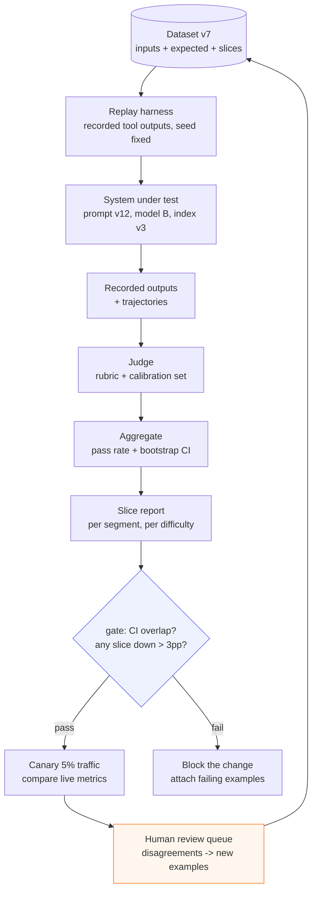

# 13 · Evals as a production system

!!! abstract "The question"
    **"How do you ship a model, prompt or retrieval change without breaking the
    product?"** There are no assertions for a non-deterministic system, so what
    replaces the test suite — and how do you know a 2-point move is real?

!!! info "Source"
    This chapter is assembled from practice rather than one write-up: the
    sample-size arithmetic is standard two-proportion testing, and the
    replay/canary structure borrows from chapters 04 (stored results) and 11
    (recall@k harnesses). Anthropic's *Building effective agents* supplies the
    rule that matters most: only add complexity when it demonstrably improves
    outcomes — which requires an eval to demonstrate against.

---

## 1. The problem, and the naive design

The naive eval is a notebook:

```python
score = sum(judge(q, answer(q)) for q in questions) / len(questions)
print(f"accuracy: {score:.2%}")
```

It gives a number, and the number is untrustworthy for five separate reasons:

| Problem | What happens | Consequence |
|---|---|---|
| No sample size | 20 questions, one flip = 5 points | you ship noise and call it progress |
| Judge is uncalibrated | an LLM judge with its own biases | you measure the judge, not the system |
| No slices | the average improves while one customer segment collapses | silent regression |
| No replay | the model's tool calls hit live systems | results are not reproducible |
| Run cost is unbounded | 10k examples × 2k tokens | a $135 run nobody runs on a Friday |

The core insight is statistical: **a pass rate is an estimate with a confidence
interval**, and if your interval is wider than the effect you are trying to
detect, the eval cannot answer the question you are asking it.

---

## 2. The numbers that decide the design

How many examples do you need? For a two-proportion comparison at 95%
confidence and 80% power:

$$
n \approx \frac{2\,(z_{\alpha/2} + z_\beta)^2\, p(1-p)}{\delta^2}
= \frac{15.7 \times 0.25}{\delta^2}
$$

| Symbol | Read as | Value here |
|---|---|---|
| \(n\) | examples needed **per arm** — per configuration you are comparing | the answer |
| \(z_{\alpha/2}\) | normal quantile for the confidence level; how many standard deviations cover 95% | 1.96 |
| \(z_\beta\) | normal quantile for power; the chance you detect a real effect | 0.84 at 80% power |
| \(p\) | baseline pass rate of the system you are measuring | 0.5 (worst case) |
| \(p(1-p)\) | variance of a pass/fail outcome, largest when \(p = 0.5\) | 0.25 |
| \(\delta\) (delta) | the smallest effect you care to detect, as a proportion | 0.02 for 2 points |
| \(15.7\) | \(2(1.96 + 0.84)^2\), the constant once confidence and power are fixed | — |

Worked: \(\delta = 0.02\) gives \(15.7 \times 0.25 / 0.0004 \approx 9{,}800\)
examples per arm, which is the 2-point row in the table below.

| Effect you want to detect | Examples per arm | Verdict |
|---|---|---|
| 10 points | ~390 | a demo set |
| 5 points | ~1,570 | a working set |
| 2 points | ~9,800 | a serious set |
| 1 point | ~39,000 | only if you are optimising at the margin |

| Figure | Value | Consequence |
|---|---|---|
| Run cost, 10k examples × 2k in / 500 out | ≈ $60 input + $75 output = **$135** | it is a nightly job, not a per-commit one |
| Run time, 10k at 50 concurrent × 3 s | ~**10 minutes** | fine in CI if you gate it |
| Judge noise floor (same input, two runs) | 0.5–1.0 points | **your threshold must exceed this** |
| Human labels for calibration | 200–500 | measure agreement before trusting a judge |
| Flaky examples | 2–5% of a golden set | quarantine them, do not average them in |
| Golden set maintenance | ~10 new examples per shipped bug | the set is a product artefact |

The 0.5–1.0 point noise floor is the number that saves you from yourself: if
your gate is "must not drop more than 1 point", you will page on noise. Either
grow the set until the interval is tight, or set the threshold above the floor.

---

## 3. The mental model

> **An eval is a regression test with a confidence interval. It has a versioned
> dataset, a deterministic replay, a calibrated judge, slices that matter, and a
> threshold wider than its own noise.**

Everything else follows: you version the dataset like code, you record tool
outputs so a replay is repeatable, you calibrate the judge against humans before
trusting it, and you report slices because averages hide the regressions that
hurt customers.

---

## 4. The flow chart



The loop back to the dataset is the part teams skip, and it is why their eval
set drifts out of relevance within a quarter: every production bug becomes a new
example, or the set slowly stops describing the product.

---

## 5. Sizing the components

| Component | Unit of work | Cost per unit | Peak demand | Provisioned | Headroom |
|---|---|---|---|---|---|
| Replay harness | 1 example | 3 s, 1 model call | 10k examples nightly | 50 concurrent workers | 10 min |
| Judge | 1 output | ~1 s, 800 tokens | 10k judgments | same pool | — |
| Results store | 1 row per (example, run) | ~1 KB | 10k × 30 days = 300k rows | Postgres | trivial |
| Golden set | 1 example | human time | 2k–10k examples | versioned in git | — |
| CI gate | 1 comparison | bootstrap over 2k samples | every PR | 1 job | — |

**Bytes and money.**

- model traffic: 10k × 2.5k tokens = **25M tokens per run**, ~$135
- judge traffic: 10k × 800 tokens = **8M tokens**, ~$40 — so judging costs a third of the run
- storage: 300k rows × 1 KB = **300 MB/month**, negligible
- the expensive resource is **human labelling time**: 200 examples is a day of one person's attention

| Benchmark | How to measure | Target | What it tells you |
|---|---|---|---|
| Judge–human agreement | Cohen's κ on 200 labels | ≥ 0.6 | the judge is a proxy, not a coin flip |
| CI width | bootstrap on the golden set | < 2 points | the set can resolve the changes you make |
| Run-to-run variance | same config twice | < 1 point | your noise floor, and your gate threshold |
| Slice coverage | examples per slice | ≥ 100 each | a slice with 20 examples cannot detect anything |
| Time to reproduce a bug | from report to failing example | < 1 day | the loop is alive |

---

## 6. The algorithm, end to end

| # | Who | What happens | Durable afterwards |
|---|---|---|---|
| 1 | engineer | changes a prompt, model, chunker or index version | commit |
| 2 | CI | pins the dataset version and the seed | run row |
| 3 | harness | replays each example with **recorded tool outputs** | outputs, trajectories |
| 4 | judge | scores each output against the rubric | per-example scores |
| 5 | aggregate | pass rate + bootstrap confidence interval | summary row |
| 6 | slices | same statistics per segment | slice rows |
| 7 | gate | fails if the CI overlaps the baseline, or any slice drops > 3pp | build status |
| 8 | canary | 5% of live traffic, compare real metrics | canary report |
| 9 | human | reviews disagreements, promotes new examples | dataset v8 |

```text
function evaluate(config, dataset_version, baseline):
    examples = load(dataset_version)                  # inputs, expected, slice
    results  = parallel_map(examples, limit = 50, fn = e =>
        replay(e, config, tools = e.recorded_tool_outputs))   # deterministic

    scores = parallel_map(results, limit = 50, fn = r => judge(r, rubric))

    overall = bootstrap_ci(scores, n = 2000)          # (mean, lo, hi)
    slices  = group_by(examples, e => e.slice) |> map(bootstrap_ci)

    if overlaps(overall, baseline.overall): fail("no measurable change")
    for s in slices:
        if s.mean < baseline.slices[s.name].mean - 0.03:
            fail("slice regression: " + s.name)

    return report(overall, slices, failing_examples = scores.where(s => !s.pass))
```

**Invariants.**

- **Every result is reproducible from (dataset version, config, seed, recorded
  tool outputs).** If it is not, you are measuring the weather.
- **The judge is calibrated, not assumed.** κ against 200 human labels, re-run
  whenever the rubric changes.
- **The gate is wider than the noise floor**, or you page on nothing.
- **Slices are first-class.** An average that improves while a slice collapses
  is a regression.
- **Every production bug becomes an example**, or the set rots.

| Edge case | What the algorithm does |
|---|---|
| Change is within noise | gate reports "no measurable change" instead of a false win |
| One slice has 20 examples | excluded from the gate with a warning, not silently averaged |
| Judge drifts after a rubric edit | recalibrate before gating |
| Flaky example | quarantine by id after 2 disagreements, keep it visible |
| Eval data contains an injection | sandboxed replay, output treated as data (chapter 12) |

---

## 7. Build it

### Step 1 — the harness, with replay and intervals

```python
# code/evals/harness.py (excerpt)
def evaluate(config, dataset, baseline=None, n_boot=2000):
    results = run_parallel(dataset.examples, limit=50,
                           fn=lambda e: replay(e, config, e.recorded_tools))
    scores = run_parallel(results, limit=50, fn=lambda r: judge(r, config.rubric))

    overall = bootstrap_ci([s.passed for s in scores], n=n_boot)
    by_slice = {name: bootstrap_ci([s.passed for s in group], n=n_boot)
                for name, group in groupby(scores, key=lambda s: s.slice)}

    verdict = "pass"
    if baseline and ci_overlaps(overall, baseline.overall):
        verdict = "no measurable change"
    for name, ci in by_slice.items():
        if baseline and ci.lo < baseline.by_slice[name].lo - 0.03:
            verdict = f"slice regression: {name}"
    return Report(overall=overall, slices=by_slice, verdict=verdict,
                  failures=[s for s in scores if not s.passed][:50])
```

`bootstrap_ci` resamples the pass/fail vector 2,000 times and takes the 2.5th and
97.5th percentiles — twenty lines, no dependencies, and it is the difference
between "85%" and "85% ± 1.8".

### Step 2 — replay determinism

```python
# code/evals/replay.py (excerpt)
def replay(example, config, recorded_tools):
    """Run the system with every external effect served from the recording."""
    tools = RecordedTools(recorded_tools)        # raises if an unseen call happens
    system = build_system(config, tools=tools, temperature=0.0, seed=config.seed)
    try:
        out = system.run(example.input)
        return Result(example=example, output=out, passed=None,
                      trajectory=tools.calls)
    except UnrecordedToolCall as e:
        return Result(example=example, error=f"non-reproducible: {e}", passed=False)
```

Raising on an unrecorded tool call is deliberate: it converts "the eval is
silently non-deterministic" into a visible failure.

### Step 3 — the gate in CI

```yaml
# .github/workflows/evals.yml (excerpt)
- name: Evaluate
  run: python code/evals/run.py --dataset v7 --config pr --baseline main.json
- name: Gate
  run: |
    python - <<'PY'
    import json, sys
    r = json.load(open("report.json"))
    print(f"pass {r['overall']['mean']:.3f} [{r['overall']['lo']:.3f}, {r['overall']['hi']:.3f}]")
    print("verdict:", r["verdict"])
    sys.exit(0 if r["verdict"] == "pass" else 1)
    PY
```

---

## 8. The production layer

```yaml
# deploy/evals/nightly.yaml
apiVersion: batch/v1
kind: CronJob
metadata: { name: evals-nightly, namespace: evals }
spec:
  schedule: "0 3 * * *"                 # 03:00 IST, after the nightly index rebuild
  concurrencyPolicy: Forbid
  jobTemplate:
    spec:
      backoffLimit: 1
      activeDeadlineSeconds: 3600
      template:
        spec:
          restartPolicy: Never
          containers:
            - name: evals
              image: ghcr.io/example/evals:1.4.0
              args: ["--dataset=v7", "--concurrency=50", "--max-cost-usd=250"]
              env:
                - { name: DATABASE_URL, valueFrom: { secretKeyRef: { name: evals-db, key: url } } }
              resources:
                requests: { cpu: "2", memory: 2Gi }
                limits:   { memory: 4Gi }
```

| Concern | Choice | Why |
|---|---|---|
| Dataset | YAML/JSONL in git, versioned `v7` | reviewable, diffable, revertible |
| Results | Postgres, one row per (example, run) | slice analysis needs the raw rows |
| Judge | pinned model version + rubric hash | a judge upgrade is a change like any other |
| Cost guard | `--max-cost-usd` aborts the run | an eval bug must not cost $2,000 |
| Nightly + PR | full set nightly, 2k subset on PRs | keeps CI under ten minutes |

| Alert | Threshold | Why |
|---|---|---|
| Nightly pass rate | drops > 3pp week over week | a regression shipped |
| Judge–human κ | < 0.5 | the judge has drifted; results are meaningless |
| Run cost | > 1.5× budget | the dataset or retries exploded |
| Dataset age | > 30 days since an example was added | the set is rotting |

### Failure drills

1. **Flaky judge.** Score the same outputs twice; measure the delta. That is
   your noise floor — write it down and set the gate above it.
2. **Slice regression.** Ship a change that improves the average and hurts one
   slice; confirm the gate blocks it.
3. **Non-deterministic replay.** Delete one recorded tool output; confirm the
   harness fails loudly instead of silently changing the result.
4. **Injection in the eval set.** Add an example whose input contains
   instructions; confirm it is replayed in a sandbox and never executed.

---

## 9. The two-minute answer

> "For a non-deterministic system the test suite becomes a statistical one, so I
> would build the eval as a production service: a versioned dataset, a
> deterministic replay, a calibrated judge, slices, and a gate that is wider
> than the noise floor.
>
> The arithmetic decides the design. To detect a 5-point change at 95%
> confidence with 80% power you need about 1,600 examples per arm; 2 points
> needs nearly 10,000, and 1 point needs 39,000. So a 2,000-example set can only
> see large moves — and a gate of 'no more than 1 point down' on a set that
> noisy will page you on noise. I would measure the run-to-run variance first,
> typically half a point to a point, and set the threshold above it.
>
> Replay has to be deterministic, which means recorded tool outputs and a pinned
> seed — and the harness should fail loudly on an unrecorded call rather than
> silently produce a different answer. The judge is a proxy: calibrate it
> against 200 human labels and track kappa, and re-calibrate whenever the rubric
> changes.
>
> Slices are not optional. An average that improves while one customer segment
> collapses is a regression, and it is exactly what a canary will catch in
> production if the eval does not catch it first.
>
> Cost and time are manageable: 10,000 examples is about 25 million tokens,
> roughly $135 plus $40 for judging, and ten minutes at fifty concurrent
> workers — a nightly job, with a 2,000-example subset on pull requests. And
> every production bug goes back into the set as a new example, or the dataset
> stops describing the product within a quarter."

### Follow-ups you should expect

| Question | The answer they want |
|---|---|
| "Why not just A/B test in production?" | you should, but after the offline gate — an A/B test on a 1-point regression needs weeks of traffic |
| "How do you score open-ended answers?" | rubric-based LLM judge, calibrated to humans, with a human review queue for disagreements |
| "Isn't the judge biased?" | yes — that is why κ is tracked and the judge version is pinned |
| "How many examples?" | enough that the CI is narrower than the effect you care about; show the formula |
| "What about agent trajectories?" | score the final state, not the path; assert invariants (no duplicate effects) separately |
| "Cost of running this?" | ~$175 and ten minutes nightly; the expensive part is human labelling |

**Code:** `code/evals/` · **Manifests:** `deploy/evals/`
