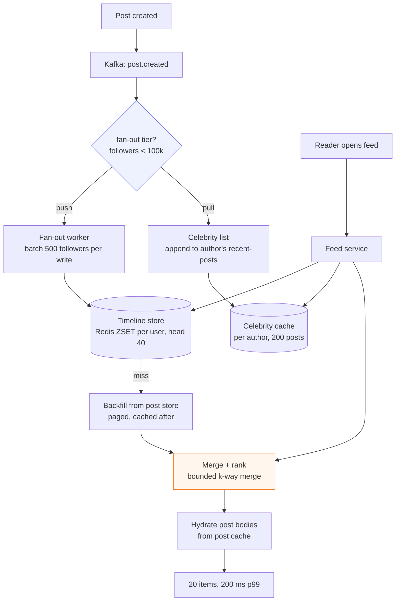

# 14 · News feed and timeline

!!! abstract "The question"
    **"Design Instagram's feed."** One post must appear in the timelines of
    everyone who follows the author — including the account with fifty million
    followers — and a reader must get a page of twenty items in under 200 ms.

!!! info "Source"
    Facebook's *TAO: Facebook's Distributed Data Store for the Social Graph*
    (USENIX ATC 2013) for the graph layer and its read patterns. The fan-out
    arithmetic, the hybrid rule and the code are this chapter's additions.

---

## 1. The problem, and the naive design

The naive feed reads the graph at request time:

```sql
-- "show me the 20 newest posts from everyone I follow"
SELECT p.* FROM posts p
JOIN follows f ON f.followee = p.author_id
WHERE f.follower = :me
ORDER BY p.created_at DESC
LIMIT 20;
```

It is correct, and it dies three ways at once:

| Problem | What happens | Consequence |
|---|---|---|
| The join fans out at read time | following 800 accounts means merging 800 post lists per page view | p99 grows with the heaviest user's follow count |
| No index covers it | `ORDER BY created_at` across 800 authors cannot use one | a sort of millions of rows |
| Reads vastly outnumber writes | 50M daily readers × 20 sessions | the read path is the whole system |

The opposite extreme — **fan-out on write**, where publishing a post writes a
row into every follower's timeline — fixes reads and creates a different
disaster. One post from an account with 50M followers is 50M row inserts. At
1,000 posts/second, if every author were that size, you would need
5 × 10¹⁰ inserts/second.

Real systems ship the hybrid: **push for ordinary accounts, pull for the
handful of accounts whose fan-out would be absurd**, and merge the two at read
time.

---

## 2. The numbers that decide the design

The design is decided by the shape of the follower distribution, not by the
average.

| Figure | Value | Consequence |
|---|---|---|
| Daily active readers | 50M | the read path dominates everything |
| Posts per second | 1,000 average, 3,000 peak | writes are small; fan-out is not |
| Median followers per author | ~150 | a push costs 150 inserts |
| p99 author followers | ~50,000 | a push costs 50k inserts |
| Largest accounts | 50M followers, ~200 accounts | one push = 50M inserts; at 2 posts/s that is **10⁸ inserts/s** |
| Read QPS | 11.6k average, **60k peak** | each read must be a cache hit, not a merge of 800 lists |
| Timeline page | 20 items × 300 B = 6 KB | 60k reads/s × 6 KB = **360 MB/s** of egress |
| Full timeline cache for every reader | 50M × 800 entries × 120 B ≈ **4.8 TB** | affordable only if you cache the head, not the whole thing |
| Head-only cache (40 entries) | 50M × 40 × 120 B = **240 GB** | 20× cheaper, and covers ~95% of page views |

The **followers-per-author distribution** is the number that matters. If you
push for everyone, your write amplification is set by the tail, and the tail is
4–5 orders of magnitude above the median. If you pull for everyone, your read
latency is set by the heaviest follower's follow count.

---

## 3. The mental model

> **A feed is a materialised join, and you get to choose where to pay for it:
> at write time (push), at read time (pull), or in a hybrid where the
> distribution decides per author.**

The rule that falls out: push when `followers × posts_per_second` fits your
write budget, pull when it does not, and make the read path merge a small,
bounded number of sources either way. Never let a single request's cost depend
on the size of one user's graph.

---

## 4. The flow chart



Two failure points worth naming: a fan-out worker that stalls turns into a lag
alarm, not a lost post (the log is the source of truth), and a merge that is not
bounded turns the p99 into a function of how many celebrities a user follows.

---

## 5. Sizing the components

| Component | Unit of work | Cost per unit | Peak demand | Provisioned | Headroom |
|---|---|---|---|---|---|
| Fan-out worker | 1 post → N follower writes | 500 inserts per batch, ~5 ms | 3,000 posts/s × 150 avg = **450k inserts/s** | 40 pods, 12k inserts/s each | 1.1× |
| Kafka | 1 fan-out task | 200 B message | 450k tasks/s | 12 partitions × 3 | 2× |
| Timeline store | 1 ZADD + 1 ZREMRANGEBYRANK | ~0.1 ms | 450k writes/s, 60k reads/s | 24 Redis shards | 3× |
| Celebrity cache | 1 author's recent posts | 200 entries | 200 authors | 3 replicas | trivial |
| Feed service | 1 page render | merge 3–8 sources + hydrate | 60k/s | 30 pods (2k/s each) | 1.5× |
| Post body cache | 1 hydrate | 300 B per post | 60k × 20 = 1.2M reads/s | 12 shards | 2× |

**Bytes on the wire.**

- post ingest: 3,000 posts/s × 400 B = **1.2 MB/s** — trivially small
- fan-out: 450k tasks/s × 200 B = **90 MB/s** into the timeline store
- read egress: 60k pages/s × 6 KB = **360 MB/s** — the dominant cost, and why pages are cached as JSON, not re-rendered
- merge inputs: 60k × 8 sources × 2 KB = **960 MB/s** of internal traffic unless sources are pre-trimmed to 20 items

That last line is the design constraint people miss: each source must return
**at most k items**, not its whole history, or the merge traffic dwarfs the
response.

| Benchmark | How to measure | Target | What it tells you |
|---|---|---|---|
| Feed p99 | synthetic load, 60k rps | ≤ 200 ms | the whole SLO |
| Fan-out lag | Kafka consumer lag, p99 | < 5 s | posts are arriving in timelines on time |
| Cache hit rate, head | hits ÷ reads | ≥ 95% | below this the merge path is doing the work |
| Merge sources per read | histogram | p99 ≤ 8 | one user following 2,000 celebrities must not cost 2,000 merges |
| Backfill rate | reads served from post store | < 5% | the head cache is sized right |

---

## 6. The algorithm, end to end

Two paths, one shared merge. The tier decision happens once per post, at ingest.

| # | Path | Who | What happens | Durable afterwards |
|---|---|---|---|---|
| 1 | write | API | stores the post, appends to the author's post list | post row |
| 2 | write | API | publishes `post.created` with the author id | Kafka log |
| 3 | write | fan-out worker | reads the tier: `followers < 100k` → push, else pull | nothing |
| 4 | write | push path | pages followers in batches of 500, `ZADD` into each timeline, trim to 800 | timeline entries |
| 5 | write | pull path | appends to the author's celebrity list, capped at 200 | celebrity entry |
| 6 | read | feed service | fetches the pushed head (1 ZSET range read) | nothing |
| 7 | read | feed service | fetches up to 8 celebrity lists the reader follows | nothing |
| 8 | read | feed service | bounded k-way merge by timestamp, take 20 | nothing |
| 9 | read | feed service | hydrates 20 post bodies from cache, renders, caches the page | page cache entry |

```text
function onPostCreated(post):
    followers = graph.countFollowers(post.author)      # cached count, not a scan
    if followers < PUSH_THRESHOLD:                     # 100k
        for batch in graph.followersOf(post.author, page = 500):
            pipeline { for f in batch: ZADD timeline(f, post.ts, post.id) }
            trim(timeline, keep = 800)
    else:
        ZADD celebrity(post.author, post.ts, post.id)  # one write, not 50M
        trim(celebrity(post.author), keep = 200)


function readFeed(user, limit = 20):
    sources = []
    sources.push(timelineRange(user, limit))                       # pushed head
    for author in celebritiesFollowedBy(user, limit = 8):          # bounded!
        sources.push(celebrityRange(author, limit))
    if sources.isEmpty: sources.push(backfillFromPosts(user, limit))

    merged = kwayMerge(sources, by = timestamp, limit = limit)     # bounded heap
    return hydrate(merged)                                        # 1 mget
```

**Invariants.**

- **Per-request cost never depends on graph size.** The celebrity merge is
  capped at 8 sources; a user following 2,000 celebrities gets 8 of them merged
  and the rest by backfill, not 2,000 merges.
- **Every source returns at most k items.** A source that returns its whole
  history makes the merge the bottleneck.
- **The timeline is a cache, not a record.** Losing a ZSET costs a backfill, not
  a post — the log and the post store are the truth.
- **Fan-out is idempotent per (post, follower).** Replaying a Kafka batch must
  not duplicate an entry; `ZADD` on a member is naturally idempotent.
- **The tier is decided per author, not per post.** Otherwise a celebrity's
  small post still costs 50M inserts.

| Edge case | What the algorithm does |
|---|---|
| Author crosses 100k followers | next post routes to pull; existing timelines drain by backfill |
| User follows 2,000 celebrities | merge is capped; the rest appear via backfill on scroll |
| Fan-out worker down for 10 minutes | Kafka lag grows; posts appear when it catches up, in order |
| Reader with an empty timeline | explicit backfill query, not an empty page |
| Post deleted | tombstone in the post store; hydration filters it out |
| One post goes viral | read traffic rises, write cost is unchanged — that is the point of push |

---

## 7. Build it

### Step 1 — the timeline store and the merge

```python
# code/feed/timeline.py (excerpt)
class TimelineStore:
    """Redis ZSET semantics in memory: score = timestamp, member = post id."""

    def __init__(self, cap: int = 800):
        self.cap = cap
        self.z: dict[str, dict[str, float]] = {}

    def add(self, user: str, post_id: str, ts: float) -> None:
        z = self.z.setdefault(user, {})
        z[post_id] = ts
        if len(z) > self.cap:                      # keep the head only
            for pid, _ in sorted(z.items(), key=lambda kv: kv[1])[: len(z) - self.cap]:
                del z[pid]

    def head(self, user: str, k: int) -> list[tuple[str, float]]:
        return sorted(self.z.get(user, {}).items(), key=lambda kv: -kv[1])[:k]


def kway_merge(sources, k=20):
    """Bounded merge: each source is already sorted newest-first, and we only
    ever hold k items, so a user with 8 sources costs 8 heap pushes per item."""
    import heapq
    heap, out = [], []
    for i, src in enumerate(sources):
        if src:
            pid, ts = src[0]
            heapq.heappush(heap, (-ts, pid, i, 0))
    while heap and len(out) < k:
        neg_ts, pid, i, idx = heapq.heappop(heap)
        out.append(pid)
        nxt = idx + 1
        if nxt < len(sources[i]):
            pid2, ts2 = sources[i][nxt]
            heapq.heappush(heap, (-ts2, pid2, i, nxt))
    return out
```

### Step 2 — the tier decision, with the arithmetic in it

```python
# code/feed/fanout.py (excerpt)
PUSH_THRESHOLD = 100_000        # followers
CELEB_MERGE_CAP = 8             # sources merged per read

def tier(followers: int) -> str:
    """Push when the write cost is bounded; pull when it is not."""
    return "push" if followers < PUSH_THRESHOLD else "pull"

def fanout(post, followers, store):
    if tier(len(followers)) == "push":
        for f in followers:
            store.add(f, post.id, post.ts)
    else:
        store.add("celeb:" + post.author, post.id, post.ts)
```

### Step 3 — see the two strategies diverge

```bash
python code/feed/bench.py
# push-everything : 1,000 posts/s x 50M followers -> 5.0e10 writes/s (impossible)
# push-hybrid     : 980 posts/s x 150 avg + 20 posts/s x 1 celeb write
#                 = 147,020 writes/s, 99.99% of reads served from the head
# pull-everything : 60,000 reads/s x 800 followees = 4.8e7 list reads/s (impossible)
```

The benchmark prints those three lines from the same follower distribution the
chapter uses, so the argument is checkable rather than asserted.

---

## 8. The production layer

```yaml
# deploy/feed/fanout-worker.yaml (abridged)
apiVersion: apps/v1
kind: Deployment
metadata: { name: fanout-push, namespace: feed }
spec:
  replicas: 40
  template:
    spec:
      containers:
        - name: worker
          image: ghcr.io/example/fanout:2.1.0
          args: ["--batch=500", "--tier=push", "--trim=800"]
          env:
            - { name: KAFKA_BROKERS, value: kafka-0.kafka:9092 }
            - { name: TIMELINE_URL, valueFrom: { secretKeyRef: { name: feed, key: timeline-url } } }
          resources:
            requests: { cpu: "1", memory: 512Mi }
---
apiVersion: keda.sh/v1alpha1
kind: ScaledObject
metadata: { name: fanout-push, namespace: feed }
spec:
  scaleTargetRef: { name: fanout-push }
  minReplicaCount: 8
  maxReplicaCount: 120
  triggers:
    - type: kafka
      metadata:
        bootstrapServers: kafka-0.kafka:9092
        consumerGroup: fanout-push
        topic: post.created
        lagThreshold: "50000"       # scale on lag, not CPU
```

| Knob | Value | Why |
|---|---|---|
| Batch size | 500 followers per write | 500 pipelined ZADDs is one round trip |
| Timeline cap | 800 entries | the head is what gets read; older pages backfill |
| Merge cap | 8 celebrity sources | bounds per-request cost |
| Consumer group | one per tier | a stalled push consumer must not block pull |
| Page cache | 30 s TTL on the rendered 20 | 60k reads/s of the same pages |

| Alert | Threshold | Why |
|---|---|---|
| Consumer lag | > 50k messages for 2 min | timelines are going stale |
| Feed p99 | > 200 ms | merge or hydration is slow |
| Merge sources p99 | > 8 | someone's follow graph is breaking the bound |
| Timeline evictions | > 5% of reads | the head cache is undersized |

### Failure drills

1. **Celebrity post.** Publish from an account with 50M followers; assert one
   write, not 50M, and that the feed still shows it.
2. **Consumer stop.** Kill the fan-out workers for ten minutes; confirm lag
   recovers and no post is lost.
3. **Merge storm.** Give one user 2,000 celebrity follows; assert p99 stays
   flat because the merge is capped.
4. **Cold reader.** A user with no pushed timeline; confirm backfill returns a
   page rather than an empty screen.

---

## 9. The two-minute answer

> "A feed is a materialised join and you choose where to pay for it. Fan-out on
> write gives cheap reads: publishing writes one entry into every follower's
> timeline. With a median of 150 followers that is 150 inserts per post, and at
> 1,000 posts a second it is 150,000 inserts a second — fine. But the
> distribution has a tail: one account with 50M followers is 50M inserts, and
> two posts a second from accounts that size is 10⁸ inserts a second, which is
> not a system, it is a wish.
>
> So the hybrid everyone ships: push for authors under a threshold — 100k
> followers, say — and pull for the celebrities. A celebrity post is one write
> into that author's recent-posts list, and readers merge it at read time. The
> read path fetches the pushed head from a Redis sorted set, merges at most
> eight celebrity lists it follows, does a bounded k-way merge for twenty items,
> and hydrates the bodies from a post cache. Capping the merge at eight is the
> important part: per-request cost must never depend on the size of someone's
> follow graph.
>
> Numbers that shape it: 60,000 feed reads a second at 6 KB a page is 360 MB/s
> of egress, so pages are cached rendered, not re-rendered. A full timeline for
> every reader would be 4.8 TB of Redis; caching only the head — forty entries —
> is 240 GB and covers about 95% of page views. Everything older backfills from
> the post store.
>
> And the invariants: the timeline is a cache, not a record, so losing a shard
> costs a backfill rather than a post; fan-out is idempotent per post and
> follower, so a Kafka replay is safe; and the tier is decided per author, once,
> not per post."

### Follow-ups you should expect

| Question | The answer they want |
|---|---|
| "Where is the threshold?" | wherever `followers × posts/s` stops fitting the write budget; measure, do not guess |
| "Why not rank at write time?" | ranking depends on the reader; store by time, rank at read |
| "How do you handle a deleted post?" | tombstone in the post store, filtered at hydration; no fan-out rewrite |
| "Push vs pull, in one line?" | push when the tail is small, pull when it is not, merge both at read |
| "What breaks first?" | the merge, if you let it grow with the follow graph; then egress |
| "How is this different from chapter 09?" | 09 fans out to *devices* with a bounded provider limit; this fans out to *mailboxes* with an unbounded follower count |

**Code:** `code/feed/` · **Manifests:** `deploy/feed/`
