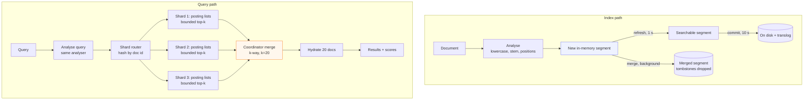

# 15 · Search: inverted index to ranking

!!! abstract "The question"
    **"Design search for a docs product with ten million documents."** Type a
    query, get the twenty most relevant pages in 50 ms, and keep doing it while
    documents are added, edited and deleted underneath you.

!!! info "Source"
    Lucene's index model as documented by Elasticsearch — segments, refresh
    versus commit, tombstones, and the near-real-time contract. The arithmetic,
    the sharded top-k and the code are this chapter's additions.

---

## 1. The problem, and the naive design

The naive search is a scan with a `LIKE`:

```sql
SELECT id, title FROM docs
WHERE title ILIKE '%postgres%' OR body ILIKE '%postgres%'
LIMIT 20;
```

It is honest about what it does and unusable past a few hundred thousand rows:

| Problem | What happens | Consequence |
|---|---|---|
| Full scan per query | 10M rows × ~2 KB read per query | seconds per search, at any concurrency |
| No term statistics | cannot rank; returns whatever the planner found first | the best page is often not on page one |
| No phrase awareness | `"idempotency key"` matches documents with both words anywhere | precision collapses |
| No scoring | no IDF, no field weights | a passing mention outranks the definitive doc |

The fix is an **inverted index**: for each term, the list of documents that
contain it — plus, if you want phrases, the positions inside each document.

---

## 2. The numbers that decide the design

| Figure | Value | Consequence |
|---|---|---|
| Documents | 10M | the corpus fits on a handful of nodes, so shard count is about latency, not capacity |
| Terms per document | ~500 after tokenisation | 5 × 10⁹ postings before compression |
| Postings entry, compressed | ~1.5 B (delta + varint) | **~7.5 GB** of postings; with positions, ~22 GB |
| Query latency budget | 50 ms search, **20 ms typeahead** | the typeahead budget forbids scatter-gather over many shards |
| Documents matching a typical query | 10⁴–10⁶ | you cannot score them all; you need top-k |
| k returned | 20 | a bounded heap of 20, not a sort of a million |
| Refresh interval | 1 s (Lucene) | new documents are visible within a second |
| Commit interval | 10 s or 30 s | durability, not visibility — the two are different knobs |
| Segment merge | continuous, background | deletes are tombstones until a merge rewrites the segment |

The number that shapes everything is **the mismatch between matches and
results**: a query matching a million documents must still cost work
proportional to *k*, not to the match count. That is what a bounded heap and a
block-max index buy you, and it is why "approximate top-k" is a legitimate
engineering choice.

---

## 3. The mental model

> **An inverted index turns "find documents containing X" into "read one
> posting list", and search becomes a merge over those lists with a bounded
> heap. Ranking is a function of the posting list's statistics, not of the
> document's contents at query time.**

Two consequences: writes are append-only segments that are searched as they
are, so deletes are tombstones until a merge; and because posting lists are
sorted by document id, top-k by score requires either a full traversal or an
index that lets you skip — which is why search engines trade a little recall for
a lot of latency.

---

## 4. The flow chart



The failure to watch: a coordinator that collects *all* matches from every shard
before sorting. At a million matches per shard, that is the difference between
50 ms and 5 seconds.

---

## 5. Sizing the components

| Component | Unit of work | Cost per unit | Peak demand | Provisioned | Headroom |
|---|---|---|---|---|---|
| Index shard | 5M documents, ~11 GB with positions | ~10 ms per query for top-k | 500 q/s | 3 primary shards | 3× |
| Replica shard | same, read-only | doubles read capacity | 500 q/s | 1 replica each | 2× |
| Coordinator | 1 query | 1 ms merge + hydration | 500 q/s | 3 pods | 10× |
| Ingest | 1 document | ~2 ms analysis | 200 docs/s | 4 pods | 3× |
| Merge thread pool | 1 segment merge | I/O bound, throttled | background | 2 threads per node | — |

**Bytes on the wire.**

- query: 500 q/s × 200 B = **0.1 MB/s** in — searches are tiny
- shard → coordinator: 500 q/s × 3 shards × 20 hits × 60 B = **1.8 MB/s**
- hydration: 500 × 20 × 1.5 KB = **15 MB/s**
- ingest: 200 docs/s × 4 KB = **0.8 MB/s**, but indexing amplification (postings + stored fields + doc values) is ~3× on disk

Note how small the query path is compared with the feed: search is CPU-bound on
posting-list traversal, not bandwidth-bound. That changes what you scale.

| Benchmark | How to measure | Target | What it tells you |
|---|---|---|---|
| Query p99 | load test at 500 q/s | ≤ 50 ms | the SLO |
| Typeahead p99 | separate endpoint, k=5 | ≤ 20 ms | prefix queries must not scatter-gather |
| Recall@20 | golden set of query→doc pairs | ≥ 0.95 | approximate top-k has not eaten the answer |
| Refresh lag | write → searchable | ≤ 1 s | near-real-time is actually near |
| Segment count | per shard | < 30 | too many segments means merge is losing |

---

## 6. The algorithm, end to end

| # | Path | Who | What happens | Durable afterwards |
|---|---|---|---|---|
| 1 | write | ingest | analyse the document: lowercase, stem, record positions | nothing |
| 2 | write | shard | route by `hash(doc_id)` to a primary | — |
| 3 | write | shard | append to the in-memory segment and the translog | translog on disk |
| 4 | write | shard | refresh after 1 s: the segment becomes searchable | segment (in memory) |
| 5 | write | shard | commit after 10 s: fsync segment, checkpoint translog | segment on disk |
| 6 | read | coordinator | analyse the query, fan out to one shard per hash range | nothing |
| 7 | read | shard | per term, read the posting list, intersect, score with BM25 | nothing |
| 8 | read | shard | push into a **bounded heap of k**, discarding the rest | nothing |
| 9 | read | coordinator | k-way merge the shard heaps, take 20 | nothing |
| 10 | read | coordinator | hydrate 20 documents from the stored fields | nothing |

```text
function index(doc):
    terms = analyse(doc.text)                   # tokenise, lowercase, stem
    for term, positions in terms:
        segment.postings[term].add(doc.id, positions, fieldWeights)
    translog.append(doc)                        # durability before visibility
    if now - lastRefresh > 1s: refresh()        # make it searchable
    if now - lastCommit  > 10s: commit()        # make it durable on disk


function search(query, k = 20):
    terms = analyse(query)
    heap  = boundedHeap(k)                      # holds only the best k so far

    for shard in shardsFor(query):
        for doc in intersectPostings(shard, terms):   # doc-at-a-time
            score = bm25(doc, terms, shard.stats)
            if heap.wouldAccept(score):               # the cheap early exit
                heap.push(doc, score)
    return mergeHeaps(heap).top(k)


function delete(docId):
    tombstone(docId)                            # invisible immediately, still on disk
    # the space is reclaimed when the segment is merged
```

**Invariants.**

- **Visibility and durability are separate.** Refresh makes a document
  searchable; commit makes it survive a crash. Conflating them either loses data
  or makes every write fsync.
- **Deletes are tombstones until merge.** A deleted document still occupies
  postings; segment count is the health signal.
- **A shard returns at most k hits.** Anything more moves the cost to the
  network and the coordinator.
- **The analyser is identical on both sides.** A query analysed differently from
  the documents finds nothing, and it is the most common silent bug.
- **Scores are only comparable within one index snapshot.** Do not cache scores
  across refreshes.

| Edge case | What the algorithm does |
|---|---|
| Query matches 1M documents | bounded heap; the coordinator never sees more than k per shard |
| Document updated | new version indexed, old tombstoned; refresh makes the new one visible |
| Shard down | replica serves; if both are down, the coordinator returns partial results with a flag |
| Prefix query for typeahead | separate index or edge n-grams, one shard, k=5 |
| Term in 90% of documents | IDF pushes its weight to ~0, which is correct |
| Segment explosion after bulk load | force-merge offline, never on the query path |

---

## 7. Build it

### Step 1 — an inverted index you can query

```python
# code/search/index.py (excerpt)
class Index:
    def __init__(self):
        self.postings: dict[str, dict[str, list[int]]] = {}   # term -> doc -> positions
        self.docs: dict[str, dict] = {}
        self.tombstones: set[str] = set()
        self.analyser = analyse

    def add(self, doc_id: str, text: str, fields: dict | None = None):
        for pos, term in enumerate(self.analyser(text)):
            self.postings.setdefault(term, {}).setdefault(doc_id, []).append(pos)
        self.docs[doc_id] = {"text": text, **(fields or {})}

    def remove(self, doc_id: str):
        self.tombstones.add(doc_id)          # visible gone, still indexed

    def search(self, query: str, k: int = 20) -> list[tuple[str, float]]:
        terms = self.analyser(query)
        if not terms:
            return []
        # candidate set = intersection of posting lists (rarest term first)
        terms = sorted(terms, key=lambda t: len(self.postings.get(t, {})))
        candidates = set(self.postings.get(terms[0], {})) - self.tombstones
        for t in terms[1:]:
            candidates &= set(self.postings.get(t, {}))
        # score only the survivors, with a bounded heap
        heap = []
        for doc_id in candidates:
            s = self.bm25(doc_id, terms)
            if len(heap) < k:
                heapq.heappush(heap, (s, doc_id))
            elif s > heap[0][0]:
                heapq.heapreplace(heap, (s, doc_id))
        return [(d, round(s, 3)) for s, d in sorted(heap, reverse=True)]
```

`rarest term first` is the small decision that makes it usable: intersecting a
50-document posting list with a 1M-document one costs 50 lookups, not a million.

### Step 2 — ranking is a formula, so name its symbols

BM25 scores a document for a query term:

$$
\text{score}(q, d) = \sum_{t \in q} \text{IDF}(t) \cdot \frac{f(t,d)\,(k_1 + 1)}{f(t,d) + k_1\left(1 - b + b\,\frac{|d|}{\text{avgdl}}\right)}
$$

| Symbol | Read as | Typical value |
|---|---|---|
| \(f(t,d)\) | term frequency: how many times \(t\) occurs in \(d\) | 1–20 |
| \(|d|\) | document length in terms | ~500 |
| \(\text{avgdl}\) | mean document length across the shard | ~500 |
| \(k_1\) | term-frequency saturation: how quickly repeats stop helping | 1.2–2.0 |
| \(b\) | length normalisation: 0 ignores length, 1 fully normalises | 0.75 |
| \(\text{IDF}(t)\) | inverse document frequency, \(\log(1 + (N - n + 0.5)/(n + 0.5))\) where \(N\) is documents in the shard and \(n\) is documents containing \(t\) | 0.1–10 |
| \(q\), \(d\) | the query and the document | — |

The \(k_1\) saturation is why a page mentioning "postgres" twenty times does not
outrank the definitive guide that mentions it eight times.

### Step 3 — sharding and the scatter-gather

```python
# code/search/cluster.py (excerpt)
class Cluster:
    def search(self, query, k=20, shard_timeout_ms=40):
        heaps = parallel_map(self.shards, lambda s: s.search(query, k),
                             timeout_ms=shard_timeout_ms)
        # merge k-way; a slow shard contributes partial results, it does not block
        merged = heapq.nlargest(k, chain.from_iterable(heaps), key=lambda x: x[1])
        return [(doc, score) for score, doc in merged]
```

---

## 8. The production layer

```yaml
# deploy/search/opensearch.yaml (abridged)
apiVersion: opensearch.org/v1
kind: OpenSearchCluster
metadata: { name: docs-search, namespace: search }
spec:
  general:
    version: 2.15.0
    httpPort: 9200
    serviceName: docs-search
  dashboards: { enable: false }
  nodePools:
    - component: masters
      replicas: 3
      diskSize: 20Gi
      nodeSelector: { role: master }
      resources: { requests: { cpu: "1", memory: 2Gi }, limits: { memory: 2Gi } }
    - component: data
      replicas: 3
      diskSize: 200Gi              # ~11 GB per 5M docs, plus headroom for merges
      resources: { requests: { cpu: "4", memory: 16Gi }, limits: { memory: 16Gi } }
      jvm: -Xms8g -Xmx8g           # heap <= 50% of RAM, and never above 31 GB
---
apiVersion: batch/v1
kind: CronJob
metadata: { name: reindex, namespace: search }
spec:
  schedule: "0 4 * * 0"            # weekly full rebuild, into a new index alias
  jobTemplate:
    spec:
      template:
        spec:
          restartPolicy: OnFailure
          containers:
            - name: reindex
              image: ghcr.io/example/reindex:1.0.0
              args: ["--from=docs-v3", "--to=docs-v4", "--alias=docs-current"]
```

| Knob | Value | Why |
|---|---|---|
| `refresh_interval` | 1 s (5 s during bulk load) | visibility versus merge pressure |
| `translog.durability` | `async` (default) | `request` fsyncs every write; 10× slower |
| Heap | 8 GB on a 16 GB node | the rest is filesystem cache, which Lucene needs |
| Shards | 3 primaries, 1 replica | more shards = more parallelism but more per-query overhead |
| Alias | `docs-current` | reindex into a new index, flip the alias, no downtime |

| Alert | Threshold | Why |
|---|---|---|
| Query p99 | > 50 ms | posting lists are cold or a shard is degraded |
| Segment count | > 30 per shard | merge is falling behind; search gets slower |
| Refresh lag | > 2 s | indexing backpressure |
| Shard unassigned | > 0 for 5 min | replica loss; one more failure and you are down |

### Failure drills

1. **The million-match query.** Search a term present in 10% of documents;
   assert p99 stays at 50 ms because the heap is bounded.
2. **Delete and search.** Delete a document, search for it; assert it is gone
   immediately and the disk does not shrink until merge.
3. **Analyser mismatch.** Index with stemming and query without; watch recall
   collapse — then fix the analyser on both sides.
4. **Shard timeout.** Make one shard slow; confirm partial results with a flag
   rather than a failed query.

---

## 9. The two-minute answer

> "Search is an inverted index plus a bounded top-k, and the two decisions that
> matter are how you write and how much you are willing to read. For ten
> million documents at about five hundred terms each, that is five billion
> postings, roughly seven and a half gigabytes compressed and twenty-two with
> positions — small enough that sharding is about latency, not capacity, so
> three primaries with a replica.
>
> Writes are append-only segments. A refresh every second makes a new document
> searchable; a commit every ten seconds makes it durable. Those are different
> knobs and conflating them either loses data or fsyncs every write. Deletes are
> tombstones until a background merge rewrites the segment, which is why segment
> count is the health metric nobody watches until search gets slow.
>
> Reads are the interesting part. A query can match a million documents, so cost
> has to be proportional to k, not to matches: each shard intersects posting
> lists rarest-term-first and pushes scores into a bounded heap of twenty, and
> the coordinator merges the shard heaps. If a shard collects all its matches
> before sorting, fifty milliseconds becomes five seconds.
>
> Ranking is BM25 — term frequency saturating at k1, normalised by document
> length with b, weighted by inverse document frequency — and the saturation is
> why a passing mention does not outrank the definitive page. Typeahead gets its
> own budget, twenty milliseconds, which means one shard or edge n-grams, never
> a scatter-gather.
>
> And the invariant that bites most often: the analyser must be identical on the
> index and query side, or you silently return nothing."

### Follow-ups you should expect

| Question | The answer they want |
|---|---|
| "Why not just use a database index?" | no term statistics, no phrase positions, no ranking — a B-tree finds equality, not relevance |
| "How do you keep it fresh?" | refresh 1 s for visibility, commit 10 s for durability, alias flip for reindex |
| "Exact or approximate top-k?" | approximate in practice; measure recall@20 on a golden set so the trade is visible |
| "How many shards?" | enough for parallelism, few enough to avoid per-query overhead; 3–5 per 10M docs |
| "Ranking beyond BM25?" | a second-stage reranker on the top 100 (chapter 11), not a heavier first stage |
| "Deletes?" | tombstone now, reclaimed at merge; watch segment count |

**Code:** `code/search/` · **Manifests:** `deploy/search/`
