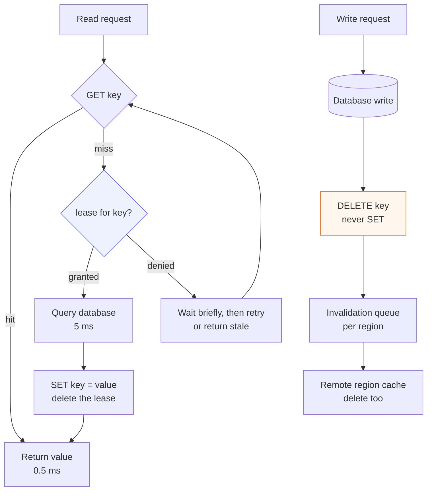

# 16 · The cache tier

!!! abstract "The question"
    **"Put a cache in front of your database — now make it correct."** Every
    chapter so far assumes reads are cheap. This is the chapter that makes them
    cheap, without turning a cache miss into an outage or a stale read into a
    support ticket.

!!! info "Source"
    *Scaling Memcache at Facebook* (NSDI 2013) — billions of requests per
    second, trillions of items, and the published per-pool miss rates used
    below. The arithmetic, the client and the drills are this chapter's
    additions.

---

## 1. The problem, and the naive design

The naive cache is three lines:

```python
def get_user(uid):
    cached = redis.get(f"user:{uid}")
    if cached:
        return json.loads(cached)
    row = db.query("SELECT * FROM users WHERE id = %s", uid)
    redis.set(f"user:{uid}", json.dumps(row), ex=300)
    return row
```

It works until it does not, and it fails in four distinct ways — each of which
needs a different mechanism:

| Failure | What happens | Mechanism that fixes it |
|---|---|---|
| **Stampede** | a hot key expires; 5,000 concurrent requests all miss and all query the DB | leases / single-flight |
| **Stale set** | a writer sets the cache while a concurrent reader is still fetching the old row | delete-only invalidation + leases |
| **Hot key** | one key at 50k reads/s melts the single shard that owns it | key replication / local in-process cache |
| **Cold start** | a new region or a restarted fleet has 0% hit rate | gutter pool, gradual warm-up |

The database is not fragile because it is slow; it is fragile because a cache
turns a steady 100k reads/second into a *binary* load on it.

---

## 2. The numbers that decide the design

| Figure | Value | Consequence |
|---|---|---|
| Cache reads | 100k gets/s | the cache is a tier, not an optimisation |
| Cache hit latency | ~0.5 ms | versus ~5 ms for the database |
| **1% miss rate** | 1,000 queries/s to the DB | comfortable — a single primary absorbs it |
| **10% miss rate** | 10,000 queries/s | an outage: that is the whole database's capacity |
| Wildcard pool miss rate (published) | 1.76% | normal, healthy |
| Replicated pool miss rate (published) | 0.053% | 30× better, for hot items |
| App pool miss rate (published) | 7.85% | high churn — close to the danger line |
| Working set | 10M keys × 10 KB = **100 GB** | 3 nodes × 64 GB with replicas, not one big box |
| Hot key ceiling | one key, one shard | at 50k/s a single shard is at its limit; replicate or cache locally |

**The number to carry into a review: miss rate × read rate = database load.**
At 100k reads/second, every 1% of misses is 1,000 queries/second aimed at a
system sized for a fraction of that. That is why a cache outage is worse than no
cache: you go from 1% of traffic hitting the database to 100% of it, instantly.

---

## 3. The mental model

> **A cache is not a faster database; it is a bet that a key will be read again
> before it changes. Every correctness rule exists to keep that bet from being
> called at the worst possible moment.**

Two rules follow, and they are the whole chapter:

1. **The cache is not a source of truth.** If you cannot rebuild it from the
   database, you have built a second database with weaker guarantees.
2. **Invalidation deletes; it does not set.** A `SET` from a writer can race a
   concurrent reader's fetch and install a value older than the one it replaced.

---

## 4. The flow chart



The lease is the mechanism that turns a stampede into one database query plus
4,999 short waits. The delete-not-set rule is what stops a writer from
resurrecting a stale row.

---

## 5. Sizing the components

| Component | Unit of work | Cost per unit | Peak demand | Provisioned | Headroom |
|---|---|---|---|---|---|
| Cache shard | 1 GET | ~0.1 ms of CPU | 100k gets/s | 6 shards (3 primaries + replicas) | 4× |
| Cache memory | 1 value | 10 KB average | 100 GB working set | 6 × 64 GB = 384 GB | 3× |
| Database on a 1% miss | 1 query | 5 ms | 1,000 q/s | sized for 2,000 q/s | 2× |
| Database on a 10% miss | 1 query | 5 ms | 10,000 q/s | **5× over capacity** | — |
| Invalidation queue | 1 delete | ~0.2 ms | 5k writes/s | 3 consumers | 6× |

**Bytes on the wire.**

- cache reads: 100k × (60 B key + 10 KB value) = **1 GB/s** of egress — the cache tier is the bandwidth-heavy tier
- cache writes: 5k writes/s × 10 KB = **50 MB/s**
- database under 1% miss: 1,000 × 10 KB = **10 MB/s**
- database under a stampede: 5,000 concurrent × 10 KB = **50 MB/s in a burst**, and the queue is the problem, not the bytes

| Benchmark | How to measure | Target | What it tells you |
|---|---|---|---|
| Hit rate | hits ÷ (hits + misses) | ≥ 98% | below 95% the database is at risk |
| Cache p99 | per-shard latency | ≤ 5 ms | a slow cache is worse than a miss |
| Lease grant rate | grants ÷ misses | ~1 per key | more than that means the lease is too short |
| Stale-read rate | reads older than the write | ~0 | invalidation is working |
| Hot-key skew | top key ÷ median key | < 100× | above that, replicate or cache locally |

---

## 6. The algorithm, end to end

| # | Path | Who | What happens | If this step fails |
|---|---|---|---|---|
| 1 | read | app | `GET key` | cache down → **read the database** and set a flag |
| 2 | read | app | on miss, request a lease for that key | lease exists → wait 50 ms, retry the GET |
| 3 | read | app | query the database | query error → release the lease, return an error |
| 4 | read | app | `SET key` with a TTL, delete the lease | set fails → the next reader repeats the work |
| 5 | write | app | write the database, then `DELETE key` | delete fails → enqueue to the invalidation log and retry |
| 6 | write | queue | broadcast the delete to other regions | lag → that region serves stale until it catches up |
| 7 | read | app | if the cache is unavailable, serve from the DB with a circuit breaker | breaker open → return stale or 503, never a storm |

```text
function read(key):
    value = cache.get(key)
    if value != null: return value

    token = cache.lease(key, ttl = 10s)        # only one caller wins
    if token == null:
        sleep(50ms)
        value = cache.get(key)
        return value != null ? value : db.read(key)   # bounded fallback

    row = db.read(key)                          # exactly one query per key
    cache.set(key, row, ttl = jitter(300s))     # jitter avoids synchronised expiry
    cache.releaseLease(key, token)              # also invalidates a stale set
    return row


function write(key, row):
    db.write(key, row)
    cache.delete(key)                           # DELETE, never SET
    invalidateLog.publish(key)                  # other regions delete too
```

**Invariants.**

- **One lease per key, so one database query per miss.** Without it, a hot key's
  expiry is a self-inflicted DDoS.
- **Writers delete; readers set.** A reader's set is safe because it just read
  the truth; a writer's set is not, because it may be older than a concurrent
  reader's view.
- **TTLs are jittered.** Uniform expiry turns a cache into a metronome of
  stampedes.
- **The cache is disposable.** Every value must be reconstructible from the
  database, so a flush is a performance event, not a data event.
- **A cache outage degrades to the database with a breaker**, and the breaker's
  job is to protect the database, not the cache.

| Edge case | What algorithm does |
|---|---|
| Hot key expires under 50k/s | one lease holder queries; the rest wait 50 ms |
| Writer sets while a reader fetches | the reader's lease release invalidates the stale set |
| Cache node dies | its keys miss; the breaker caps DB load until it warms |
| New region, 0% hit rate | gutter pool: a small fallback cluster absorbs the cold misses |
| TTL too long | staleness bounded by the TTL, so choose it from the product's tolerance |
| Cache stampede after a deploy | warm before serving: replay the top N keys from the log |

---

## 7. Build it

### Step 1 — cache-aside with single-flight

```python
# code/cache/aside.py (excerpt)
class CacheAside:
    def __init__(self, cache, db, ttl=300, lease_ttl=10):
        self.cache, self.db = cache, db
        self.ttl, self.lease_ttl = ttl, lease_ttl

    def get(self, key):
        hit = self.cache.get(key)
        if hit is not None:
            return hit, "hit"

        token = self.cache.acquire_lease(key, self.lease_ttl)
        if token is None:
            time.sleep(0.05)
            hit = self.cache.get(key)
            if hit is not None:
                return hit, "waited"
            return self.db.read(key), "fallback"     # bounded, never a storm

        row = self.db.read(key)                      # one query per key
        self.cache.set(key, row, ttl=self.jitter(self.ttl))
        self.cache.release_lease(key, token)         # kills a stale concurrent set
        return row, "miss"
```

### Step 2 — the invalidation rule, demonstrated

```python
# code/cache/race.py
# Demonstrates why writers must DELETE, not SET:
#   t0  reader misses, starts a slow DB read (50 ms) -> sees v1
#   t1  writer commits v2 and SETs cache = v2
#   t2  reader finishes and SETs cache = v1        <- stale forever
# With DELETE at t1 and a lease check at t2, the reader's set is rejected.
python code/cache/race.py --strategy set     # stale value survives
python code/cache/race.py --strategy delete  # cache ends at v2
```

That script is the chapter in executable form: same interleaving, two
strategies, two outcomes.

### Step 3 — the miss-rate budget, as a number you can watch

```python
# code/cache/budget.py
python budget.py --reads 100000 --db-capacity 2000
# miss 0.5% ->    500 q/s -> 25% of DB capacity  OK
# miss 1.0% ->  1,000 q/s -> 50% of DB capacity  OK
# miss 2.0% ->  2,000 q/s -> 100% of DB capacity  AT THE EDGE
# miss 5.0% ->  5,000 q/s -> 250% of DB capacity  OUTAGE
```

Put that table in the alert's description, so whoever is on call at 3 a.m. knows
what a 3% miss rate means in queries per second.

---

## 8. The production layer

```yaml
# deploy/cache/redis.yaml (abridged)
apiVersion: apps/v1
kind: Deployment
metadata: { name: cache-proxy, namespace: cache }
spec:
  replicas: 6
  template:
    spec:
      containers:
        - name: proxy
          image: ghcr.io/example/cache-proxy:1.3.0
          args: ["--hash=ketama", "--lease-ttl=10s", "--local-ttl=1s"]
          env:
            - { name: REDIS_NODES, value: "redis-0:6379,redis-1:6379,redis-2:6379" }
          resources:
            requests: { cpu: 500m, memory: 256Mi }
          readinessProbe:
            httpGet: { path: /ready, port: 8080 }
            periodSeconds: 5
            failureThreshold: 2
---
apiVersion: batch/v1
kind: CronJob
metadata: { name: hotkey-report, namespace: cache }
spec:
  schedule: "*/5 * * * *"
  jobTemplate:
    spec:
      template:
        spec:
          restartPolicy: Never
          containers:
            - name: hotkeys
              image: ghcr.io/example/cache-tools:1.3.0
              args: ["hotkeys", "--threshold=100x-median", "--window=5m"]
```

| Knob | Value | Why |
|---|---|---|
| Consistent hashing in the client | ketama, 160 vnodes | one node loss moves 1/N of keys, not all of them |
| Local in-process cache | 1 s TTL | absorbs the top 10 keys without a network hop |
| Lease TTL | 10 s | long enough for a slow query, short enough to recover from a crash |
| Value TTL | 300 s, jittered ±10% | bounds staleness without synchronised expiry |
| Circuit breaker | open at 5% error, half-open after 10 s | protects the database, not the cache |

| Alert | Threshold | Why |
|---|---|---|
| Hit rate | < 95% for 5 min | the database is about to receive 5× its capacity |
| Cache p99 | > 5 ms | a slow cache is worse than a miss |
| Lease waiters | > 1,000 | a stampede is in progress |
| Hot key | > 100× median QPS | one shard is doing all the work |

### Failure drills

1. **Expire a hot key under load.** Delete the top key at 50k reads/s; assert one
   database query and a p99 bump under 100 ms.
2. **The set-versus-delete race.** Run `race.py` with both strategies and read
   the final cached value.
3. **Flush the cache.** `FLUSHALL` in staging; confirm the breaker caps database
   load and the fleet warms without an outage.
4. **Kill a cache node.** Confirm the client rehashes, miss rate rises to
   `1/N`, and the database absorbs it.

---

## 9. The two-minute answer

> "A cache is a bet that a key will be read again before it changes, and the
> whole design is about not losing that bet at the worst moment. The number that
> governs everything is miss rate times read rate: at 100,000 reads a second,
> every 1% of misses is 1,000 queries a second at the database. Published
> numbers from Facebook's memcache tier show a healthy pool at 1.76% miss and a
> replicated hot pool at 0.053%; an app pool at 7.85% is close to the line. So
> the alert is on hit rate, and the alert text says what the miss rate means in
> queries per second.
>
> Four mechanisms, four failures. Stampede: a hot key expires and 5,000 requests
> all miss — fix with a lease, so exactly one caller queries and the rest wait
> fifty milliseconds. Stale set: a writer sets the cache while a reader is still
> fetching the old row, and the stale value survives forever — fix by having
> writers delete rather than set, and by having the reader's lease release
> reject a stale write. Hot key: one key at 50k a second overwhelms one shard —
> fix with a short local in-process cache plus key replication. Cold start: a new
> region has 0% hit rate — fix with a gutter pool that absorbs the cold misses.
>
> Operationally: consistent hashing in the client so one node loss moves 1/N of
> keys; jittered TTLs so expiries do not synchronise; and a circuit breaker whose
> job is to protect the database, not the cache. And the invariant that keeps it
> safe: the cache is never a source of truth, so flushing it is a performance
> event, not a data event."

### Follow-ups you should expect

| Question | The answer they want |
|---|---|
| "Cache-aside or write-through?" | cache-aside for read-heavy; write-through only when you can tolerate the write latency |
| "Why delete instead of set?" | a writer's set can be older than a concurrent reader's fetch; delete cannot resurrect |
| "TTL or explicit invalidation?" | both: TTL bounds staleness, invalidation bounds it tighter |
| "What breaks first?" | the database, the moment hit rate drops; watch it, not the cache |
| "How do you warm a new region?" | replay the top keys, or route cold traffic to a gutter pool first |
| "How does this relate to chapter 06?" | 06 protects the API; this protects the database — same fail-open thinking |

**Code:** `code/cache/` · **Manifests:** `deploy/cache/`
