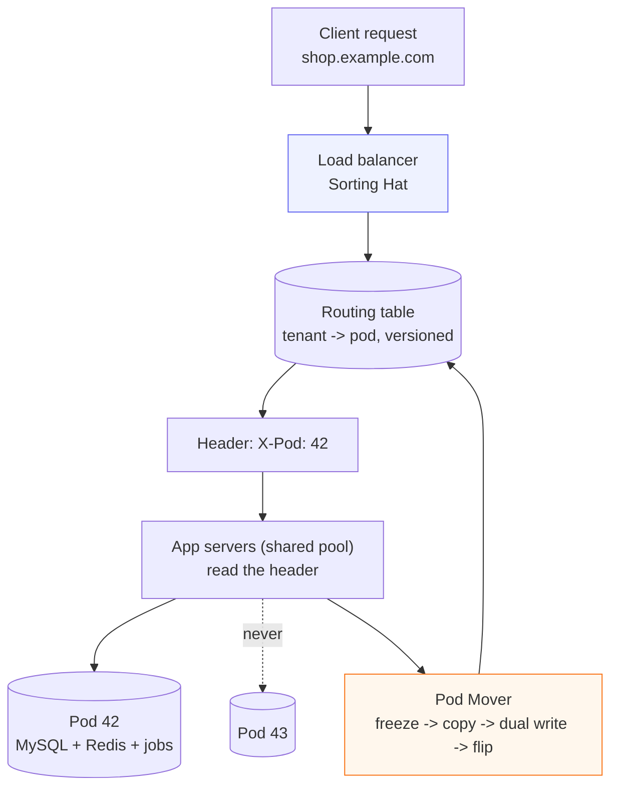

# 17 · Multi-tenant isolation

!!! abstract "The question"
    **"Design a B2B SaaS that one bad tenant cannot take down."** Ten thousand
    customers share your platform; one of them writes a runaway query at 3 a.m.
    and the other 9,999 must not notice.

!!! info "Source"
    Shopify Engineering, *A Pods Architecture To Allow Shopify To Scale*
    (2018), plus the follow-up on shard balancing (2021): sharding bought
    capacity but lost resilience, a shared Redis caused "Redismageddon", and the
    answer was pods — an isolated stack per tenant group, routed by a
    load-balancer component called Sorting Hat, with a Pod Mover that evacuates
    one in a minute without dropping requests.

---

## 1. The problem, and the naive design

The naive multi-tenant platform is one shared stack with a `tenant_id` column:

```sql
SELECT * FROM orders WHERE tenant_id = :t AND created_at > :since;
```

It is efficient, and it makes every tenant's reliability a function of every
other tenant's behaviour:

| Problem | What happens | Consequence |
|---|---|---|
| Shared connection pool | one tenant's slow query holds 200 of 500 connections | everyone else queues |
| Shared CPU and memory | a report job saturates the node | latency for all tenants |
| Shared cache | a tenant with a huge working set evicts everyone else's keys | hit rate collapses platform-wide |
| Shared blast radius | a corrupted migration or a bad deploy takes everyone down | 10,000 customers in one incident |
| Shared lock contention | one tenant's bulk update blocks a hot row | cross-tenant stalls |

Sharding the database alone does not fix this — Shopify learned exactly that:
sharding in 2015 bought capacity, but code like
`Sharding.with_each_shard { … }` meant *any* shard going down broke the whole
platform, and a single shared Redis ("Redismageddon") took the entire site down.

---

## 2. The numbers that decide the design

| Figure | Value | Consequence |
|---|---|---|
| Tenants | 10,000 | you cannot give each one a database, but you can give each one a *pod* |
| Tenants per pod | 100 | 100 pods, one isolated stack each |
| **Blast radius** | 1/N = **1%** of tenants per pod failure | the number this whole design buys |
| Requests per pod | ~5,000/s | each pod is small enough to move in a minute |
| Routing lookup | 1 per request, ~0.2 ms in the load balancer | the cost of isolation is one hash |
| Pod data size | ~50 GB MySQL + 8 GB Redis | copyable in minutes, not hours |
| Pod move | freeze 5 s, copy, dual-write, flip, verify | **< 1 minute** of reduced capacity, zero dropped requests |
| Skew without balancing | least-used shard vs most-used: **~4×** | one pod at 4× load is the outage you are trying to prevent |
| Noisy neighbour ceiling | 1 tenant at 40% of a pod's DB time | above that, move the tenant, do not add hardware |

The design number is **blast radius**: with 100 pods a failure costs 1% of
tenants instead of 100%. Everything else — Sorting Hat, the Pod Mover, per-pod
namespaces — exists to make 1/N real without paying for it in operational toil.

---

## 3. The mental model

> **Isolation is a routing problem, not a hardware problem.** Every unit of work
> must belong to exactly one pod, and a request must never touch two. Once that
> holds, a pod is a failure domain you can move, drain, and reason about — and
> the blast radius is 1/N by construction.

The corollary is the hard part: **no cross-pod operations.** The moment one
request needs two pods, you have rebuilt the shared stack with extra steps. If a
feature needs data from two tenants, it becomes an asynchronous job that runs
per pod, not a synchronous join.

---

## 4. The flow chart



The dotted arrow is the invariant: an application server may talk to any pod, but
a single request touches exactly one.

---

## 5. Sizing the components

| Component | Unit of work | Cost per unit | Peak demand | Provisioned | Headroom |
|---|---|---|---|---|---|
| Sorting Hat (LB layer) | 1 routing lookup | ~0.2 ms, cached | 500k req/s | 6 LB nodes | 5× |
| Routing table | 1 read per LB node, refreshed 1 s | 10k entries × 40 B = 400 KB | — | replicated config map | — |
| App pool (shared) | 1 request | stateless | 500k req/s | 200 pods | 1.5× |
| Pod (per 100 tenants) | all tenant work | ~5,000 req/s, 50 GB data | — | 100 pods | per-pod, not global |
| Pod Mover | 1 tenant move | copy 50 GB at 200 MB/s ≈ 4 min, or 1 min with dual-write catch-up | rare | 2 workers | — |

**Bytes on the wire.**

- routing: 500k req/s × 20 B header = **10 MB/s** — negligible
- cross-pod copy during a move: 50 GB over ~1 minute = **~830 MB/s** on the internal network, which is why moves are scheduled, not spontaneous
- replication for a pod's own database: 2× write volume, inside the pod

| Benchmark | How to measure | Target | What it tells you |
|---|---|---|---|
| Blast radius | chaos: kill one pod | ≤ 1% of tenants affected | the design's purpose |
| Routing latency | LB p99 | ≤ 1 ms | isolation must not cost latency |
| Cross-pod requests | counter, must be 0 on the request path | 0 | the invariant holds |
| Pod skew | max ÷ median DB time | ≤ 2× | above this, rebalance |
| Move duration | move start → flip | ≤ 60 s | operational viability |

---

## 6. The algorithm, end to end

| # | Path | Who | What happens | Durable afterwards |
|---|---|---|---|---|
| 1 | request | client | hits the tenant's hostname | — |
| 2 | request | Sorting Hat | resolves tenant → pod from a cached, versioned table | nothing |
| 3 | request | Sorting Hat | adds `X-Pod: 42` and forwards | nothing |
| 4 | request | app server | connects only to pod 42's datastores | nothing |
| 5 | request | app server | all jobs it enqueues carry the pod id | job rows |
| 6 | move | operator | marks the tenant `moving`, routing table still points at 42 | move row |
| 7 | move | Pod Mover | freezes writes for the tenant (5 s), takes a snapshot | snapshot |
| 8 | move | Pod Mover | copies to pod 77, replays writes in dual-write mode | both pods consistent |
| 9 | move | Pod Mover | flips the routing table version, waits for LB refresh (1 s) | new mapping |
| 10 | move | Pod Mover | verifies row counts and a sample of reads, then unfreezes | move complete |

```text
function route(request):
    tenant = tenantFromHost(request.host)          # or from the session
    pod    = table.podFor(tenant)                  # cached, versioned
    if pod == null: return 404
    request.headers["X-Pod"] = pod
    return forward(request)


function move(tenant, from_pod, to_pod):
    freezeWrites(tenant)                            # ~5 s
    snapshot = snapshotTenant(from_pod, tenant)
    copy(snapshot, to_pod)
    dualWrite(tenant, from_pod, to_pod)             # replay the gap
    table.set(tenant, to_pod)                       # bump the version
    waitForRoutingRefresh()                         # ~1 s
    verify(tenant, to_pod)                          # counts + sampled reads
    unfreezeWrites(tenant)
    # on any failure before the flip: unfreeze, keep the old mapping, retry later
```

**Invariants.**

- **One unit of work, one pod.** No synchronous cross-pod call, ever.
- **The routing table is versioned** and the LB refreshes it in ~1 s; a stale
  mapping during a move is detected by the pod rejecting writes for a tenant it
  no longer owns.
- **Every job carries its pod id**, so background work cannot drift to the wrong
  datastore.
- **A move is reversible until the flip.** After the flip, the old pod's copy is
  kept read-only for a day.
- **Per-tenant quotas exist inside the pod.** Isolation between pods does not
  stop one tenant from eating its own pod; you need both.

| Edge case | What the algorithm does |
|---|---|
| One tenant writes 10k rows/s | it degrades its own pod; the other 99 are fine |
| A pod's database dies | 1% of tenants fail over; the rest never notice |
| A move fails halfway | unfreeze, keep the old mapping, retry; the tenant sees nothing |
| A tenant grows 100× | move it to a dedicated pod, not a bigger shared one |
| Reporting needs cross-tenant data | async export per pod into the warehouse, never a live join |
| A bad deploy | canary one pod, then roll |

---

## 7. Build it

### Step 1 — the routing middleware

```python
# code/tenant/router.py (excerpt)
class PodRouter:
    """Sorting Hat: resolve tenant -> pod, versioned, cached, one lookup."""

    def __init__(self, table: dict[str, int], version: int = 1):
        self.table = table
        self.version = version

    def pod_for(self, tenant: str) -> int:
        try:
            return self.table[tenant]
        except KeyError:
            raise UnknownTenant(tenant)

    def apply(self, new_table: dict[str, int], version: int) -> None:
        """Hot reload: only accept a newer version, so a stale push cannot
        roll the fleet backwards mid-move."""
        if version <= self.version:
            return
        self.table, self.version = new_table, version


def middleware(router: PodRouter):
    def handle(request):
        tenant = request.host.split(".")[0]
        pod = router.pod_for(tenant)
        request.headers["X-Pod"] = str(pod)
        conn = pools[pod]                     # the ONLY datastore this request may use
        return dispatch(request, conn)
    return handle
```

### Step 2 — the invariant, as a test

```python
# code/tenant/test_isolation.py
# 1. route 1,000 tenants and record which pod each request touched
# 2. assert every request touched exactly one pod
# 3. kill pod 42 and assert only its tenants fail
python test_isolation.py
# requests: 10000  multi-pod: 0  tenants_affected_by_pod42_failure: 100 (1.0%)
```

The second assertion is the design goal expressed as a number.

### Step 3 — the move, and its rollback

```python
# code/tenant/move.py (excerpt)
def move_tenant(tenant, from_pod, to_pod, router, store):
    freeze(tenant)                                  # writes rejected, reads served
    try:
        snapshot = store.snapshot(from_pod, tenant)
        store.restore(to_pod, snapshot)
        dual_write(tenant, from_pod, to_pod)         # catch up the gap
        router.apply({**router.table, tenant: to_pod}, router.version + 1)
        wait_for_refresh()
        verify(tenant, to_pod, store)                # counts + sample reads
    except Exception:
        unfreeze(tenant)                             # old mapping still valid
        raise
    unfreeze(tenant)
    mark_readonly(from_pod, tenant, for_hours=24)    # fast rollback window
```

---

## 8. The production layer

```yaml
# deploy/tenant/pod-42.yaml (abridged)
apiVersion: v1
kind: Namespace
metadata:
  name: pod-42
  labels: { tenant-pod: "42" }
---
apiVersion: networking.k8s.io/v1
kind: NetworkPolicy
metadata: { name: deny-cross-pod, namespace: pod-42 }
spec:
  podSelector: {}
  policyTypes: [Ingress, Egress]
  ingress:
    - from:
        - namespaceSelector: { matchLabels: { role: app } }   # shared app pool only
  egress:
    - to:
        - namespaceSelector: { matchLabels: { tenant-pod: "42" } }
    - to:                                                     # DNS only
        - namespaceSelector: { matchLabels: { name: kube-system } }
      ports: [{ protocol: UDP, port: 53 }]
---
apiVersion: policy/v1
kind: PodDisruptionBudget
metadata: { name: mysql, namespace: pod-42 }
spec:
  minAvailable: 1
  selector: { matchLabels: { app: mysql } }
```

| Knob | Value | Why |
|---|---|---|
| Routing table refresh | 1 s | a move must take effect quickly, without a deploy |
| Pod namespace | one per pod | network policy can then deny cross-pod traffic by construction |
| PDB per pod | `minAvailable: 1` | a node drain must not take a pod's database with it |
| Per-tenant quota | 40% of pod DB time | stops one tenant eating its own pod |
| Move window | off-peak, one at a time | moves cost network and a few seconds of reduced capacity |

| Alert | Threshold | Why |
|---|---|---|
| Cross-pod requests | > 0 | the invariant is broken; fix before it becomes an outage |
| Pod skew | max ÷ median > 2× | rebalance before the hot pod fails |
| Single-tenant DB time | > 40% of its pod | noisy neighbour inside the pod |
| Routing table versions | nodes disagreeing > 5 s | a move is in flight or the refresh is stuck |

### Failure drills

1. **Kill one pod.** Confirm exactly 1% of tenants error and the rest are
   untouched — the blast-radius assertion.
2. **Noisy tenant.** Run a 10k rows/s write loop from one tenant; assert the
   other 99 tenants in that pod stay under their latency SLO... and that the
   other 99 pods never notice.
3. **Move a tenant under load.** Move while the tenant serves 500 req/s; assert
   zero dropped requests and a p99 bump under 200 ms.
4. **Cross-pod attempt.** Add a feature that joins two tenants' data; watch the
   network policy deny it, which is the design working.

---

## 9. The two-minute answer

> "Isolation is a routing problem. Give every tenant exactly one pod — a fully
> isolated stack of app servers, MySQL, Redis and job workers — and make every
> unit of work belong to exactly one pod. With a hundred pods, a failure costs
> 1% of tenants instead of everyone, and that blast radius is the number the
> whole design buys.
>
> The cost of isolation is one hash. A load-balancer component resolves tenant
> to pod from a versioned routing table and stamps a header; app servers are
> shared and stateless but may only connect to the pod in that header. Jobs
> carry the pod id too, so background work cannot drift.
>
> The hard rule is no cross-pod operations. The moment one request needs two
> pods, you have rebuilt the shared stack with extra steps. Anything that needs
> cross-tenant data becomes an asynchronous per-pod export into the warehouse.
>
> Shopify's history is the argument: they sharded in 2015, and code that looped
> over all shards meant any shard going down broke the platform; a single shared
> Redis took the whole site down. Pods plus a router fixed both, and a Pod Mover
> evacuates a pod in about a minute — freeze writes for five seconds, copy,
> dual-write the gap, flip the routing version, verify, unfreeze.
>
> Isolation between pods is necessary but not sufficient: inside a pod you still
> need per-tenant quotas, because one tenant can eat its own pod. And you watch
> two things — cross-pod requests, which must be zero, and pod skew, which must
> stay under 2× or the hot pod becomes the outage you were preventing."

### Follow-ups you should expect

| Question | The answer they want |
|---|---|
| "Why not one database per tenant?" | 10,000 databases is unmanageable; 100 pods of 100 tenants is the middle |
| "How big is a pod?" | small enough to move in a minute and to fail without notice |
| "How do you route?" | versioned table in the LB, one lookup, 1 s refresh, header downstream |
| "Cross-tenant reporting?" | async export per pod to the warehouse; never a live join |
| "Noisy neighbour inside a pod?" | per-tenant quotas on DB time, then move that tenant out |
| "How does this relate to chapter 02?" | 02 shards *data* for capacity; this shards *stacks* for blast radius |

**Code:** `code/tenant/` · **Manifests:** `deploy/tenant/`
