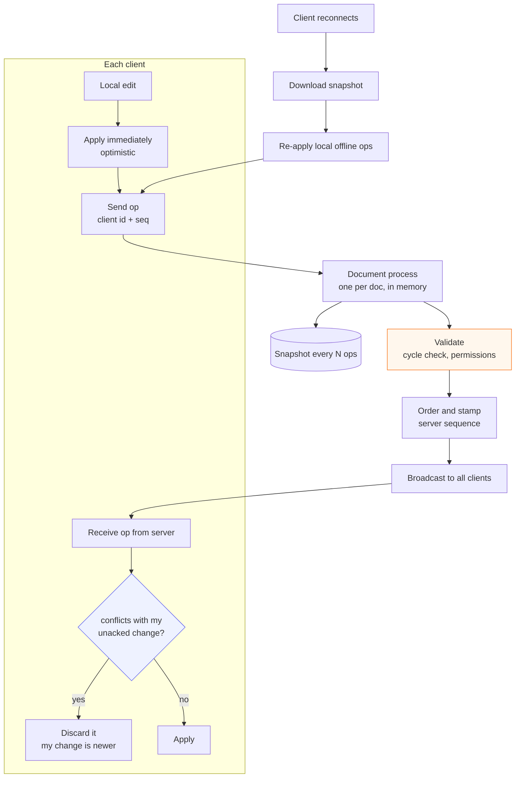

# 18 · Collaborative editing

!!! abstract "The question"
    **"Design real-time collaborative editing."** Ten people edit one document at
    the same time, offline for an hour, and when they reconnect every replica
    must converge on the same state — without a lock and without losing anyone's
    work.

!!! info "Source"
    Figma Engineering, *How Figma's multiplayer technology works* (Evan Wallace,
    2019): one process per document, CRDT-inspired last-writer-wins per
    property, fractional indexing for ordering, and a server that rejects parent
    links which would form a cycle.

---

## 1. The problem, and the naive design

The naive version locks:

```python
def edit(doc_id, user_id, change):
    with lock(doc_id):                    # one editor at a time
        doc = load(doc_id)
        apply(doc, change)
        save(doc)
```

It is correct and unusable, then unusable and incorrect:

| Problem | What happens | Consequence |
|---|---|---|
| A global lock | the second editor waits for the first to finish | collaboration becomes turn-taking |
| Lock held during a network round trip | one slow client stalls the document | head-of-line blocking |
| Last write wins on the whole document | two editors' saves overwrite each other | silent data loss |
| No offline story | a disconnected client cannot edit at all | the feature people actually need |

The fix is to make every change **commutative and idempotent** — an operation
that can be applied in any order, any number of times, and still converge. That
is the CRDT idea, and Figma's simplification of it is what makes it practical.

---

## 2. The numbers that decide the design

| Figure | Value | Consequence |
|---|---|---|
| Concurrent editors per document | up to ~200 | one process per document can hold the whole session in memory |
| Edits per editor per second | ~2 (a keystroke burst, a drag) | 200 × 2 = **400 ops/s** per document |
| Operation size | ~200 B | 400 × 200 B = **80 KB/s** per document — trivial |
| Concurrent documents | 10k | 10k processes; ~400 k ops/s across the fleet |
| Presence updates | cursor at 60 Hz is wasteful | throttle to **10 Hz**, ~60 B each: 120 KB/s per busy document |
| Document size | ~1 MB for a large file | reconnect = re-download 1 MB, not replay 10k ops |
| Fractional index precision | 2⁵² floats between 0 and 1 | ~50 inserts between two adjacent items before a rebalance is needed |
| Offline window | hours | replay must be bounded, so clients re-download and re-apply locally |

The two numbers that shape the architecture: **400 ops/s per document** is small
enough that one process per document is affordable, and **1 MB per document** is
small enough that reconnect-by-redownload beats replay.

---

## 3. The mental model

> **The server is a sequencer, not a lock. It defines the order of operations;
> clients apply their own changes optimistically and reconcile when the server's
> order disagrees.**

Figma's simplification is worth stating precisely: true CRDTs are built for
decentralised systems with no authority, and they pay for it in memory and
metadata. With a central server you can drop that overhead — the server's
arrival order *is* the tiebreak, so you need no timestamps, no vector clocks,
just "last value the server accepted wins, per property".

---

## 4. The flow chart



The cycle check on the server is the one validation that cannot be done on the
client: two clients can each make a valid reparent, and only the second one,
seen in the server's order, creates a loop.

---

## 5. Sizing the components

| Component | Unit of work | Cost per unit | Peak demand | Provisioned | Headroom |
|---|---|---|---|---|---|
| Document process | 1 op | ~0.1 ms validate + broadcast | 400 ops/s per doc | 10k processes | one per doc, by design |
| Gateway | 1 WebSocket | ~10 KB memory per socket | 200 sockets per doc | 40 gateways | 2× |
| Broadcast fan-out | 1 op → N clients | 200 B × N | 400 × 200 = 80 KB/s per doc | — | — |
| Snapshot | 1 MB document | every ~1,000 ops | 10k docs × 400 ops/s | 4/s per doc | write amplification 0.4% |
| Presence | 1 cursor | 60 B, throttled 10 Hz | 200 cursors | 120 KB/s per doc | — |

**Bytes on the wire.**

- ops in: 10k docs × 400 ops/s × 200 B = **800 MB/s** across the fleet
- fan-out: × average 8 subscribers = **6.4 GB/s** — the dominant cost, and why presence is throttled and ops are batched per frame
- snapshots: 10k docs × 1 MB / 2.5 s = **4 GB/s** if you snapshot naively; snapshot lazily, on idle
- reconnect: 1 MB per reconnect, and reconnects cluster after a deploy

| Benchmark | How to measure | Target | What it tells you |
|---|---|---|---|
| Op latency p99 | client send → ack | ≤ 100 ms | feels instant |
| Convergence | fuzz two clients with random ops | 100% identical state | the correctness property |
| Reconnect time | snapshot download + replay | ≤ 1 s for 1 MB | offline editing is usable |
| Fan-out cost | bytes sent ÷ bytes received | ≤ 10× | above that, batch or throttle |
| Cycle rejections | counter | > 0 in a fuzz run | the check is live, not dead code |

---

## 6. The algorithm, end to end

| # | Path | Who | What happens | Durable afterwards |
|---|---|---|---|---|
| 1 | edit | client | applies the change locally, assigns `(clientId, seq)` | local op log |
| 2 | edit | client | sends the op over the socket | — |
| 3 | edit | document process | validates permissions and tree invariants | nothing |
| 4 | edit | document process | **rejects a parent link that would create a cycle** | nothing |
| 5 | edit | document process | stamps a server sequence and broadcasts | in-memory doc |
| 6 | edit | other clients | apply unless they conflict with an unacked local change | local state |
| 7 | edit | document process | snapshots every N ops or on idle | snapshot |
| 8 | reconnect | client | downloads the snapshot, re-applies its offline ops | local state |
| 9 | reconnect | document process | dedupes by `(clientId, seq)` so a replay is safe | — |

```text
function onLocalEdit(doc, change):
    apply(doc, change)                       # optimistic, never wait
    pending.add(change)                      # unacked
    send({ client: me.id, seq: nextSeq(), change: change })


function onServerOp(op):
    if conflictsWithPending(op):              # my change is newer in my view
        return                                # discard, do not flicker
    apply(doc, op.change)


function onServerEdit(doc, op):
    if !authorised(op): return deny(op)
    if op.kind == REPARENT and wouldCycle(doc, op.child, op.newParent):
        return reject(op, "cycle")            # only the server can see this
    doc.order = doc.order + 1                 # server sequence IS the tiebreak
    doc.apply(op)
    broadcast(op, except = op.client)
```

**Invariants.**

- **Last writer wins per property, ordered by the server.** No timestamps, no
  vector clocks — the sequencer is the clock.
- **Object identity survives moves.** Reparenting writes a `parent` property on
  the child, so concurrent edits to the object are not dropped by an id change.
- **The server rejects cycles; clients may briefly be wrong.** A client that has
  an unacked change can hold a temporary loop and is corrected when the server
  refuses it.
- **Ordering inside a parent is fractional.** Inserting between two siblings is
  the average of their indices — no renumbering, no lock.
- **Every op is idempotent per `(clientId, seq)`**, so a reconnect replay cannot
  double-apply.

| Edge case | What the algorithm does |
|---|---|
| Two clients move the same object | server order decides; the loser's move is rejected, both converge |
| A creates A→B while B creates B→A | server accepts the first, rejects the second as a cycle |
| Offline for an hour | snapshot + re-apply local ops, then send the delta |
| 200 cursors moving | presence throttled to 10 Hz, never persisted |
| Same property set by 5 clients | last one in server order wins, deterministically |
| Client reconnects twice | `(clientId, seq)` dedupe makes the replay safe |

---

## 7. Build it

### Step 1 — fractional indexing, with its limit made explicit

```python
# code/collab/tree.py (excerpt)
class Node:
    __slots__ = ("id", "parent", "pos", "props")
    def __init__(self, id, parent=None, pos=0.5, props=None):
        self.id, self.parent, self.pos = id, parent, pos
        self.props = props or {}

class Doc:
    def __init__(self):
        self.nodes: dict[str, Node] = {"root": Node("root", None, 0.5)}

    def children(self, parent_id):
        kids = [n for n in self.nodes.values() if n.parent == parent_id]
        return sorted(kids, key=lambda n: n.pos)

    def insert_between(self, parent_id, left: Node | None, right: Node | None, node_id):
        lo = left.pos if left else 0.0
        hi = right.pos if right else 1.0
        pos = (lo + hi) / 2
        if abs(hi - lo) < 1e-12:                  # 2^52-ish inserts in one gap
            self.rebalance(parent_id)             # rare, and local to one parent
            return self.insert_between(parent_id, left, right, node_id)
        self.nodes[node_id] = Node(node_id, parent_id, pos)
        return pos

    def would_cycle(self, node_id, new_parent) -> bool:
        seen = set()
        cur = new_parent
        while cur is not None and cur not in seen:
            if cur == node_id:
                return True                       # the move would close a loop
            seen.add(cur)
            cur = self.nodes[cur].parent if cur in self.nodes else None
        return False

    def reparent(self, node_id, new_parent):
        if self.would_cycle(node_id, new_parent):
            raise CycleRejected(f"{node_id} -> {new_parent} would form a cycle")
        self.nodes[node_id].parent = new_parent
```

### Step 2 — two clients, one document, and a convergence assertion

```python
# code/collab/simulate.py
# Applies the same set of ops in two different orders to two replicas, then
# asserts they converge -- the property the whole design exists for.
python simulate.py --ops 500 --clients 3 --seed 7
# replica A == replica B  (state hash 9f2c...)
# cycle rejections: 3   (and both replicas rejected the same 3)
```

### Step 3 — what a reconnect actually costs

```python
# code/collab/reconnect.py
python reconnect.py --doc-size-mb 1 --offline-ops 400
# replay 400 ops ......... 8 ms
# download 1 MB snapshot .. 80 ms at 100 Mbps
# re-apply locally ....... 12 ms
# total ................... 100 ms  (redownload beats replay past ~2k ops)
```

That crossover — somewhere around a couple of thousand offline operations — is
why the reconnect path is "download and re-apply", not "replay the log".

---

## 8. The production layer

```yaml
# deploy/collab/gateway.yaml (abridged)
apiVersion: apps/v1
kind: StatefulSet
metadata: { name: collab-gateway, namespace: collab }
spec:
  serviceName: collab-gateway
  replicas: 6
  template:
    spec:
      containers:
        - name: gateway
          image: ghcr.io/example/collab:3.0.0
          args: ["--doc-shards=4096", "--presence-hz=10", "--snapshot-ops=1000"]
          env:
            - { name: DOC_PROCESS_URL, value: "collab-doc.collab:7000" }
          resources:
            requests: { cpu: "2", memory: 2Gi }
            limits: { memory: 4Gi }
          readinessProbe:
            httpGet: { path: /ready, port: 8080 }
---
# One process per document, addressed by document id: sticky by construction.
apiVersion: apps/v1
kind: StatefulSet
metadata: { name: collab-doc, namespace: collab }
spec:
  serviceName: collab-doc-headless
  replicas: 12
  template:
    spec:
      containers:
        - name: doc
          image: ghcr.io/example/collab-doc:3.0.0
          args: ["--idle-evict=10m", "--snapshot-dir=/data"]
          volumeMounts: [{ name: snapshots, mountPath: /data }]
  volumeClaimTemplates:
    - metadata: { name: snapshots }
      spec:
        accessModes: ["ReadWriteOnce"]
        resources: { requests: { storage: 50Gi } }
```

| Knob | Value | Why |
|---|---|---|
| Document sharding | `hash(docId) % 4096` → process | sticky by construction, no session store |
| Presence rate | 10 Hz | 60 Hz cursors are 6× the traffic for no perceptible gain |
| Snapshot interval | 1,000 ops or on idle | bounds reconnect cost without write amplification |
| Idle eviction | 10 minutes | 10k documents, but only hundreds are actively edited |
| Op dedupe | `(clientId, seq)` | makes reconnect replay idempotent |

| Alert | Threshold | Why |
|---|---|---|
| Op latency p99 | > 200 ms | the document feels laggy; usually fan-out or a slow client |
| Snapshot lag | > 5,000 ops behind | reconnect cost is growing |
| Cycle rejections | spike | a client bug is generating loops |
| Reconnect storm | > 100/s | a deploy or a network blip |

### Failure drills

1. **Concurrent reparent.** Two clients each move A under B and B under A;
   assert one is rejected and both converge.
2. **Offline replay.** Disconnect a client for 400 ops, reconnect, assert
   convergence and no duplicates.
3. **Slow client.** Throttle one socket to 10 kbit/s; assert others are
   unaffected and the slow one catches up.
4. **Process death.** Kill the document process mid-edit; clients reconnect,
   download the snapshot, re-apply, and converge.

---

## 9. The two-minute answer

> "Collaborative editing is a convergence problem, and the practical answer is
> a central sequencer rather than a full CRDT. Figma's model is the one I would
> copy: one process per document, changes applied optimistically on the client,
> and last-writer-wins per property with the *server's* arrival order as the
> tiebreak — which means no timestamps and no vector clocks, because there is
> one authority.
>
> Two structural decisions make it work. Object identity survives moves: a
> reparent writes a parent link on the child instead of deleting and recreating
> it, so concurrent edits to the object are not dropped. And ordering inside a
> parent uses fractional indexing — a position between zero and one, inserted at
> the average of its neighbours — so inserting never renumbers siblings. You get
> about fifty inserts in one gap before precision runs out, then a local
> rebalance.
>
> The server does the one check a client cannot: it rejects a parent link that
> would create a cycle. Two clients can each make a valid move that together
> form a loop; only the server, seeing them in order, can refuse the second. A
> client holding an unacked change may be briefly wrong and is corrected when
> the server refuses it.
>
> Numbers: 200 concurrent editors at 2 ops/s is 400 ops/s per document at 200
> bytes each — 80 KB/s, small enough that one process per document is
> affordable, and that process holds the whole document in memory. Presence is
> throttled to 10 Hz because cursors are the expensive part, not edits.
> Reconnect is download-and-re-apply rather than replay, because a 1 MB snapshot
> is 80 ms while replaying thousands of ops is unbounded — the crossover is a
> couple of thousand ops.
>
> The invariant I would test with a fuzzer: apply the same op set in two
> different orders to two replicas and assert identical state."

### Follow-ups you should expect

| Question | The answer they want |
|---|---|
| "CRDT or OT?" | CRDT-style for rich documents with a central server; OT needs a transform function per operation type |
| "Why is last-writer-wins acceptable?" | the unit is a property, not a document — two people editing different properties never conflict |
| "What about text editing inside a property?" | that is where per-property LWW fails; use a sequence CRDT for the text field only |
| "How do you handle offline?" | local ops, snapshot on reconnect, re-apply, send the delta |
| "Sticky routing?" | shard by document id; the process owns the document, so stickiness is inherent |
| "How is this different from chapter 07?" | 07 is delivery of already-ordered messages; this is *agreement* on order |

**Code:** `code/collab/` · **Manifests:** `deploy/collab/`
