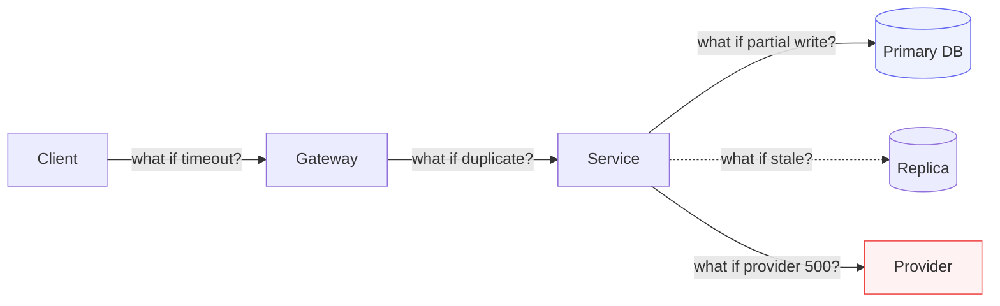

# The 8-step method

Every chapter in this manual follows the same eight steps. This page explains why,
so you can use the method on systems that are not in this repo — including the one
in your interview tomorrow.

## The steps

### 1. The problem, and the naive design

Start with the design a competent engineer ships in week one, then find the exact
line of load at which it breaks. Being able to say *"this is fine until about
5,000 writes/second, and here is why"* is the difference between reciting
architecture and understanding it.

Write the naive version down explicitly. In an interview this also buys you
goodwill: interviewers want to hear that you know the simple answer first.

### 2. The numbers that decide it

Every design has one or two numbers that pick the architecture. Find them:

| System | The deciding number |
|---|---|
| Chat storage | writes/second and bytes/message |
| Sharding Postgres | table size, IOPS, TXID age |
| Idempotency | retry window and duplicate rate |
| Rate limiting | requests/second per key, and Redis round trip |
| Realtime messaging | concurrent sockets and fan-out factor |
| Geo matching | candidate set size per lookup |
| Notifications | provider's in-flight limit and burst size |

Then do the arithmetic in the open. State assumptions, compute, sanity check
against a known production figure.

### 3. The mental model

One sentence. Not a diagram. If you can say "this system is a bounded queue in
front of a partition-prone store, and the whole design exists to keep the queue
bounded", you can re-derive everything else under pressure. The nine models live
in [mental models](mental-models.md).

### 4. The flow chart, annotated with failure

Draw the happy path, then annotate every arrow with what happens when it breaks:
timeout, duplicate, reorder, partial write, node loss. A diagram with failure
annotations is worth five without.

### 5. Sizing the components

The flow chart says which components exist; this step gives each one a number. A table of
*unit of work → cost per unit → peak demand → provisioned → headroom*, then the bytes on the
wire between each hop, then the benchmarks the component must hold itself to.

This is the step most designs skip, and it is the one that catches the mistake: a component
with 1.05× headroom, or a queue that is sized for the average instead of the burst.

### 6. Build it

From `docker compose` on your laptop to a prototype that does the interesting
thing: the partitioned table, the Lua script, the consistent hash ring, the
coalescing layer. The code in `code/` is deliberately small — 100 to 250 lines per
prototype — because the point is the mechanism, not a framework.

Run it. Break it. The failure drills in [Appendix B](../appendices/drills.md) tell
you how.

### 7. The production layer

This is where most tutorials stop and where real systems are decided:

- **Limits**: timeouts, retries with jitter, connection pool caps, concurrency
  semaphores, queue bounds.
- **Kubernetes**: Deployment vs StatefulSet, HPA vs KEDA, PodDisruptionBudget,
  topology spread, readiness vs liveness, graceful drain.
- **AWS**: the managed service you would actually use (RDS, ElastiCache, MSK, SQS,
  ScyllaDB on EKS, DynamoDB) and the specific knob that matters.
- **Observability**: the three or four metrics that tell you this subsystem is
  sick, and the alert thresholds.
- **Failure drill**: one command that breaks it on purpose, and what you should
  see.

### 8. The two-minute answer

The spoken version, with numbers, trade-offs, and the failure mode you would watch.
Then the follow-up questions you should expect, because interviews are decided in
the follow-ups.

---

## The interview answer, timed

A senior loop gives you 35–45 minutes. Spend it like this.

| Time | What you do | Why |
|---|---|---|
| 0–3 min | Restate the problem, ask 3–5 clarifying questions | Scope is the interview |
| 3–6 min | Write the constraints table: QPS, payload, retention, SLO, consistency, budget | These pick the design |
| 6–9 min | Back-of-envelope arithmetic, out loud | Proves you can size it |
| 9–12 min | Draw the happy path, name each component's job | Shared vocabulary |
| 12–25 min | Deep dive on the one hard part (hot partition, exactly-once, fan-out) | This is what you are hired for |
| 25–32 min | Failure modes: node loss, duplicates, backpressure, retries | Senior signal |
| 32–38 min | Trade-offs you rejected and why; cost; what you would monitor | Staff signal |
| 38–45 min | Their follow-ups | |

### The constraints table

Write this on the board in the first five minutes. It is the highest-leverage
artefact you will produce.

| Constraint | Value | Consequence |
|---|---|---|
| Peak QPS | 115,000 writes/s | must partition, cannot single-node |
| Payload | 200 B | 1.7 TB/day on disk with RF=3 |
| Retention | forever (scrolling back) | cold storage tier, not just a cache |
| Latency SLO | 200 ms p99 send-to-deliver | fan-out must be async |
| Consistency | read-your-writes per channel | route reads by channel, not by user |
| Availability | 99.95% | no single point, no synchronous cross-region |
| Budget | ₹X/month | rules out the 177-node option |

### Three sentences that make you sound senior

1. "Before I design, let me bound the two numbers that change the answer: peak
   write rate and the p99 budget."
2. "This component is the one that will break first, so let me put a bound on its
   queue and decide the drop policy now."
3. "I'd rather fail open here and alert, than have the limiter become the outage."

---

## Vocabulary used across the repo

The same pattern has many names depending on the layer. This table maps them, so
you can move between a Kubernetes manifest, an AWS console and a design doc
without translating in your head.

| Concept | In code | In Kubernetes | In AWS |
|---|---|---|---|
| Stateless service | HTTP handler | Deployment + Service + HPA | ECS/EKS + ALB |
| Stateful hash-ring member | consistent hash node | StatefulSet + PDB | EC2 ASG / EKS |
| Bounded work queue | channel with capacity | KEDA `ScaledObject` on queue depth | SQS + autoscaling |
| Durable log | append-only topic | Strimzi/Kafka CRD | MSK |
| Idempotency store | table with state + lease | StatefulSet or managed | RDS Postgres / DynamoDB |
| Rate-limit state | Redis Lua keys | ElastiCache via IRSA | ElastiCache Redis |
| Read-through cache | `singleflight` | — | ElastiCache / DAX |
| Cross-shard router | shard map lookup | sidecar or library | RDS Proxy / app-side |
| Durable intent record | outbox table | CronJob sweeper | EventBridge + SQS |
| Provider limiter | semaphore + token bucket | HPA on in-flight | — |

---

## How to read a chapter

Each chapter is written so that the first three sections (problem, numbers, mental
model) can be read in five minutes, the flow chart in two, and the build and
production sections are for when you are at a keyboard. The two-minute answer is
for the night before the interview.

If you only have twenty minutes per system: read steps 1, 2, 3 and 8. That is 80%
of the interview value for 20% of the reading.
