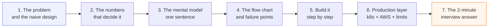

# System Design in Production

Nine systems, nine published post-mortems, and the code, configs and capacity math
that turn them into something you can actually build and run.

This is not a list of boxes and arrows. Every chapter starts at *why the naive
version breaks*, puts real production numbers on the table, and then walks you to
a working prototype and a Kubernetes/AWS deployment you could defend in a design
review.

!!! quote "The premise"
    Diagrams teach you the boxes. Write-ups teach you why the boxes broke.
    An engineer at Discord, Stripe, Airbnb, Notion, Figma, Slack or Uber already
    built the thing, broke it, and wrote down what happened. This manual takes
    those write-ups and adds the missing half: the implementation and the
    operations.

## Who this is for

- Engineers preparing for senior/staff system design loops who can already draw
  a load balancer and a cache, and want the second half of the answer.
- Backend engineers who have to actually ship one of these systems on Kubernetes
  and want the manifests, not the metaphor.
- Anyone who learns by running things: every chapter has runnable code under
  `code/` and deployable manifests under `deploy/`.

You should be comfortable with SQL, HTTP, one server-side language, and
`kubectl apply`. Nothing here assumes you have run a 200-node cluster.

## The nine chapters

| # | The question | The system | What you will actually build |
|---|---|---|---|
| [01](chapters/01-chat-message-storage.md) | "Design a chat app" | Discord, trillions of messages | A partitioned message table, a coalescing data service, a dual-write migration |
| [02](chapters/02-sharding-postgres.md) | "Your Postgres is full. Now what?" | Notion, 480 logical shards | A shard router, a schema-per-shard layout, an online backfill |
| [03](chapters/03-scaling-postgres-figma.md) | "Scale a database without rewriting the app" | Figma, vertical then horizontal | A DBProxy that routes by shard key, logical-then-physical sharding |
| [04](chapters/04-idempotent-payment-api.md) | "Design a payment API" | Stripe idempotency keys | A key store, a fingerprint check, replay, 409s, a reaper |
| [05](chapters/05-double-payment-prevention.md) | "Stop a user getting charged twice" | Airbnb Orpheus | Pre-RPC/RPC/Post-RPC phases, leases, transactional outbox |
| [06](chapters/06-rate-limiting.md) | "Design a rate limiter" | Stripe's four limiters | Token bucket in Redis Lua, concurrency limiter, load shedder |
| [07](chapters/07-realtime-messaging.md) | "Design Slack" | Slack channel + gateway servers | WebSocket gateway, consistent-hash channel ring, fan-out |
| [08](chapters/08-geospatial-matching.md) | "Design driver matching for Uber" | Uber H3 | Hexagonal indexing, k-ring matching, PostGIS queries, a matching loop |
| [09](chapters/09-notification-fanout.md) | "Design a notification system" | Discord push bursts | Bounded fan-out with backpressure, provider limiters, retries, dedupe |

## How every chapter is built

Each chapter is the same seven steps, so you can navigate them from muscle memory
and so you can reuse the shape in an interview.



1. **The problem, and the naive design.** What a first-principles engineer builds
   on day one, and the exact line of load where it dies.
2. **The numbers.** Real figures from the source write-up, plus the
   back-of-envelope arithmetic that predicts the wall before you hit it.
3. **The mental model.** One sentence you can carry into an interview. If you
   cannot say it in a sentence, you do not understand it yet.
4. **The flow chart.** The architecture as a diagram, annotated with the failure
   point of every arrow.
5. **Build it.** Step-by-step implementation, from `docker compose` on your laptop
   to a working prototype. Code is in `code/`, and it runs.
6. **The production layer.** Kubernetes manifests, AWS managed services, limits,
   timeouts, dashboards and a failure drill. This is the part that separates a
   design from a system.
7. **The interview answer.** A spoken script with the numbers in it, plus the
   follow-up questions you should expect.

## How to use this

=== "In a week"

    | Day | Read | Build |
    |---|---|---|
    | 1 | [Mental models](foundations/mental-models.md), [Numbers](foundations/numbers.md) | Nothing. Do the arithmetic by hand. |
    | 2 | 04, 05 | `code/idempotency`, then kill it mid-request |
    | 3 | 06 | `code/ratelimit`, then run the load test until it sheds |
    | 4 | 01, 09 | `code/chat-storage`, `code/notify` |
    | 5 | 02, 03 | `code/sharding`, `code/dbproxy` |
    | 6 | 07, 08 | `code/realtime`, `code/geo` |
    | 7 | [Drills](appendices/drills.md) | Answer all nine out loud, 2 minutes each |

=== "Before an interview"

    Read the mental models page, then the "Two-minute answer" and "Follow-ups"
    sections of each chapter. That is roughly 40 minutes and it covers the nine
    most common senior prompts. Do not memorise diagrams; memorise the numbers
    and the failure modes, because those are what the interviewer is testing.

=== "As a reference at work"

    Each chapter's production layer is a pattern library, not a tutorial. Jump to
    [Appendix A](appendices/k8s-aws-patterns.md) for the cross-chapter catalogue:
    HPA vs KEDA, PodDisruptionBudgets, PgBouncer, CloudNativePG, ElastiCache,
    ScyllaDB on EKS, MSK vs SQS, and the timeout budgets that tie them together.

## What "production" means in this repo

Every deployment section sticks to primitives you will actually find in a real
cluster, and prefers managed AWS services where a team of ten would sensibly use
them:

| Concern | Default choice here | Why |
|---|---|---|
| Stateless services | EKS + Deployment + HPA on RPS or CPU | Cheap, boring, well understood |
| Queue-driven workers | KEDA scaling on queue depth | HPA on CPU cannot see a backlog |
| Postgres | RDS/CloudNativePG, PgBouncer in front | Connection count, not CPU, is the usual wall |
| Cache / rate-limit state | ElastiCache Redis (cluster mode) | Atomic Lua, sub-ms |
| Message log | MSK (Kafka) or SQS+SNS | Replay vs simplicity, chapter 09 picks apart when |
| Wide-column messages | ScyllaDB on local NVMe + RAID | Chapter 01's whole point |
| Secrets | External Secrets + IRSA | No long-lived keys in the cluster |

!!! warning "About the numbers"
    Every figure is either quoted from the linked engineering post or is my own
    arithmetic shown step by step so you can check it. Cloud prices and instance
    limits change; the arithmetic does not. Where a number is approximate it says
    so.

## Repo layout

```
docs/            this manual
code/            runnable prototypes, one folder per chapter
deploy/          Kubernetes manifests, Helm values, Terraform, compose files
```

Start with [The 9 mental models](foundations/mental-models.md).
